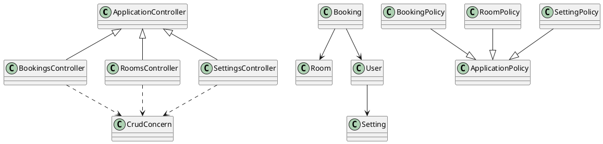
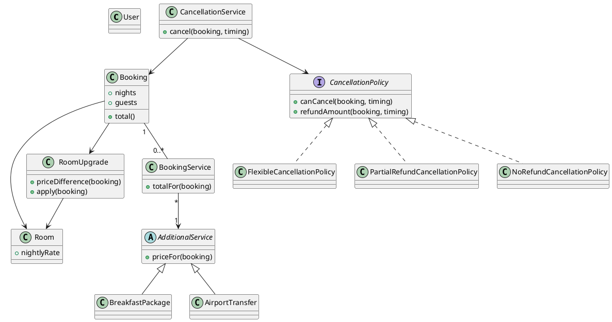
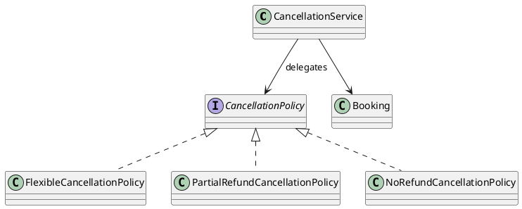
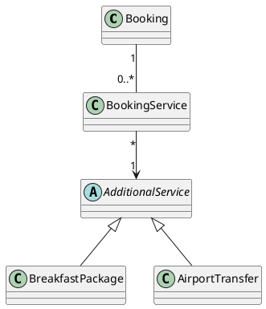
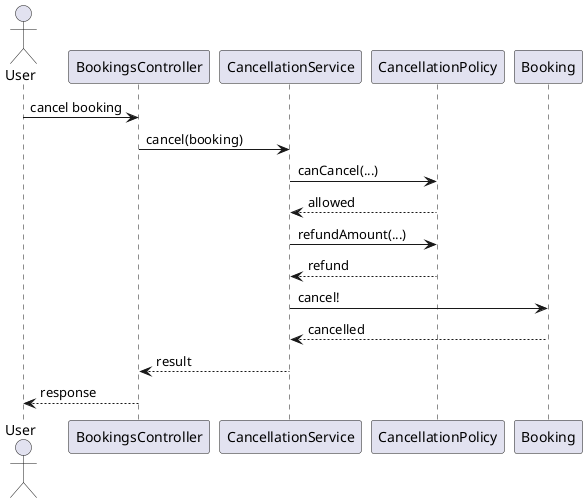

# Saved LLM Prompts, Inputs and Outputs

**Username: Abhijith Krishna**

**Work attribution:** This project work was done by user Abhijith Krishna. This attribution was supplied by the user; the export preserves the recorded prompts, outputs and interaction-date limitations.

**Stated submission date: 6 September.**

## Public conversation reference

The public ChatGPT conversation supplied for this work is available here:

[Open the public ChatGPT conversation](https://chatgpt.com/s/cx_6acb7e5d721481919fe549f65ba426e6)

The link is provided as a reference. If it is unavailable or does not expose the complete conversation, use the prompt/result files in this archive and the project artifacts as the available record.
## 1. Baseline

Recorded model/date: unknown historical model/date

### Saved input prompt

Source: `llm-analysis/prompts/prompt-01-baseline.md`  
SHA-256: `ceb6a5026184a546ebfcbcf5577a1f537cf4466b6867f0cafeb460f5d7afbf72`

```text
# HOTEL BOOKING APPLICATION — DESIGN PATTERN ANALYSIS AND EVOLUTION

## MASTER RESEARCH SETUP AND REPOSITORY DISCOVERY PROMPT

You are acting as a:

**Senior Software Architect + Design Patterns Expert + Software Reverse-Engineering Specialist + Refactoring Expert + Empirical Software Engineering Researcher + Ruby on Rails Specialist.**

You have extensive experience with:

* Ruby on Rails
* Object-oriented software design
* GoF design patterns
* Architectural patterns
* Rails conventions and idioms
* Software architecture reverse engineering
* Code smells and anti-patterns
* Refactoring
* UML
* Software evolution
* Maintainability and extensibility analysis
* Software metrics
* Cross-language design-pattern implementation
* Academic software engineering case studies

Your role is NOT simply to generate code.

You are helping conduct a **Human-in-the-Loop software engineering case study** in which an existing, viable Ruby on Rails Hotel Booking Application is investigated, analyzed, evolved, refactored, and compared across programming languages.

The analysis must be evidence-driven and based primarily on the actual source code.

---

# 1. CASE STUDY TITLE

The working title is:

**Design Pattern Analysis and Evolution in a Ruby on Rails Hotel Booking Application**

---

# 2. PROFESSOR'S REQUIRED CASE STUDY

The project consists of three major parts.

## PART 1 — INVESTIGATION

Investigate the following hotel booking domain concepts:

* Hotel
* Room
* Customer
* Reservation
* Payment
* Cancellation
* Additional Services

Identify the design patterns present in the existing application.

The analysis must determine:

* What architectural patterns exist
* What design patterns exist
* Where they occur
* Which classes participate
* Why they are being used
* What problem they solve
* Whether the implementation genuinely qualifies as the identified pattern
* What evidence exists in the source code
* What advantages and disadvantages result
* How maintainable and extensible the implementation is

Do NOT force patterns onto the code.

A pattern must be supported by evidence.

---

# 3. PART 2 — APPLICATION EVOLUTION

The existing application must evolve to support the following new requirements:

1. Breakfast package
2. Airport transfer
3. Room upgrade
4. Cancellation policy

For each new requirement, analyze:

* How the existing architecture handles the requirement
* Which existing classes must change
* Which new classes/modules may be necessary
* Whether existing responsibilities become overloaded
* Whether coupling increases
* Whether conditionals increase
* Whether cohesion decreases
* Whether existing patterns remain appropriate
* Whether new patterns become useful
* Whether refactoring is justified
* What the minimum reasonable design change would be

Do not introduce design patterns simply because the assignment asks for patterns.

Patterns must emerge from actual design problems.

---

# 4. PART 3 — FOUR-LANGUAGE IMPLEMENTATION

Select significant and academically meaningful patterns from the case study and implement their conceptual solutions in four programming languages.

The four languages will be determined later by the project requirements.

The implementations must demonstrate the same underlying design problem and solution while respecting the idioms of each language.

The comparison should include:

* Structure
* Interfaces/abstractions
* Polymorphism
* Coupling
* Boilerplate
* Extensibility
* Readability
* Language-specific implementation differences

Do not simply translate Ruby syntax line by line.

---

# 5. EXPECTED FINAL OUTPUTS

The completed case study must contain:

1. Application architecture
2. Pattern inventory
3. UML diagrams
4. Pattern evidence
5. Evolution scenarios
6. Refactoring analysis
7. Four-language implementations
8. Software metrics
9. LLM prompts and results
10. Excel/CSV data

The final work must be suitable for an academic software engineering/design-pattern case study.

---

# 6. CRITICAL METHODOLOGICAL PRINCIPLE

This is a **reverse-engineering and evolution study**, not a greenfield system-design exercise.

Therefore:

DO NOT start by deciding that the application contains:

* Factory
* Strategy
* Observer
* Adapter
* Decorator
* Singleton
* etc.

Instead:

SOURCE CODE
↓
OBSERVED STRUCTURE
↓
OBSERVED BEHAVIOR
↓
RESPONSIBILITIES
↓
DEPENDENCIES
↓
DESIGN PROBLEM
↓
PATTERN EVIDENCE
↓
PATTERN IDENTIFICATION

The evidence must come before the pattern conclusion.

---

# 7. PATTERN CLASSIFICATION

When identifying a pattern, classify it into one of these categories:

### A. Architectural Pattern

Examples:

* MVC
* Layered Architecture
* Service-oriented structures

### B. GoF Creational Pattern

Examples:

* Factory Method
* Abstract Factory
* Builder
* Prototype
* Singleton

### C. GoF Structural Pattern

Examples:

* Adapter
* Decorator
* Facade
* Composite
* Proxy
* Bridge

### D. GoF Behavioral Pattern

Examples:

* Strategy
* Observer
* Command
* State
* Template Method
* Chain of Responsibility
* Iterator
* Mediator
* Memento
* Visitor
* Interpreter

### E. Rails/Framework Pattern

Examples:

* Active Record
* Convention over Configuration
* Service Objects
* Concerns
* Callbacks
* RESTful controller conventions

### F. Pattern-like Structure

If the code resembles a known pattern but does not satisfy enough characteristics to confidently classify it as that pattern, explicitly label it:

**Pattern-like / Partial Implementation**

Do not exaggerate pattern usage.

---

# 8. CONFIDENCE SYSTEM

Every identified pattern must receive a confidence level:

* HIGH
* MEDIUM
* LOW

Use:

### HIGH

The code clearly demonstrates the structure, participants, relationships, and intent of the pattern.

### MEDIUM

The code exhibits substantial characteristics of the pattern, but some elements are implicit or incomplete.

### LOW

There is only a superficial resemblance.

Low-confidence patterns should NOT be presented as definitive findings.

---

# 9. HUMAN-IN-THE-LOOP REQUIREMENT

The human researcher has final authority over repository selection and research direction.

You must NOT automatically choose the final repository.

You must first search for candidate repositories and provide a shortlist.

The human will then inspect the candidates and select one.

After the human selects a repository, subsequent analysis must use THAT repository as the primary evidence source.

Never silently substitute another repository.

---

# 10. CRITICAL REPOSITORY DISCOVERY TASK

Before performing the case study, you must search the web for viable Ruby on Rails Hotel Booking Applications.

Explicitly perform web searches for:

* GitHub Ruby on Rails hotel booking application
* GitHub Rails hotel reservation system
* GitHub Rails hotel booking system
* GitHub Ruby hotel reservation open source
* GitHub Rails hotel management reservation
* GitHub Rails hotel booking room reservation
* GitHub Ruby on Rails hotel management system

Search GitHub repositories and other legitimate open-source sources.

Prioritize repositories that are:

* Publicly accessible
* Open source
* Actually implemented in Ruby on Rails
* Functional or reasonably complete
* Large enough to provide meaningful architectural evidence
* Structured into multiple Rails components
* Contain meaningful domain models
* Include reservations/bookings
* Include rooms
* Include customers/users
* Include payments or payment-related logic where possible
* Include cancellation-related functionality where possible
* Include additional services or functionality that can reasonably evolve into them
* Have sufficient source code for design-pattern analysis
* Have a meaningful commit history where possible
* Have documentation/README where possible
* Can be cloned and executed or inspected
* Are not merely tutorials containing trivial CRUD operations

Do NOT select a repository simply because its name contains "hotel booking."

---

# 11. REPOSITORY QUALITY SCREENING

For each candidate repository, investigate as much as possible:

* Repository URL
* Repository name
* Author/organization
* License
* Ruby version
* Rails version
* Database
* Approximate project size
* Number of models
* Number of controllers
* Presence of services
* Presence of concerns
* Presence of policies
* Presence of background jobs
* Presence of payment integration
* Reservation functionality
* Room functionality
* Customer/user functionality
* Cancellation functionality
* Additional services
* Tests
* Documentation
* Last meaningful update
* Commit history
* Whether it appears executable
* Whether dependencies are available
* Whether it is clearly a student/tutorial project
* Whether it contains enough complexity for this case study

Where information cannot be verified, mark it as:

**Unknown / Requires Human Verification**

Never invent repository details.

---

# 12. REPOSITORY SCORING

Create a candidate comparison table.

Use a scoring system such as 0–5 for:

| Criterion                          | Score |
| ---------------------------------- | ----- |
| Rails authenticity                 | 0–5   |
| Hotel domain completeness          | 0–5   |
| Reservation complexity             | 0–5   |
| Room management                    | 0–5   |
| Customer/user management           | 0–5   |
| Payment functionality              | 0–5   |
| Cancellation functionality         | 0–5   |
| Additional services                | 0–5   |
| Architectural richness             | 0–5   |
| Pattern-analysis potential         | 0–5   |
| Evolution/refactoring potential    | 0–5   |
| Codebase size                      | 0–5   |
| Documentation                      | 0–5   |
| Tests                              | 0–5   |
| Maintainability-analysis potential | 0–5   |

Calculate a total score.

However, do NOT automatically declare the highest-scoring repository the final selection.

The human researcher must make the final choice.

---

# 13. IMPORTANT: AVOIDING A BAD CASE-STUDY REPOSITORY

Reject or strongly flag repositories that are:

* Merely a basic CRUD tutorial
* Almost entirely generated scaffolding
* Too small to demonstrate meaningful design
* Not actually Ruby on Rails
* Missing reservation functionality
* Missing meaningful domain logic
* Abandoned to the point that it cannot reasonably be inspected
* Missing a usable license
* Primarily frontend code
* A fake/demo repository with little implementation
* A repository where the hotel domain is only superficial

A smaller project can still be selected if its design provides unusually strong pattern/evolution evidence, but explain the tradeoff.

---

# 14. OUTPUT OF THIS FIRST STAGE

Your first response must ONLY establish the research plan and perform repository discovery.

Do NOT perform a full pattern analysis yet.

Return:

## A. Research methodology

Explain how the case study will be conducted.

## B. Candidate repository shortlist

Provide approximately 5–10 strong candidates if available.

For each:

* Repository
* URL
* Rails evidence
* Domain coverage
* Architecture
* Complexity
* Pattern potential
* Evolution potential
* Major risks
* Score

## C. Recommended candidates

Identify:

* Best overall candidate
* Best technically complex candidate
* Best pattern-analysis candidate
* Best evolution/refactoring candidate

But explicitly state that the human researcher makes the final selection.

## D. Human verification checklist

Give me a checklist I can manually verify before selecting the repository.

The checklist must include:

* Can I clone it?
* Can I install dependencies?
* Can I run it?
* Can I inspect the models?
* Can I inspect controllers?
* Can I inspect services?
* Does the database schema make sense?
* Is there enough domain logic?
* Is the license suitable?
* Is the repository stable enough for academic use?
* Can screenshots be captured?
* Can the code be cited/documented?
* Can the application demonstrate evolution scenarios?

## E. Next-step instruction

After presenting the candidates, STOP.

Wait for the human researcher to provide:

**"I have selected repository: [repository]"**

Only then should you proceed to source-code analysis.

---

# 15. SOURCE AUTHENTICITY RULE

Throughout the entire project:

Never claim that code exists unless it has actually been observed.

If you cannot access a file, say:

**"This requires human verification from the repository."**

Do not fabricate:

* Classes
* Methods
* File paths
* Database fields
* Relationships
* Design patterns
* Metrics
* Screenshots
* Test results
* Execution results

---

# 16. ACADEMIC INTEGRITY

The LLM is an analytical assistant.

The human researcher is responsible for:

* Repository selection
* Verification
* Running the application
* Capturing screenshots
* Confirming code behavior
* Validating metrics
* Confirming generated UML
* Reviewing pattern classifications
* Final academic conclusions

Clearly distinguish:

**Observed Evidence**

from

**LLM Interpretation**

from

**Human Verification**

This distinction must be maintained throughout the project.
```

### Input context

Recorded input references: code/

The retained record references this project source/context; an exact historical transmitted input payload is not available as a separate transcript.

### Saved output

Source: `llm-analysis/results/result-01-baseline.md`  
SHA-256: `a524630ebdd841217014d62a6d5feef6a0c4c26734e6d3b9bb0ca9d08660a2da`

````text
# Baseline Reproducibility Record — `rails-room-booking`

**Repository inspected:** `andrewdsilva/rails-room-booking`
**Inspection basis:** GitHub repository contents, Git history, dependency lockfile, configuration, application source, tests, schema/migrations, and supplied faculty instructions.
**Pattern analysis:** intentionally **not performed** in this baseline task.

A key point for the case study: the repository's current default branch is `main`, but the reproducible baseline below is pinned to the exact HEAD commit rather than the moving branch.

## A. Baseline identification table

| Item                    | Baseline finding                                                                                      | Evidence                                           |
| ----------------------- | ----------------------------------------------------------------------------------------------------- | -------------------------------------------------- |
| Repository owner        | `andrewdsilva`                                                                                        | GitHub repository metadata                         |
| Repository name         | `rails-room-booking`                                                                                  | GitHub repository metadata                         |
| Full repository         | `andrewdsilva/rails-room-booking`                                                                     | GitHub repository metadata                         |
| Visibility              | Public                                                                                                | GitHub repository metadata                         |
| Default branch          | `main`                                                                                                | Repository metadata                                |
| Current HEAD on `main`  | `5e15551ee646871b4bed32c982fa17da319d3ee3`                                                            | Latest repository commit                           |
| HEAD commit date        | 2023-07-16 04:45:38 UTC                                                                               | Git commit metadata                                |
| HEAD commit message     | `Merge pull request #7 from bretheskevin/docker-sql` / `Add PostgreSql database with docker-compose.` | Git commit metadata                                |
| Relevant latest change  | PostgreSQL + Docker/Docker Compose support                                                            | HEAD diff                                          |
| Repository releases     | None returned                                                                                         | GitHub `/releases`                                 |
| Repository tags         | No tag result was established from the inspection available                                           | Not sufficient to claim tags exist or do not exist |
| License metadata        | GitHub API reports `license: null`; README contains an MIT license badge/link                         | Repository metadata + README                       |
| Source-version identity | immutable commit, not `main`                                                                          | Required by case-study instructions                |

The selected HEAD is particularly important because commit `5e15551...` is the commit that introduced the PostgreSQL/Docker setup and is the current `main` HEAD. Its diff explicitly changes the application from SQLite to PostgreSQL, adds database environment variables, and updates Docker configuration. Therefore that commit, rather than an earlier SQLite commit, is the appropriate current repository baseline.

**Proposed immutable baseline:**

```text
source_version = original
baseline_commit = 5e15551ee646871b4bed32c982fa17da319d3ee3
baseline_ref = main@5e15551ee646871b4bed32c982fa17da319d3ee3
```

The faculty instructions explicitly require the exact baseline commit and prohibit relying on a moving branch alone.

## B. Environment table

| Item                             | Observed value                                                                                                       | Source                                     |
| -------------------------------- | -------------------------------------------------------------------------------------------------------------------- | ------------------------------------------ |
| Language                         | Ruby                                                                                                                 | Repository metadata                        |
| Ruby declared version            | `2.7.5`                                                                                                              | `Gemfile`                                  |
| Ruby locked version              | `ruby 2.7.5p203`                                                                                                     | `Gemfile.lock`                             |
| Rails declared constraint        | `~> 7.0.4`                                                                                                           | `Gemfile`                                  |
| Rails locked version             | `7.0.6`                                                                                                              | `Gemfile.lock`                             |
| Bundler                          | `2.4.17`                                                                                                             | `Gemfile.lock`                             |
| Database adapter                 | PostgreSQL                                                                                                           | `Gemfile`, `config/database.yml`           |
| PostgreSQL adapter gem           | `pg 1.5.3`                                                                                                           | `Gemfile.lock`                             |
| Production/development/test DBs  | `rails_room_booking_development`, `rails_room_booking_test`, `rails_room_booking_production`                         | `config/database.yml`                      |
| Web server                       | Puma                                                                                                                 | `Gemfile`, lockfile                        |
| Puma locked version              | `5.6.6`                                                                                                              | `Gemfile.lock`                             |
| Test framework                   | RSpec / RSpec Rails                                                                                                  | `Gemfile`, `spec/rails_helper.rb`          |
| RSpec Rails                      | `6.0.3`                                                                                                              | `Gemfile.lock`                             |
| System test stack                | Capybara + Selenium WebDriver + Webdrivers                                                                           | `Gemfile`, lockfile                        |
| Authorization                    | Pundit `2.3.0`                                                                                                       | `Gemfile.lock`                             |
| Authentication                   | Devise `4.9.2`                                                                                                       | `Gemfile.lock`                             |
| Payments                         | Payify `0.1.18`, Stripe `8.5.0`                                                                                      | `Gemfile.lock`                             |
| External automation/webhook      | Integromat `0.1.0`                                                                                                   | `Gemfile.lock`                             |
| Money handling                   | Money `6.16.0`                                                                                                       | `Gemfile.lock`                             |
| Pagination                       | Kaminari `1.2.2`                                                                                                     | `Gemfile.lock`                             |
| Image processing                 | `image_processing 1.12.2`, MiniMagick, ruby-vips                                                                     | `Gemfile.lock`                             |
| Front-end/framework dependencies | Bootstrap, Turbo Rails, Stimulus Rails, JS/CSS bundling, Importmap                                                   | `Gemfile` / lockfile                       |
| I18n                             | `i18n-js`, `rails-i18n`                                                                                              | `Gemfile` / lockfile                       |
| Asset pipeline                   | Sprockets Rails                                                                                                      | `Gemfile`                                  |
| Docker base image                | `ruby:2.7.5`                                                                                                         | `Dockerfile`                               |
| Docker services                  | `app`, `db`                                                                                                          | `docker-compose.yml`                       |
| Database container               | `postgres` image                                                                                                     | `docker-compose.yml`                       |
| Application port                 | `3000`                                                                                                               | `Dockerfile`, `docker-compose.yml`, README |
| Bundled environment management   | `dotenv-rails`                                                                                                       | `Gemfile`                                  |
| Static-analysis/lint             | RuboCop is declared in README as a project dependency/tool, but the Gemfile inspected does not contain a RuboCop gem | README + Gemfile                           |
| CI environment                   | No CI execution result was established in this baseline inspection                                                   | Not established                            |

The README declares Ruby 2.7.5 and Rails 7.0.4, while the lockfile fixes Rails at 7.0.6 and Ruby at 2.7.5p203. For reproducibility, the **lockfile values should be treated as the dependency-resolution baseline**, not the looser README description.

The README's documented installation flow is:

```text
bundle install
rails db:create
rails db:migrate
rails db:seed
rails s
```

and its Docker flow uses `docker-compose build`, `docker-compose up`, followed by the database setup commands.

## C. Repository/module inventory

### Top-level/application structure

The application has the normal Rails structure plus explicit domain/security/integration areas:

| Directory                  | Status                               | Baseline role                                                                               |
| -------------------------- | ------------------------------------ | ------------------------------------------------------------------------------------------- |
| `app/models`               | inspected                            | Domain/persistence models                                                                   |
| `app/models/concerns`      | inspected                            | Reusable application model modules                                                          |
| `app/controllers`          | inspected                            | HTTP/controller layer                                                                       |
| `app/controllers/concerns` | inspected                            | Shared controller behavior                                                                  |
| `app/policies`             | inspected                            | Authorization rules                                                                         |
| `app/views`                | partially inspected                  | Booking/room/settings/UI views                                                              |
| `app/jobs`                 | inspected                            | Rails job layer; only `application_job.rb` present                                          |
| `app/mailers`              | inspected                            | Rails mailer layer; only `application_mailer.rb` present                                    |
| `app/javascript`           | partially inspected                  | Stimulus/browser-side behavior                                                              |
| `app/assets`               | partially inspected                  | Asset pipeline/resources                                                                    |
| `config`                   | inspected for relevant configuration | Routes, DB, environment, initializers                                                       |
| `db/schema.rb`             | inspected                            | Current schema representation                                                               |
| `db/migrate`               | inspected                            | Database evolution history                                                                  |
| `spec`                     | inspected                            | RSpec test suite                                                                            |
| `lib`                      | inspected                            | Rails tasks/assets; no application services directory                                       |
| `vendor`                   | not comprehensively inspected        | Dependency/vendor assets; outside primary application design scope unless directly relevant |

### Models actually present

The repository contains these application model files:

```text
app/models/application_record.rb
app/models/booking.rb
app/models/room.rb
app/models/setting.rb
app/models/user.rb
```

There is also:

```text
app/models/concerns/has_owner_concern.rb
app/models/concerns/has_price_concern.rb
app/models/concerns/has_settings_concern.rb
```

No separate application model for **Hotel**, **Property**, **Customer**, **Payment**, **Cancellation**, or **AdditionalService** was found during this baseline inventory. The actual domain vocabulary includes `Room`, `Booking`, `User`, `Setting`, and Payify's payment model/table.

### Controllers actually present

```text
app/controllers/application_controller.rb
app/controllers/home_controller.rb
app/controllers/bookings_controller.rb
app/controllers/rooms_controller.rb
app/controllers/settings_controller.rb
app/controllers/payify/...
```

Shared controller concerns:

```text
app/controllers/concerns/auth_concern.rb
app/controllers/concerns/crud_concern.rb
app/controllers/concerns/locale_concern.rb
app/controllers/concerns/page_concern.rb
```

`BookingsController` delegates much of its CRUD behavior through `CrudConcern`, while adding booking-specific cancellation and payment initialization behavior. This is an observed implementation fact for later source analysis, **not a pattern classification**.

### Services/modules

No `app/services` directory was found.

Application modules that are relevant to later source analysis include:

```text
HasOwnerConcern
HasPriceConcern
HasSettingsConcern
AuthConcern
CrudConcern
LocaleConcern
PageConcern
```

This is important because later pattern analysis must treat these as actual modules/functions rather than inventing service classes.

### Jobs

Only:

```text
app/jobs/application_job.rb
```

was found. No domain-specific background job was identified during the inventory.

### Mailers

Only:

```text
app/mailers/application_mailer.rb
```

was found. No booking-specific mailer was identified.

### External integrations/configuration

Two application-level integrations are explicitly represented:

**Payify/Stripe**

- `Gemfile`: `payify`
- `Gemfile.lock`: Payify `0.1.18`, Stripe `8.5.0`
- `config/initializers/payify.rb`
- `config/routes.rb`: Payify engine mounted at `/payify`
- Payify migration files under `db/migrate`

**Integromat/Make**

- `Gemfile`: `integromat`
- `Gemfile.lock`: `integromat 0.1.0`
- `config/initializers/integromat.rb`
- `Booking` contains booking-notification/webhook logic

The README explicitly documents both online Stripe payment and a booking webhook integration with Integromat/Make.

### Policies

Actual policy files:

```text
app/policies/application_policy.rb
app/policies/booking_policy.rb
app/policies/room_policy.rb
app/policies/setting_policy.rb
```

No `user_policy.rb` was found.

### Views/components relevant to booking

Booking views:

```text
app/views/bookings/_booking.html.erb
app/views/bookings/_form.html.erb
app/views/bookings/index.html.erb
app/views/bookings/new.turbo_stream.erb
app/views/bookings/show.html.erb
```

Room views include:

```text
app/views/rooms/index.html.erb
app/views/rooms/new.html.erb
app/views/rooms/show.html.erb
```

Settings views include:

```text
app/views/settings/_form.html.erb
app/views/settings/new.html.erb
```

Authentication views are under:

```text
app/views/devise/
```

Payment-specific views exist under:

```text
app/views/payify/
```

The repository also has front-end Stimulus controllers for application behavior, including:

```text
app/javascript/controllers/application.js
app/javascript/controllers/datepicker_controller.js
app/javascript/controllers/image_uploader_controller.js
app/javascript/controllers/index.js
app/javascript/controllers/modal_controller.js
```

## D. Initial domain model inventory

This is a **domain inventory only**, not a pattern analysis.

| Domain concept        | Actual implementation                                              | Evidence in schema/source                  | Status                            |
| --------------------- | ------------------------------------------------------------------ | ------------------------------------------ | --------------------------------- |
| User/customer/account | `User`                                                             | `app/models/user.rb`, `users` table        | Confirmed entity                  |
| Room/accommodation    | `Room`                                                             | `app/models/room.rb`, `rooms` table        | Confirmed entity                  |
| Booking/reservation   | `Booking`                                                          | `app/models/booking.rb`, `bookings` table  | Confirmed entity                  |
| Property/hotel        | No separate `Hotel`/`Property` model found                         | Room appears to represent accommodation    | No separate entity                |
| Payment               | Payify integration/model                                           | `payify_payments` table and Payify concern | Dependency-integrated entity      |
| Cancellation          | No separate cancellation class/table                               | `Booking#cancel!`, `canceled_at`           | Booking state                     |
| Pricing               | `HasPriceConcern`, booking totals, `Room#day_price`, `Setting#vat` | model source/schema                        | Embedded pricing logic            |
| Availability          | `Booking#dates_are_available`, `Room#booked_dates`                 | model source                               | Booking/room behavior             |
| Additional services   | No corresponding model/table found                                 | schema/domain inventory                    | Not present                       |
| Notification/webhook  | Integromat webhook from `Booking`                                  | initializer + booking model                | Integration behavior              |
| Authentication        | Devise-backed `User`                                               | `User`, routes, migration, initializer     | Framework/dependency-backed       |
| Authorization         | Pundit policies                                                    | `app/policies/*`                           | Application code using dependency |
| Persistence           | Active Record + PostgreSQL                                         | models/schema/database config              | Rails framework                   |
| Image storage         | Active Storage                                                     | room model/schema/storage config           | Rails framework                   |

The schema currently contains tables for `users`, `rooms`, `bookings`, `settings`, Payify payments, and Active Storage. The booking table contains dates, guest count, room/user references, total prices, and `canceled_at`. The room table contains accommodation attributes, pricing, location, and owner reference.

## E. Test inventory

### Framework

The test stack is RSpec/RSpec Rails.

Evidence:

```text
Gemfile
  gem "rspec-rails"

Gemfile.lock
  rspec-rails 6.0.3
  rspec-core 3.12.2
  rspec-expectations 3.12.3
  rspec-mocks 3.12.6
```

### Test infrastructure

Relevant files:

```text
spec/rails_helper.rb
spec/spec_helper.rb
spec/support/chrome.rb
spec/factories.rb
spec/factories/bookings.rb
spec/factories/rooms.rb
spec/factories/users.rb
```

`rails_helper.rb` configures Active Record transactional fixtures and automatically loads support files.

`spec/support/chrome.rb` configures Selenium/Chrome for system tests, using headless Chrome by default unless `SHOW_BROWSER=true`.

### Discovered specifications

The model test inventory includes:

```text
spec/models/booking_spec.rb
spec/models/room_spec.rb
```

The inspected `booking_spec.rb` checks:

- booking price calculation;
- VAT-inclusive calculation;
- required booking dates;
- invalid date ordering;
- valid non-conflicting dates;
- rejection of conflicting bookings.

`room_spec.rb` checks room creation and the `room_type` value.

No controller/system/request spec was established from the inspected tree in this baseline pass.

### Test command

The README explicitly specifies:

```bash
rspec
```

for the test suite.

The repository also has the infrastructure for browser/system tests through Capybara/Selenium, although an actual system-test specification was not established in the inspected inventory.

### Actual test execution

**Not run.**

Therefore:

```text
test_result = not_run
reason = Repository inspection task only; no execution environment was established during baseline source inspection.
```

This follows the faculty requirement not to fabricate test results or runtime measurements.

## F. Reproducibility checklist

| Check                                          | Status  | Evidence/requirement                                                       |
| ---------------------------------------------- | ------- | -------------------------------------------------------------------------- |
| Repository URL recorded                        | ✓       | GitHub repository                                                          |
| Owner/name recorded                            | ✓       | `andrewdsilva/rails-room-booking`                                          |
| Default branch recorded                        | ✓       | `main`                                                                     |
| Immutable baseline SHA recorded                | ✓       | `5e15551ee646871b4bed32c982fa17da319d3ee3`                                 |
| Commit date recorded                           | ✓       | 2023-07-16 04:45:38 UTC                                                    |
| Lockfile preserved                             | ✓       | `Gemfile.lock`                                                             |
| Ruby version identified                        | ✓       | `2.7.5p203`                                                                |
| Rails version identified                       | ✓       | `7.0.6`                                                                    |
| Bundler version identified                     | ✓       | `2.4.17`                                                                   |
| Database identified                            | ✓       | PostgreSQL                                                                 |
| Database env variables identified              | ✓       | `DATABASE_USERNAME`, `DATABASE_PASSWORD`, `DATABASE_HOST`, `DATABASE_PORT` |
| `.env` requirement identified                  | ✓       | README / Docker setup                                                      |
| Dockerfile inspected                           | ✓       | Ruby 2.7.5 image                                                           |
| Docker Compose inspected                       | ✓       | app + PostgreSQL                                                           |
| Startup command identified                     | ✓       | `rails s` / Docker `rails server -b 0.0.0.0`                               |
| Database setup commands identified             | ✓       | `rails db:create`, `db:migrate`, `db:seed`                                 |
| Test framework identified                      | ✓       | RSpec                                                                      |
| Test command identified                        | ✓       | `rspec`                                                                    |
| System-test dependencies identified            | ✓       | Capybara/Selenium/Webdrivers                                               |
| Lint/static analysis documented                | Partial | README says RuboCop; no RuboCop dependency was found in Gemfile            |
| License verified from metadata                 | No      | GitHub metadata says `license:null`                                        |
| README license claim recorded                  | ✓       | README shows MIT badge/link                                                |
| Baseline source modified                       | No      | Repository only inspected                                                  |
| Runtime test result recorded honestly          | ✓       | `not_run`                                                                  |
| Exact source version suitable for future diffs | ✓       | immutable commit                                                           |

The supplied faculty instructions also require README documentation of source commits, environment versions, commands, inspected modules, LOC/complexity/timing rules, and limitations.

## G. Proposed exact baseline source_version identifier

Use this consistently in every Part 1 record:

```text
source_version = original
commit_sha = 5e15551ee646871b4bed32c982fa17da319d3ee3
```

Recommended human-readable baseline label for your internal README:

```text
Original — 5e15551ee646871b4bed32c982fa17da319d3ee3
```

Do **not** subsequently replace this with `main`, `latest`, `HEAD`, or another moving reference.

The baseline commit is the merge commit that added PostgreSQL/Docker support. Its recorded commit date is **2023-07-16**, and its diff shows the preceding application used SQLite. Thus the earlier SQLite state is historical context, not the selected `original` baseline.

## H. Risks / limitations affecting later analysis

### 1. README and lockfile differ slightly

README describes Rails `7.0.4`, while `Gemfile.lock` resolves Rails `7.0.6`. The baseline should use the **actual locked dependency versions** for reproducibility.

### 2. PostgreSQL configuration is environment-dependent

`config/database.yml` expects:

```text
DATABASE_USERNAME
DATABASE_PASSWORD
DATABASE_HOST
DATABASE_PORT
```

and Docker Compose also consumes these variables. A complete execution environment therefore requires appropriate database credentials/environment values.

### 3. Secrets/environment files are external to the reproducible source snapshot

The README documents Stripe and Integromat environment variables. Those external credentials/configuration values should not be copied into the case-study repository. The faculty instructions explicitly prohibit uploading passwords.

### 4. License evidence is inconsistent in strength

The README displays an MIT license badge/link, but GitHub repository metadata returned no license object. This should be documented as **README-claimed MIT**, rather than asserting that GitHub has formally detected the license.

### 5. RuboCop status needs verification before being used as evidence

The README presents RuboCop as part of the project, but the inspected `Gemfile` does not declare a RuboCop gem. Therefore we should not yet claim that a reproducible RuboCop command exists in the baseline environment.

### 6. No `app/services` layer

There is no application services directory in the inspected repository. Later analysis must therefore use the actual modules/models/controllers that exist rather than imposing a service-layer interpretation.

### 7. Payment behavior partly belongs to an external dependency

Payify supplies payment-related functionality and migrations. Later pattern evidence must explicitly distinguish:

```text
application code
vs.
Payify dependency/framework behavior
```

This is particularly important under your evidence rules.

### 8. Domain granularity is uneven

The application does not have separate classes for every conceptual term in the case-study brief. For example, cancellation is represented as booking state/behavior rather than a separate `Cancellation` entity, and no additional-services entity was found. Later analysis must reflect the repository's actual model rather than the assignment vocabulary.

### 9. Test coverage appears narrow

The inspected repository contains model specifications for booking and room behavior, but the baseline inventory did not establish comprehensive controller/system/integration coverage. This limits the testing evidence available for later behavioral preservation unless additional executable tests are added in Part 2.

### 10. Baseline execution remains unverified

I have **not** claimed that the application currently boots or that `rspec` passes. Those remain execution tasks to be performed in the controlled environment.

---

## Baseline record to carry forward

```text
repository:
  owner: andrewdsilva
  name: rails-room-booking
  url: https://github.com/andrewdsilva/rails-room-booking

source_version:
  id: original
  commit: 5e15551ee646871b4bed32c982fa17da319d3ee3
  branch_at_selection: main
  commit_date: 2023-07-16T04:45:38Z

environment:
  ruby: 2.7.5p203
  rails: 7.0.6
  bundler: 2.4.17
  database: PostgreSQL
  web_server: Puma 5.6.6
  test_framework: RSpec Rails 6.0.3

execution:
  application_command: rails s
  database_setup:
    - rails db:create
    - rails db:migrate
    - rails db:seed
  test_command: rspec
  execution_status: not_run
```

This baseline is now suitable as the anchor for subsequent Part 1 source inspection and later `Change1`, `Change2`, and `Change3` evolution tracking. The faculty template specifically requires the original source URL, exact baseline commit, environment, inspected scope, architecture, and actual run/test result in the application baseline section.
````

### Retained evaluation

partial: retained baseline result establishes repository and immutable commit; original displayed model/date is unknown; package source is checked separately

Verification references: data/baseline_source_manifest.json; code/Gemfile; code/Gemfile.lock

## 2. Architecture

Recorded model/date: unknown historical model/date

### Saved input prompt

Source: `llm-analysis/prompts/prompt-02-architecture.md`  
SHA-256: `cc90224e1e23de588003224523418c3e3710fb33f2fe9aa2d1de55c054f9a79a`

```text
# Prompt 02 — Architecture Reconstruction & Collaboration Map

VERBATIM-RECOVERY STATUS

The exact original Prompt 02 text is not present in the retained file artifacts available for final package reconstruction. The retained conversation record identifies the prompt as the revised “Architecture Reconstruction & Collaboration Map” prompt and records its full scope as:

- use the exact baseline established in Prompt 01
- baseline commit `5e15551ee646871b4bed32c982fa17da319d3ee3`
- reconstruct the actual architecture
- identify architectural style and components
- map collaborations
- trace flows A–E
- inspect concerns/modules, policies, and integrations
- produce four PlantUML diagrams
- produce an evidence table
- document uncertainties
- return the required ordered output
- do not perform formal design-pattern classification at this stage

This file intentionally does not fabricate missing wording. The complete retained Prompt 02 RESULT is archived in `../results/result-02-architecture.md`.
```

### Input context

Recorded input references: code/

The retained record references this project source/context; an exact historical transmitted input payload is not available as a separate transcript.

### Saved output

Source: `llm-analysis/results/result-02-architecture.md`  
SHA-256: `6be47ea49d94e73f87a958d46957a9692d4bc4087b93b78e13000bbb1e34c54c`

````text
## 1. Architectural summary

**Baseline analyzed:**
`source_version = original`
`commit = 5e15551ee646871b4bed32c982fa17da319d3ee3`

The baseline is a conventional server-rendered Rails application centered on:

```text
Browser
  ↓
Routes
  ↓
Controllers
  ↓
Active Record models + application concerns
  ↓
PostgreSQL
```

with additional cross-cutting/application mechanisms for:

```text
Authentication → Devise
Authorization  → Pundit
Payments       → Payify → Stripe
Booking hook   → Integromat/Make
Images         → Active Storage
Browser UI     → Stimulus + Turbo/elements
```

The application-owned domain model is small: `User`, `Room`, `Booking`, and `Setting`. There is **no separate application-owned Hotel, Property, Customer, Cancellation, or AdditionalService model** in the inspected baseline. `Booking` contains cancellation state, and payment persistence is supplied through Payify.

The main application-specific behavior is distributed between Active Record models, model concerns, controller concerns, controllers, and policies rather than an `app/services` layer.

---

# 2. Architecture classification

| Mechanism                              | Classification                | Actual implementation                                        | Evidence                                           |
| -------------------------------------- | ----------------------------- | ------------------------------------------------------------ | -------------------------------------------------- |
| MVC request handling                   | Present                       | Rails routes/controllers/views                               | `config/routes.rb`, `app/controllers`, `app/views` |
| Active Record persistence/domain model | Present                       | `ApplicationRecord`, `User`, `Room`, `Booking`, `Setting`    | `app/models/*`                                     |
| Model concerns                         | Present                       | `HasOwnerConcern`, `HasPriceConcern`, `HasSettingsConcern`   | `app/models/concerns/*`                            |
| Controller concerns                    | Present                       | `CrudConcern`, `AuthConcern`, `LocaleConcern`, `PageConcern` | `app/controllers/concerns/*`                       |
| Policy-based authorization             | Present                       | `ApplicationPolicy`, resource policies, Pundit integration   | `app/policies/*`, `ApplicationController`          |
| External payment integration           | Present                       | Payify configuration/use, Stripe through Payify              | `Booking`, `payify` initializer, routes, Gemfile   |
| Webhook integration                    | Present                       | Booking callback invokes Integromat webhook                  | `Booking#notify_booking`, Integromat initializer   |
| Client-side MVC adjunct                | Present                       | Stimulus controllers and Rails/Turbo responses               | `app/javascript`, `.turbo_stream` view             |
| Persistent database                    | Present                       | PostgreSQL via Active Record                                 | `config/database.yml`, `db/schema.rb`              |
| Background jobs                        | Only base abstraction located | `ApplicationJob` only                                        | `app/jobs/application_job.rb`                      |
| Application service layer              | Not present                   | No `app/services` directory                                  | repository tree                                    |
| Separate cancellation subsystem        | Not present                   | `Booking#cancel!` + `canceled_at`                            | `app/models/booking.rb`, schema                    |

### Application-owned vs framework vs third-party

**A. Application-owned**

Examples include:

```text
Booking
Room
User
Setting
BookingsController
RoomsController
SettingsController
HomeController
CrudConcern
AuthConcern
LocaleConcern
PageConcern
HasOwnerConcern
HasPriceConcern
HasSettingsConcern
ApplicationPolicy
BookingPolicy
RoomPolicy
SettingPolicy
```

**B. Rails framework**

Examples:

```text
ActionController
ActiveRecord::Base
ActiveSupport::Concern
Active Storage
Action Mailer
Turbo Rails
Rails routing
Active Record callbacks/validations/associations
```

**C. Third-party dependencies**

Examples:

```text
Devise
Pundit
Payify
Stripe
Integromat
Kaminari
Capybara
Selenium
Dropzone
Easepick
Day.js
```

For later pattern work, these categories must stay separate. A behavior inside a gem is not automatically evidence of a pattern in the application.

---

# 3. Component inventory

| Component              | Type                                   | Actual files/classes/modules                                  | Responsibility                                                                      | Depends on                                                        | Used by                                 | Evidence                                                                      |
| ---------------------- | -------------------------------------- | ------------------------------------------------------------- | ----------------------------------------------------------------------------------- | ----------------------------------------------------------------- | --------------------------------------- | ----------------------------------------------------------------------------- |
| User                   | Model                                  | `app/models/user.rb` → `User`                                 | Account/authentication, owner of rooms/bookings, settings association               | Active Record, Devise, `HasSettingsConcern`, `CurrentScope`       | Controllers/models                      | `User` declares `has_many :rooms`, `has_many :bookings`, Devise configuration |
| Room                   | Model                                  | `app/models/room.rb` → `Room`                                 | Accommodation data, pricing attribute, images, bookings, availability dates         | Active Record, Active Storage, `HasOwnerConcern`, slug dependency | `RoomsController`, `Booking`, views     | `has_many :bookings`, `has_many_attached :images`, `booked_dates`             |
| Booking                | Model                                  | `app/models/booking.rb` → `Booking`                           | Reservation lifecycle, validation, pricing integration, payment and webhook trigger | Active Record, model concerns, Payify, Integromat                 | `BookingsController`, `Room`, views     | callbacks, associations, validators, `cancel!`, `notify_booking`              |
| Setting                | Model                                  | `app/models/setting.rb` → `Setting`                           | User VAT setting                                                                    | Active Record                                                     | `HasPriceConcern`, `SettingsController` | `belongs_to :user`                                                            |
| Booking controller     | Controller                             | `app/controllers/bookings_controller.rb`                      | Booking CRUD plus cancellation and payment initialization                           | `CrudConcern`, Pundit, Booking/Payify                             | Rails router/views                      | `include CrudConcern`, `cancel`, `stripe_init_intent`                         |
| Room controller        | Controller                             | `app/controllers/rooms_controller.rb`                         | Room CRUD and creation of booking form object                                       | `CrudConcern`, Room/Booking, Active Storage                       | Rails router/views                      | `object_class`, `init_booking_form`                                           |
| Settings controller    | Controller                             | `app/controllers/settings_controller.rb`                      | User settings editing                                                               | `CrudConcern`, Setting, Pundit                                    | Rails router/views                      | custom `set_object`, `redirect_to_show`                                       |
| Application controller | Controller base                        | `app/controllers/application_controller.rb`                   | Common request setup                                                                | Pundit, controller concerns                                       | All application controllers             | includes Pundit + 3 concerns and `before_action`                              |
| CRUD concern           | Module                                 | `app/controllers/concerns/crud_concern.rb`                    | Shared CRUD flow and overridable controller hooks                                   | Rails controller API, Pundit, Kaminari                            | Booking/Room/Setting controllers        | `create`, `update`, `index`, `set_object`, abstract methods                   |
| Auth concern           | Module                                 | `app/controllers/concerns/auth_concern.rb`                    | Populate `CurrentScope.user_id` from current authenticated user                     | Devise's `current_user`, `CurrentScope`                           | ApplicationController                   | `set_current_scope`                                                           |
| Locale concern         | Module                                 | `app/controllers/concerns/locale_concern.rb`                  | Locale selection and request wrapping                                               | I18n, cookies, Rails callbacks                                    | ApplicationController                   | `switch_locale`, `around_action`                                              |
| Page concern           | Module                                 | `app/controllers/concerns/page_concern.rb`                    | Common page metadata                                                                | I18n, request state                                               | ApplicationController                   | `set_page_variables`                                                          |
| Owner concern          | Module                                 | `app/models/concerns/has_owner_concern.rb`                    | Assign current user as owner before validation                                      | `User.current`, Active Record callbacks                           | Room and Booking                        | `before_validation :assign_owner`                                             |
| Price concern          | Module                                 | `app/models/concerns/has_price_concern.rb`                    | Booking price computation and save-time totals                                      | Room, Setting, Active Record callbacks                            | Booking                                 | `compute_price_ht`, `compute_price_ttc`, callbacks                            |
| Settings concern       | Module                                 | `app/models/concerns/has_settings_concern.rb`                 | Create associated setting after user creation                                       | Active Record callback/association                                | User                                    | `after_create :create_setting`, `has_one :setting`                            |
| Policies               | Authorization classes                  | `app/policies/*`                                              | Authorization decisions                                                             | Pundit                                                            | controllers/views                       | `authorize`, `policy(...).edit?`                                              |
| Payify/Stripe          | External integration                   | Payify gem + `config/initializers/payify.rb` + mounted engine | Payment initialization/storage/UI                                                   | Payify, Stripe, env vars                                          | Booking/controller/views                | `Booking` payment concern + `stripe_init_intent`                              |
| Integromat/Make        | External integration                   | `config/initializers/integromat.rb`, `Booking#notify_booking` | Booking webhook trigger                                                             | Integromat gem, environment vars                                  | Booking callback                        | webhook configuration and trigger                                             |
| Database               | Infrastructure                         | PostgreSQL + Active Record                                    | Persistent storage                                                                  | `pg`, PostgreSQL                                                  | Models                                  | `config/database.yml`, schema                                                 |
| Views                  | Presentation                           | `app/views/bookings`, `rooms`, `settings`, `devise`, `payify` | HTML/Turbo presentation                                                             | Rails view layer                                                  | Controllers/browser                     | ERB/Turbo templates                                                           |
| Frontend controllers   | Client-side                            | `app/javascript/controllers/*`                                | Date picker, image uploads, modals                                                  | Stimulus, Active Storage, Dropzone, Easepick                      | Views/browser                           | JS controller implementations                                                 |
| Authentication         | Dependency-backed application facility | Devise + `User` + routes                                      | Sign up/login/session functionality                                                 | Devise, Active Record                                             | Controllers/router                      | `devise_for :users`, `devise` in User                                         |
| Authorization          | Application + dependency               | Pundit + policies                                             | Resource access decisions                                                           | Pundit                                                            | Controllers/views                       | `include Pundit::Authorization`, policy classes                               |

---

# 4. Domain collaboration map

## User ↔ Booking

**Caller:** `Booking` / associated Active Record machinery
**Callee:** `User` association

**Relationship:** `Booking` belongs to a `User`; `User` has many bookings.

**Evidence:**

```text
app/models/booking.rb
  belongs_to :user

app/models/user.rb
  has_many :bookings
```

**Purpose:** associate each booking with the user who made/owns it.

---

## User ↔ Room

**Caller/callee:** Active Record association navigation

```text
Room.belongs_to :user
User.has_many :rooms
```

Evidence:

```text
app/models/room.rb
  belongs_to :user

app/models/user.rb
  has_many :rooms
```

`HasOwnerConcern` also writes the owner ID when absent:

```text
app/models/concerns/has_owner_concern.rb
  self.user_id = User.current.id if user_id.nil? && User.current
```

---

## Room ↔ Booking

**Caller:** `Booking#dates_are_available`
**Callee:** `room.bookings`

Evidence:

```text
app/models/booking.rb
  conflicting_bookings = room.bookings.where.not(id: id)
```

**Direction:** Booking → Room association → Booking relation.

Conversely, `Room` uses its booking association in `booked_dates`:

```text
app/models/room.rb
  bookings.where("end_date >= ?", Date.today)
```

This is a bidirectional conceptual association implemented through Active Record associations.

---

## Booking ↔ Setting

**Caller:** `HasPriceConcern#vat`
**Callee:** `room.user.setting.vat`

Evidence:

```text
app/models/concerns/has_price_concern.rb

def vat
  room.user.setting.vat || 0.2
end
```

**Direction:**

```text
Booking
  → room
    → user
      → setting
        → vat
```

**Purpose:** determine VAT used when calculating the total price.

---

## Booking ↔ payment

**Application-side caller:** `BookingsController#stripe_init_intent`

```text
app/controllers/bookings_controller.rb

return unless @object.payment_pending?

@object.payment.stripe_init_intent
```

`Booking` itself includes:

```text
include ::Payify::HasPaymentConcern
```

and exposes application-level status queries:

```text
payment_pending?
paid?
amount_to_pay
```

**Boundary:** payment object/operations are partly supplied by Payify. The repository does not contain the implementation of `Payify::HasPaymentConcern` or Payify's payment engine.

---

## Booking ↔ webhook/integration

**Caller:** `Booking#notify_booking`
**Callee:** `Integromat::Webhook#trigger`

Evidence:

```text
app/models/booking.rb

Integromat::Webhook.new(:booking).trigger(
  start: start_date,
  end: end_date,
  guests: num_guests,
  room: room.title,
  user: user.email,
  total_ht: total_ht
)
```

The operation is invoked through an Active Record callback:

```text
after_create :notify_booking
```

Configuration originates in:

```text
config/initializers/integromat.rb
```

---

## Controller ↔ model

For booking creation, `CrudConcern#create` performs:

```text
@object = object_class.new(form_values)

if @object.valid?
  @object.save!
```

`BookingsController` supplies:

```text
base_class → Booking
object_class → Booking.where(user_id: current_user.id)
model_params → :booking
```

Therefore the concrete flow is:

```text
BookingsController
  → CrudConcern#create
    → Booking.new(...)
      → Booking#valid?
      → Booking#save!
```

---

## Controller ↔ concerns

`ApplicationController` includes:

```text
Pundit::Authorization
PageConcern
LocaleConcern
AuthConcern
```

and `BookingsController`, `RoomsController`, and `SettingsController` each include:

```text
CrudConcern
```

The concern therefore supplies actual executable controller behavior rather than being merely a namespace.

---

## Model ↔ concerns

Observed direct inclusion relationships:

```text
Booking
  → Payify::HasPaymentConcern
  → HasOwnerConcern
  → HasPriceConcern

Room
  → HasOwnerConcern

User
  → HasSettingsConcern
```

The concerns inject callbacks and/or methods into the including model.

---

## Controller ↔ policy

`CrudConcern` calls:

```text
authorize base_class
authorize object_class
authorize @object
```

`BookingsController#cancel` additionally calls:

```text
authorize @object
```

Views also directly query policies, for example:

```text
policy(@object).edit?
policy(@object).destroy?
policy(:booking).new?
```

The actual policy implementations are under `app/policies`.

---

# 5. Booking creation flow

## Actual request path

```text
Browser
   ↓
POST /:locale/bookings
   ↓
BookingsController
   ↓
CrudConcern#create
   ↓
authorize object_class
   ↓
Booking.new(form_values)
   ↓
Booking validations
   ├─ presence validation
   ├─ end_date_greater_than_start_date
   └─ dates_are_available
   ↓
Booking.save!
   ↓
Active Record callbacks
   ├─ HasPriceConcern before_save pricing callbacks
   ├─ Booking after_save :create_payment
   └─ Booking after_create :notify_booking
   ↓
redirect_to_show(@object)
```

### Route

`config/routes.rb` defines:

```text
resources :bookings
```

inside:

```text
scope '/:locale'
```

so the POST create action is dispatched by Rails routing to `BookingsController#create`.

### Controller path

`CrudConcern#create`:

```text
authorize object_class
@object = object_class.new(form_values)

if @object.valid?
  @object.save!
  redirect_to_show(@object)
else
  render :new, status: :unprocessable_entity
end
```

`BookingsController` supplies:

```text
object_class
strong_params
model_params
```

with `model_params = :booking`.

### Authorization

`authorize object_class` invokes Pundit authorization for the booking model/relation.

The exact policy selected is framework-mediated, with application policy classes located in `app/policies`.

### Model construction and validation

`Booking` validates:

```text
:start_date
:end_date
:room_id
:user_id
```

and custom validations:

```text
end_date_greater_than_start_date
dates_are_available
```

### Persistence-side processing

`HasPriceConcern` registers:

```text
before_save :set_price_ht, :set_price_ttc, if: :start_or_end_changed?
```

`Booking` registers:

```text
after_save :create_payment
after_create :notify_booking
```

The callback implementations supplied directly by the application are not all present in `Booking`; `create_payment` comes from the included Payify concern.

### Response

Successful creation calls:

```text
redirect_to_show(@object)
```

which is defined in `CrudConcern` as a redirect to:

```text
polymorphic_path(object, locale: @page_lang)
```

---

# 6. Availability flow

There are **two observable availability mechanisms**: server-side validation and browser-side date selection.

## Server-side authoritative validation path

Entry point:

```text
Booking#dates_are_available
```

The method queries:

```ruby
room.bookings.where.not(id: id)
             .where("(? < end_date) AND (? > start_date)", start_date, end_date)
```

and checks:

```text
conflicting_bookings.exists?
```

If a conflict exists:

```text
errors.add(:base, I18n.t("activerecord.errors.models.booking.unavailable_dates"))
```

Thus:

```text
Booking creation/update
  → Booking#valid?
  → Booking#dates_are_available
  → Room#bookings association
  → PostgreSQL query through Active Record
  → exists?
  → validation success/failure
```

## Client-side availability assistance

`Room#booked_dates` queries current/future bookings:

```text
bookings.where("end_date >= ?", Date.today)
         .pluck(:start_date, :end_date)
         .map(...)
```

`datepicker_controller.js` reads these dates from the Stimulus data attributes:

```text
this.data.get("bookedDates")
```

and passes them to Easepick's lock/filter configuration.

Thus the frontend prevents/selectively restricts dates before submission, while the server-side `Booking#dates_are_available` performs the actual model validation.

The inspected source does **not** establish that the browser-side restriction is the only availability mechanism; the server-side validation is explicit.

---

# 7. Payment flow

## Application-side path

The payment-related source establishes this structure:

```text
Booking
  └─ Payify::HasPaymentConcern

BookingsController#show
  └─ stripe_init_intent
       └─ @object.payment_pending?
       └─ @object.payment.stripe_init_intent
```

### Booking creation

`Booking` declares:

```text
after_save :create_payment
```

but `create_payment` itself is not implemented in `Booking`.

That callback therefore crosses into behavior contributed by the Payify concern/dependency.

### Payment initialization

`BookingsController` has:

```text
before_action :stripe_init_intent, only: [:show]
```

and:

```text
def stripe_init_intent
  return unless @object.payment_pending?

  @object.payment.stripe_init_intent
end
```

The application checks status, then asks the payment object to initialize the Stripe payment intent.

### Payify configuration

```text
config/initializers/payify.rb
```

contains:

```text
Payify.setup do |config|
  config.currency = ENV["PAYMENT_CURRENCY"]
end
```

The Rails router also mounts the Payify engine:

```text
mount Payify::Engine => '/payify', as: 'payify'
```

### Payment persistence

`db/schema.rb` contains:

```text
payify_payments
```

with payment status, amount, payment method, transaction ID and Stripe-related columns.

### Boundary limitation

The baseline repository does **not** contain the internal implementation of:

```text
Payify::HasPaymentConcern
Payify::Engine
payment.stripe_init_intent
```

Therefore the complete Stripe execution sequence cannot be established solely from this repository. The application-side boundary is confirmed; internal gem-side behavior must be verified from the exact Payify dependency version separately.

---

# 8. Cancellation flow

The application does **not** define a separate cancellation domain class/table.

## Actual path

```text
Browser
  ↓
POST /:locale/bookings/:id/cancel
  ↓
BookingsController#cancel
  ↓
set_object
  ↓
authorize @object
  ↓
Booking#cancel!
  ↓
update_attribute :canceled_at, Time.now
  ↓
redirect_to_show(@object)
```

### Controller

`BookingsController#cancel`:

```text
set_object
authorize @object
@object.cancel!
redirect_to_show(@object)
```

### State change

`Booking#cancel!`:

```text
update_attribute :canceled_at, Time.now
```

### State query

`Booking#canceled?` checks:

```text
canceled_at.present?
```

### Policy

`BookingPolicy` defines:

```text
cancel?
  → update?
```

and `update?` requires:

```text
super && @record.user == @user
```

### External effects

The inspected application-side cancellation method does **not explicitly call** Payify, Integromat, mailers, or another cancellation service.

The source therefore supports the claim that cancellation directly changes `canceled_at`; it does not support claiming a separate external cancellation workflow.

---

# 9. Webhook/notification flow

## Trigger

`Booking` declares:

```text
after_create :notify_booking
```

Therefore the trigger is the successful creation lifecycle of a booking.

## Configuration

`config/initializers/integromat.rb`:

```text
require "integromat"

Integromat.configure do |c|
  uri = ENV["INTEGROMAT_BASE_URI"]
  booking_hook = ENV["INTEGROMAT_BOOKING_HOOK"]

  c.web_hooks = { booking: booking_hook } if booking_hook.present?
  c.base_uri = uri if uri.present?
end
```

## Dispatch

`Booking#notify_booking`:

```text
return unless Integromat.config.web_hooks.key?(:booking)

Integromat::Webhook.new(:booking).trigger(...)
```

## Payload

The application sends:

```text
start
end
guests
room
user
total_ht
```

where:

```text
room = room.title
user = user.email
```

Therefore the application-side sequence is:

```text
Booking saved
  ↓
after_create
  ↓
Booking#notify_booking
  ↓
check configured booking webhook
  ↓
construct Integromat::Webhook(:booking)
  ↓
trigger(payload)
  ↓
external Integromat/Make endpoint
```

The actual remote workflow after the HTTP call is **not observable in this repository**.

---

# 10. Concern/module analysis

## 10.1 `HasOwnerConcern`

**File:** `app/models/concerns/has_owner_concern.rb`

**Including models:**

```text
Booking
Room
```

**Provided behavior:**

```text
before_validation :assign_owner
```

and private:

```text
assign_owner
```

**Dependencies:**

```text
User.current
user_id
Active Record callback system
```

**Call relationship:**

```text
model validation
  → assign_owner
  → User.current
  → user_id assignment
```

**Architectural role:** reusable model-level lifecycle behavior / owner assignment.

---

## 10.2 `HasPriceConcern`

**File:** `app/models/concerns/has_price_concern.rb`

**Including model:**

```text
Booking
```

**Methods:**

```text
compute_price_ht
vat
compute_price_ttc
set_price_ht
set_price_ttc
```

**Callback:**

```text
before_save :set_price_ht, :set_price_ttc, if: :start_or_end_changed?
```

**Dependencies:**

```text
room
room.day_price
room.user.setting.vat
Booking#start_or_end_changed?
```

**Call structure:**

```text
save
  → set_price_ht
      → compute_price_ht
          → room.day_price

  → set_price_ttc
      → compute_price_ttc
          → total_ht
          → vat
              → room.user.setting.vat
```

**Architectural role:** reusable model behavior and callback-driven cross-cutting pricing logic.

---

## 10.3 `HasSettingsConcern`

**File:** `app/models/concerns/has_settings_concern.rb`

**Including model:**

```text
User
```

**Injected behavior:**

```text
after_create :create_setting
has_one :setting
```

The implementation of `create_setting` itself is not declared in this concern; it is supplied by Active Record's association-generated behavior.

**Architectural role:** association + lifecycle setup injected into `User`.

---

## 10.4 `AuthConcern`

**File:** `app/controllers/concerns/auth_concern.rb`

**Including class:**

```text
ApplicationController
```

**Method:**

```text
set_current_scope
````

### Retained evaluation

partial: exact original prompt wording is unavailable; explicit recovery note and retained result are preserved; architecture can be independently traced in packaged baseline source

Verification references: code/config/routes.rb; code/app/models/booking.rb; code/app/controllers/bookings_controller.rb

## 3. Pattern discovery

Recorded model/date: unknown historical model/date

### Saved input prompt

Source: `llm-analysis/prompts/prompt-03-pattern-discovery.md`  
SHA-256: `b5cb6973f98eefce119d79ed48a71d919f25771207cd75b516f668ab315bf7ba`

```text
# Prompt 03 — Part 1 Pattern Discovery and Verification

VERBATIM-RECOVERY STATUS

The exact original Prompt 03 text is not present in the retained file artifacts available for final package reconstruction. The retained conversation record identifies the prompt as the streamlined “Part 1 Pattern Discovery” prompt and records its required scope as:

- use the verified baseline and architecture analysis already completed
- identify confirmed, uncertain, and rejected pattern candidates
- require exact participant-role mappings and source locations
- record pattern inventory counts
- distinguish application patterns from Rails/framework mechanisms
- provide CSV-ready evidence
- verify collaborations rather than relying on names, inheritance, callbacks, concerns, or dependencies

This file intentionally does not fabricate missing wording. The complete retained Prompt 03 RESULT is archived in `../results/result-03-pattern-discovery.md`.
```

### Input context

Recorded input references: code/

The retained record references this project source/context; an exact historical transmitted input payload is not available as a separate transcript.

### Saved output

Source: `llm-analysis/results/result-03-pattern-discovery.md`  
SHA-256: `42611f648350e4d3f32082737a2a473073be3accd2d6b79e9b0d3d5bde25a481`

```text
## A. CONFIRMED PATTERNS

| Pattern                                    | Category                                  | Instance                                                   | Participants                                                                                                                                                                              | Source locations                                                                                                                                                                                           | Evidence                                                                                                                                                                                                                                                                                  |
| ------------------------------------------ | ----------------------------------------- | ---------------------------------------------------------- | ----------------------------------------------------------------------------------------------------------------------------------------------------------------------------------------- | ---------------------------------------------------------------------------------------------------------------------------------------------------------------------------------------------------------- | ----------------------------------------------------------------------------------------------------------------------------------------------------------------------------------------------------------------------------------------------------------------------------------------- |
| Template Method                            | GoF Behavioral                            | `CrudConcern` shared CRUD workflow with controller hooks   | `CrudConcern`; `BookingsController`; `RoomsController`; `SettingsController`; hook methods `base_class`, `object_class`, `strong_params`, `model_params`, `use_slug?`, `redirect_to_show` | `app/controllers/concerns/crud_concern.rb:12–55, 84–105`; `app/controllers/bookings_controller.rb:16–39`; `app/controllers/rooms_controller.rb:7–38`; `app/controllers/settings_controller.rb:5–35`        | The common CRUD algorithms are implemented once, while participating controllers provide overridable methods that the algorithm invokes.                                                                                                                                                  |
| Strategy                                   | GoF Behavioral                            | Policy-specific authorization behavior selected by Pundit  | `ApplicationPolicy`; `BookingPolicy`; `RoomPolicy`; `SettingPolicy`; `ApplicationController` via `Pundit::Authorization`                                                                  | `app/policies/application_policy.rb:3–36`; `app/policies/booking_policy.rb:1–7`; `app/policies/room_policy.rb:1–5`; `app/policies/setting_policy.rb:1–5`; `app/controllers/application_controller.rb:1–10` | **Not confirmed.** The source has interchangeable policy objects and a common interface, but the selection mechanism is supplied by Pundit and the application does not define the Strategy abstraction itself. Therefore this candidate is **not promoted** as a confirmed GoF Strategy. |
| Template Method                            | GoF Behavioral                            | `ApplicationPolicy` inheritance hierarchy                  | `ApplicationPolicy`; `BookingPolicy`; `RoomPolicy`; `SettingPolicy`                                                                                                                       | `app/policies/application_policy.rb:7–28`; resource policy files                                                                                                                                           | **Not confirmed separately.** Although subclasses override `update?`, there is no superclass algorithm that invokes subclass-defined hooks in the Template Method sense.                                                                                                                  |
| Composite reuse via ActiveSupport concerns | Rails-specific idiom                      | `HasOwnerConcern`, `HasPriceConcern`, `HasSettingsConcern` | Concern modules; including models `Booking`, `Room`, `User`                                                                                                                               | `app/models/booking.rb:1–7`; `app/models/room.rb:1–2`; `app/models/user.rb:1–2`; concern files                                                                                                             | This is a genuine Rails composition/reuse mechanism, but not a defensible GoF Decorator/Composite/etc. instance.                                                                                                                                                                          |
| Active Record                              | Architectural / Rails framework mechanism | Domain persistence objects                                 | `ApplicationRecord`; `Booking`; `Room`; `User`; `Setting`                                                                                                                                 | model files; schema                                                                                                                                                                                        | Framework-provided architectural mechanism, not a new application-level GoF pattern claim.                                                                                                                                                                                                |

### Detailed confirmed record 1

**Pattern:** Template Method
**Category:** GoF Behavioral
**Instance:** `CrudConcern` shared CRUD workflow for resource controllers

**Intent:**
Provide one reusable CRUD algorithm while allowing each participating controller to supply resource-specific operations and configuration.

**Participants:**

- `CrudConcern`
- `BookingsController`
- `RoomsController`
- `SettingsController`

**Role mapping:**

| Textbook role              | Actual source symbol           |
| -------------------------- | ------------------------------ |
| Abstract algorithm holder  | `CrudConcern`                  |
| Template operation         | `CrudConcern#create`           |
| Template operation         | `CrudConcern#update`           |
| Template operation         | `CrudConcern#index`            |
| Template operation         | `CrudConcern#show`             |
| Template operation         | `CrudConcern#destroy`          |
| Hook / primitive operation | `CrudConcern#base_class`       |
| Hook / primitive operation | `CrudConcern#object_class`     |
| Hook / primitive operation | `CrudConcern#strong_params`    |
| Hook / primitive operation | `CrudConcern#model_params`     |
| Hook / primitive operation | `CrudConcern#use_slug?`        |
| Hook                       | `CrudConcern#redirect_to_show` |
| Concrete participant       | `BookingsController`           |
| Concrete participant       | `RoomsController`              |
| Concrete participant       | `SettingsController`           |

**Interactions:**

`CrudConcern#create` performs a fixed sequence:

`authorize object_class`
→ `object_class.new(form_values)`
→ `valid?`
→ `save!`
→ `redirect_to_show(@object)`

The algorithm does not know whether the controller represents a booking, room, or setting. It invokes methods such as `object_class`, `form_values`, and `redirect_to_show`, whose effective behavior is supplied by the including controller.

For example:

`BookingsController#base_class` → `Booking`
`RoomsController#base_class` → `Room`
`SettingsController#base_class` → `Setting`

Likewise, `BookingsController#use_slug?` and `SettingsController#use_slug?` return `false`, while `CrudConcern` provides the default `true`.

**Source locations:**

- `app/controllers/concerns/crud_concern.rb:12–17` — `index`
- `app/controllers/concerns/crud_concern.rb:19–23` — `show`
- `app/controllers/concerns/crud_concern.rb:25–29` — `new`
- `app/controllers/concerns/crud_concern.rb:31–43` — `create`
- `app/controllers/concerns/crud_concern.rb:45–59` — `edit` / `update`
- `app/controllers/concerns/crud_concern.rb:61–67` — `destroy`
- `app/controllers/concerns/crud_concern.rb:69–82` — shared redirect/template support
- `app/controllers/concerns/crud_concern.rb:84–105` — configurable hook methods and object lookup
- `app/controllers/bookings_controller.rb:16–39`
- `app/controllers/rooms_controller.rb:7–38`
- `app/controllers/settings_controller.rb:5–35`

**Evidence:**

- All three controllers explicitly `include ::CrudConcern`.
- The concern contains the complete CRUD control flow.
- The concern intentionally leaves resource-specific methods such as `base_class` and `object_class` to participating controllers.
- The controllers provide concrete implementations of those methods.
- `CrudConcern` itself contains `raise NotImplementedError` for `base_class` and `object_class`, which is strong evidence that these are extension points rather than accidental method duplication.

**Why it qualifies:**
This is the strongest application-level GoF collaboration in the repository. The defining feature is not merely “shared code” or “inheritance”; it is the presence of a reusable algorithm whose steps depend on overridable operations supplied by concrete participants. The same CRUD algorithm executes with different resource-specific hooks.

One nuance should be stated in the report: this is implemented through **Ruby module inclusion and method overriding**, rather than a classical abstract superclass hierarchy. The behavioral structure nevertheless matches the Template Method idea.

**Verification status:**
**Confirmed at commit `5e15551ee646871b4bed32c982fa17da319d3ee3`.**

---

### Detailed confirmed record 2

There is **no second GoF pattern I would safely promote to confirmed status from the inspected baseline**.

The remaining candidates are either Rails mechanisms, ordinary code reuse, or plausible but incomplete analogies. That distinction is important for a defensible Part 1.

---

## B. UNCERTAIN CANDIDATES

| Candidate                             | Evidence suggesting it                                                                                                      | Missing evidence                                                                                                                            | Reason uncertain                                                                                                                                |
| ------------------------------------- | --------------------------------------------------------------------------------------------------------------------------- | ------------------------------------------------------------------------------------------------------------------------------------------- | ----------------------------------------------------------------------------------------------------------------------------------------------- |
| Strategy                              | `ApplicationPolicy` defines a common policy API and concrete policy classes implement resource-specific authorization rules | Application code does not define or select a family of interchangeable algorithms; Pundit performs policy lookup/selection                  | Could be described conceptually as strategy-like polymorphism, but the repository does not itself establish the full GoF Strategy collaboration |
| Strategy via `CrudConcern` hooks      | Controllers supply different implementations of `base_class`, `object_class`, `use_slug?`, etc.                             | These are configuration/extension hooks for one algorithm, not independently substitutable algorithms encapsulated behind a strategy object | More accurately explained as Template Method                                                                                                    |
| Policy inheritance as Template Method | Subclasses call `super` from `update?`                                                                                      | No superclass algorithm invokes a collection of subclass hooks; `ApplicationPolicy#update?` is just a reusable predicate                    | Ordinary inheritance/polymorphic override rather than Template Method                                                                           |
| Observer / Event Notification         | `Booking` has `after_create :notify_booking`, and `notify_booking` calls `Integromat::Webhook#trigger`                      | No application-defined event subject, observer registration, or observer collection is present                                              | The callback is Rails lifecycle behavior followed by a direct integration call                                                                  |
| Observer                              | `after_save :create_payment` plus external payment object                                                                   | No observer interface or subject/observer registration is visible in application source                                                     | `after_save` is an Active Record lifecycle callback, not sufficient evidence for GoF Observer                                                   |
| Adapter                               | `Booking#notify_booking` uses `Integromat::Webhook` rather than raw HTTP code                                               | No application-defined target interface or alternative incompatible adaptee is shown                                                        | The repository demonstrates library usage, not an Adapter collaboration                                                                         |
| Facade                                | `Booking#notify_booking` makes a small call into `Integromat::Webhook`                                                      | No subsystem complexity is encapsulated behind an application-defined facade                                                                | It is a direct library call                                                                                                                     |
| Decorator                             | Models gain behavior through `include` of concerns                                                                          | No wrapping object or same-interface object composition exists                                                                              | ActiveSupport concerns are mixins, not GoF Decorators                                                                                           |
| Decorator                             | `Payify::HasPaymentConcern` adds payment behavior to `Booking`                                                              | No wrapper object is shown; payment behavior is injected by a third-party module                                                            | Cannot establish Decorator roles from the available source                                                                                      |
| Factory Method                        | `base_class` returns `Booking`, `Room`, or `Setting`                                                                        | Returned value is a class constant used by the CRUD mechanism; no product hierarchy/factory-product collaboration exists                    | Naming/function resembles a factory hook, but defining factory collaboration is absent                                                          |
| Command                               | Controller actions such as `cancel` invoke `cancel!`                                                                        | No command object encapsulating a request exists                                                                                            | Direct method call, not Command                                                                                                                 |
| State                                 | `canceled?`, `payment_pending?`, `paid?` expose status-dependent behavior                                                   | No state objects or polymorphic state transitions are present                                                                               | State is represented by fields/payment status predicates                                                                                        |
| GRASP Controller                      | `BookingsController` coordinates request handling and delegates to model/policy                                             | This is largely normal MVC/Rails controller behavior                                                                                        | May be discussed as GRASP Controller at an architectural level, but should not be confused with a distinctive application pattern instance      |
| GRASP Polymorphism                    | Policy subclasses override `update?`                                                                                        | Only simple inheritance overrides are present                                                                                               | Evidence is weaker than for the CRUD Template Method                                                                                            |
| GRASP Information Expert              | `Booking#dates_are_available`, `Booking#cancel!`, `Room#booked_dates` operate on domain data                                | This is a responsibility-assignment principle rather than a structural pattern                                                              | Safe only as a responsibility principle, not as a named GoF pattern                                                                             |

---

## C. REJECTED CANDIDATES

| Candidate                   | Observed mechanism                                      | Why it does not qualify                                                                                                                                                                    |
| --------------------------- | ------------------------------------------------------- | ------------------------------------------------------------------------------------------------------------------------------------------------------------------------------------------ |
| GoF Observer                | `Booking#notify_booking` registered with `after_create` | `after_create` is Active Record lifecycle callback machinery. The application does not define Subject/Observer participants, registration, or notification dispatch to multiple observers. |
| GoF Observer for payment    | `after_save :create_payment`                            | A callback invokes behavior during persistence; there is no observer collection or event-subscription collaboration in application code.                                                   |
| GoF Adapter                 | `Integromat::Webhook.new(:booking).trigger(...)`        | The application calls the third-party API object directly. No target interface + adapter wrapping an incompatible adaptee is visible.                                                      |
| GoF Facade                  | `Booking#notify_booking`                                | This method does not expose a meaningful simplified interface over a multi-component subsystem; it is essentially one integration call with a guard and payload construction.              |
| GoF Decorator               | `include HasOwnerConcern`, `include HasPriceConcern`    | Ruby module inclusion adds methods directly to the class; there is no wrapper object forwarding to a wrapped component.                                                                    |
| GoF Decorator via Payify    | `include Payify::HasPaymentConcern`                     | Same issue, plus the implementation is outside the repository. The source proves composition through a dependency, not the Decorator collaboration.                                        |
| GoF Composite               | `Room#has_many :bookings`                               | An Active Record association is not a recursive uniform component hierarchy.                                                                                                               |
| GoF Factory Method          | `CrudConcern#base_class`                                | It returns a model class used by the CRUD workflow, but there is no product-family creation hierarchy or factory-vs-concrete-product relationship.                                         |
| GoF Abstract Factory        | `base_class` values for Booking/Room/Setting            | No related product families are created by a factory abstraction.                                                                                                                          |
| GoF Command                 | `BookingsController#cancel`                             | The request is handled directly; there is no command object representing the action.                                                                                                       |
| GoF State                   | `Booking#canceled?`, `payment_pending?`, `paid?`        | State is encoded in attributes/payment status and predicates, without separate state objects or transition polymorphism.                                                                   |
| GoF Memento                 | Booking persistence / Active Record                     | Database persistence is not an application-implemented snapshot/restore collaboration.                                                                                                     |
| GoF Chain of Responsibility | Rails `before_action` / `after_*` callbacks             | Callback chains are framework execution infrastructure, not an explicitly modeled chain of handler objects in this application.                                                            |
| GoF Prototype               | `object_class.new(...)`                                 | Creating a fresh Active Record object is ordinary object construction, not cloning an existing prototype.                                                                                  |
| GoF Singleton               | `User.current` / `CurrentScope.user_id`                 | A class method accessing current request scope is not a Singleton object implementation.                                                                                                   |
| Inheritance as pattern      | `BookingPolicy < ApplicationPolicy` etc.                | Inheritance by itself does not establish a named design pattern.                                                                                                                           |
| Concerns as Decorator       | ActiveSupport::Concern                                  | Concerns are modular code composition/reuse. Calling them Decorators would misrepresent the actual structure.                                                                              |
| Callbacks as Observer       | Active Record callbacks generally                       | Lifecycle hooks alone do not satisfy Observer's subject/subscriber collaboration.                                                                                                          |
| Payify as Adapter           | `Payify::HasPaymentConcern`                             | The application source does not expose the third-party internal classes or a translated target interface.                                                                                  |
| Payify as Facade            | `payment.stripe_init_intent`                            | The source only shows an API call into a third-party payment object. The subsystem hidden behind it is not defined here.                                                                   |

---

## D. FINAL BASELINE INVENTORY

**Total confirmed pattern types:** **1**

**Total confirmed pattern instances:** **1**

**Confirmed pattern type:**

- GoF Behavioral — **Template Method**

**Confirmed instance:**

- **`CrudConcern` shared CRUD workflow with resource-specific controller hooks**

**Concrete participant classes/modules/functions:**

- `CrudConcern`
- `CrudConcern#index`
- `CrudConcern#show`
- `CrudConcern#new`
- `CrudConcern#create`
- `CrudConcern#edit`
- `CrudConcern#update`
- `CrudConcern#destroy`
- `CrudConcern#base_class`
- `CrudConcern#object_class`
- `CrudConcern#strong_params`
- `CrudConcern#model_params`
- `CrudConcern#use_slug?`
- `CrudConcern#redirect_to_show`
- `BookingsController`
- `BookingsController#base_class`
- `BookingsController#object_class`
- `BookingsController#strong_params`
- `BookingsController#model_params`
- `BookingsController#use_slug?`
- `RoomsController`
- `RoomsController#base_class`
- `RoomsController#object_class`
- `RoomsController#strong_params`
- `RoomsController#model_params`
- `SettingsController`
- `SettingsController#base_class`
- `SettingsController#object_class`
- `SettingsController#strong_params`
- `SettingsController#model_params`
- `SettingsController#use_slug?`
- `SettingsController#set_object`
- `SettingsController#redirect_to_show`

**Unique participant symbols:** **33**

**Uncertain candidate count:** **13**

**Rejected candidate count:** **21**

The counts above treat each clearly distinguishable candidate listed in sections B and C as one candidate, while the confirmed inventory contains one pattern instance.

---

## E. PART 1 EVIDENCE TABLE

| source_version | pattern_name    | pattern_type   | instance_name                      | participant_roles                                                                                                                                                                                                                                                             | source_locations                                                                                                                                                                            | intent_and_evidence                                                                                                                                                                                                                                                  |
| -------------- | --------------- | -------------- | ---------------------------------- | ----------------------------------------------------------------------------------------------------------------------------------------------------------------------------------------------------------------------------------------------------------------------------- | ------------------------------------------------------------------------------------------------------------------------------------------------------------------------------------------- | -------------------------------------------------------------------------------------------------------------------------------------------------------------------------------------------------------------------------------------------------------------------- |
| original       | Template Method | GoF Behavioral | `CrudConcern` shared CRUD workflow | Abstract/shared algorithm → `CrudConcern#index/new/create/edit/update/destroy`; hooks → `base_class`, `object_class`, `strong_params`, `model_params`, `use_slug?`, `redirect_to_show`; concrete participants → `BookingsController`, `RoomsController`, `SettingsController` | `app/controllers/concerns/crud_concern.rb:12–105`; `app/controllers/bookings_controller.rb:1–39`; `app/controllers/rooms_controller.rb:1–38`; `app/controllers/settings_controller.rb:1–35` | The concern supplies fixed CRUD algorithms while each controller supplies resource-specific hook implementations. `base_class` and `object_class` are explicitly abstracted, including `raise NotImplementedError`, which demonstrates intentional extension points. |

---

## F. RESEARCH CONCLUSION

1. **Patterns safe to use in the final case study**

The safest formal pattern claim from the baseline is:

**GoF Template Method — implemented through `CrudConcern` and controller hook methods.**

This is supported by an actual reusable algorithm plus explicit extension points and multiple concrete participants.

The repository also contains useful **Rails-specific mechanisms** that can be discussed separately:

- ActiveSupport concerns for modular composition
- Active Record domain/persistence architecture
- Pundit policy-based authorization
- Active Record lifecycle callbacks
- mounted Payify engine
- Active Storage associations

These should be described as framework mechanisms or Rails idioms, not inflated into GoF patterns.

2. **Candidates that should NOT be claimed**

Do not claim the following as confirmed patterns from this baseline:

**Observer**, **Adapter**, **Facade**, **Decorator**, **Factory Method**, **Abstract Factory**, **Command**, or **State**.

The evidence does not demonstrate their defining collaborations.

Also avoid claiming **Strategy** solely from the policy hierarchy. The policy classes are certainly polymorphic, but the repository delegates policy lookup/selection to Pundit and does not itself expose the complete Strategy collaboration strongly enough for a professor-proof GoF claim.

3. **Most important files for the next verification step**

The highest-value files are:

`app/controllers/concerns/crud_concern.rb`
`app/controllers/bookings_controller.rb`
`app/controllers/rooms_controller.rb`
`app/controllers/settings_controller.rb`

These establish the confirmed pattern.

For supporting architectural/framework analysis:

`app/models/booking.rb`
`app/models/concerns/has_owner_concern.rb`
`app/models/concerns/has_price_concern.rb`
`app/models/concerns/has_settings_concern.rb`
`app/policies/application_policy.rb`
`app/policies/booking_policy.rb`
`app/policies/room_policy.rb`
`app/policies/setting_policy.rb`
`config/routes.rb`
`config/initializers/payify.rb`
`config/initializers/integromat.rb`

The strongest Part 1 conclusion is therefore **not a large catalog of patterns**. At the pinned original commit, there is one clearly defensible GoF pattern: **Template Method in `CrudConcern`**, surrounded by several important Rails/framework mechanisms that should be documented separately rather than misclassified.
```

### Retained evaluation

partial: exact original prompt wording is unavailable; explicit recovery note is preserved; Template Method conclusion is independently verified against the source

Verification references: Part1/evidence/baseline-pattern-evidence.md; data/patterns.csv

## 4. Evolution

Recorded model/date: unknown historical model/date

### Saved input prompt

Source: `llm-analysis/prompts/prompt-04-evolution.md`  
SHA-256: `a8cb11046c515ce1c72e088107b8840951b753beba4ce5132da70b85ddef0edb`

````text
# Prompt 04 — Part 2 Evolution Analysis and Design Pattern Introduction

## Context

You are continuing a Design Patterns Case Study on the Ruby on Rails hotel booking application at:

https://github.com/andrewdsilva/rails-room-booking/tree/main

The original baseline has already been investigated and verified.

Use this immutable baseline:

- `source_version = original`
- commit = `5e15551ee646871b4bed32c982fa17da319d3ee3`

### Verified Part 1 conclusion

At the original commit, the only clearly confirmed GoF application-level pattern is:

**Template Method — `CrudConcern` shared CRUD workflow with resource-specific controller hooks.**

Relevant participants:

- `CrudConcern`
- `BookingsController`
- `RoomsController`
- `SettingsController`

The following were investigated but **must not be presented as confirmed GoF patterns** unless new evidence in the evolved design justifies them:

- Strategy
- Observer
- Adapter
- Facade
- Decorator
- Factory Method
- Abstract Factory
- Command
- State

The application also uses important Rails/framework mechanisms such as:

- Active Record
- ActiveSupport concerns
- Pundit policies
- Active Record callbacks
- Payify payment integration
- Active Storage

These should remain distinguished from GoF patterns.

---

# Objective

Perform **Part 2 of the case study**.

Analyze how the existing hotel booking application must evolve when the following four requirements are introduced:

1. **Breakfast package**
2. **Airport transfer**
3. **Room upgrade**
4. **Cancellation policy**

The goal is NOT simply to add four database fields or four methods.

The goal is to determine:

- what new domain concepts are required,
- what existing classes/responsibilities must change,
- where the original design starts becoming difficult to maintain,
- which design patterns become justified by the new requirements,
- how the architecture evolves,
- and how the evolution can be demonstrated with concrete source/design evidence.

Do not artificially introduce patterns merely because they are expected in a design-pattern assignment.

---

# Part 1 — Reconstruct the Relevant Baseline

Briefly restate only the baseline facts necessary for understanding the evolution.

Focus on:

- `User`
- `Room`
- `Booking`
- `Setting`
- existing booking creation
- existing pricing behavior
- existing payment behavior
- existing cancellation behavior
- existing `CrudConcern`
- existing model concerns
- existing policies
- relevant callbacks/integrations

Do NOT repeat the entire Part 1 architecture report.

Use the verified baseline commit:

`5e15551ee646871b4bed32c982fa17da319d3ee3`

Clearly distinguish:

- actual existing code,
- proposed Part 2 design,
- assumptions required because the original application does not contain the new requirements.

---

# Part 2 — Requirement-by-Requirement Evolution

Analyze each requirement separately.

## A. Breakfast Package

Determine:

- What domain concept should represent breakfast?
- Is breakfast a property of a room, booking, customer, or an additional service?
- How would price calculation change?
- What happens if breakfast is optional?
- What happens if different breakfast packages have different prices?
- What existing classes/methods would need modification?
- Would adding breakfast directly to `Booking` create undesirable coupling?

Consider possible designs such as:

- additional service abstraction,
- composition,
- strategy,
- decorator,
- association with a service/package object,
- or another appropriate design.

**Do not select a pattern simply because it sounds appropriate.**

For every proposed pattern, demonstrate the actual collaboration it would create.

---

# Part 3 — Airport Transfer

Analyze:

- airport pickup/drop-off requirements,
- transfer type,
- transfer pricing,
- optionality,
- booking association,
- whether airport transfer should be modeled independently from breakfast,
- whether multiple additional services should share a common abstraction.

Determine whether the design should introduce something such as:

`AdditionalService`

with concrete services such as:

- `BreakfastPackage`
- `AirportTransfer`

If so, explain the responsibility and collaboration precisely.

Investigate whether the evolved design provides evidence for:

- Strategy
- Factory
- Composite
- Decorator
- or another pattern.

Again, only confirm a pattern if its defining collaboration is actually present.

---

# Part 4 — Room Upgrade

Analyze the room upgrade requirement.

Consider:

- upgrading from one room category/type to another,
- availability of the upgraded room,
- price difference,
- interaction with the existing `Room` and `Booking`,
- whether upgrade behavior should be encapsulated,
- whether room pricing rules may vary.

Determine whether this requirement changes the design differently from optional additional services.

Explicitly compare:

**Room Upgrade vs Breakfast/Airport Transfer**

Explain why they should or should not use the same abstraction.

---

# Part 5 — Cancellation Policy

Analyze the cancellation policy carefully.

The original system has cancellation behavior in:

`Booking#cancel!`

with `canceled_at`.

Now introduce policies such as:

- free cancellation before a deadline,
- partial refund,
- no refund,
- different rules depending on room/booking/package,
- potentially different policies in the future.

Determine:

- whether cancellation rules should remain inside `Booking`,
- whether they should be extracted into a separate abstraction,
- how the cancellation policy is selected,
- how refund calculation interacts with payment,
- whether the design now provides a genuine Strategy pattern.

This section is particularly important.

If Strategy becomes justified here, provide a rigorous role mapping such as:

| Strategy role      | Evolved application element        |
| ------------------ | ---------------------------------- |
| Context            | `Booking` / cancellation service   |
| Strategy interface | `CancellationPolicy`               |
| Concrete strategy  | `FlexibleCancellationPolicy`, etc. |

Only use this mapping if the proposed architecture actually implements those responsibilities.

---

# Part 6 — Identify Design Pressure

Create a clear table showing how the four requirements create pressure on the original design.

Use a structure like:

| Requirement | Original responsibility | New responsibility | Problem if added directly | Proposed design response |
| ----------- | ----------------------- | ------------------ | ------------------------- | ------------------------ |

Look specifically for:

- growing `Booking` complexity,
- excessive conditionals,
- pricing logic becoming scattered,
- cancellation logic becoming difficult to extend,
- tight coupling between Booking and optional services,
- violation of Single Responsibility Principle,
- difficulty adding future services,
- difficulty changing policies independently.

Do not claim SOLID violations without showing the concrete design pressure.

---

# Part 7 — Pattern Discovery in the Evolved Design

This is the most important part.

Determine which patterns are **actually justified after evolution**.

Investigate at least:

### Creational

- Factory Method
- Abstract Factory
- Builder

### Structural

- Decorator
- Composite
- Adapter
- Facade

### Behavioral

- Strategy
- Template Method
- State
- Command
- Observer

### GRASP

Where useful:

- Information Expert
- Creator
- Controller
- Polymorphism
- Low Coupling
- High Cohesion
- Protected Variations

For every candidate classify it as:

- **CONFIRMED**
- **UNCERTAIN**
- **REJECTED**

Do not force the four requirements to produce four different patterns.

It is acceptable if only one or two patterns become strongly justified.

---

# Part 8 — Existing Pattern vs New Pattern

Explicitly analyze how the original confirmed Template Method pattern is affected.

Answer:

1. Does `CrudConcern` remain unchanged?
2. Does it need new hooks?
3. Does Part 2 introduce any new Template Method usage?
4. Which new patterns complement the existing Template Method?
5. Does the evolution reduce or increase controller/model complexity?

Make the distinction between:

**existing pattern retained**

and

**new pattern introduced because of changing requirements**.

---

# Part 9 — Proposed Evolved Architecture

Produce a proposed architecture for the evolved application.

At minimum consider whether the domain should contain concepts such as:

```text
User
Room
Booking
Setting
AdditionalService
BreakfastPackage
AirportTransfer
RoomUpgrade
CancellationPolicy

```

Do not assume all of these classes are necessary.

For every proposed class/module explain:

- responsibility,
- relationships,
- important methods,
- dependencies,
- why it exists.

Also identify which original classes remain unchanged.

---

# Part 10 — UML / Design Diagrams

Generate PlantUML for the most important evolved structures.

At minimum provide:

### 1. Evolved class diagram

Show:

- Booking
- Room
- User
- relevant new abstractions
- concrete services/policies
- important relationships
- pattern roles

### 2. Cancellation Strategy diagram

Only if Strategy is confirmed.

### 3. Additional-service structure

Only if a meaningful pattern/abstraction exists.

### 4. One representative sequence diagram

For example:

**Booking with breakfast + airport transfer**

or

**Booking cancellation using a cancellation policy**

Choose whichever demonstrates the most important evolved collaboration.

Do not generate unnecessary diagrams.

---

# Part 11 — Before vs After Comparison

Create a concise comparison:

| Aspect                 | Original Design | Evolved Design |
| ---------------------- | --------------- | -------------- |
| Booking responsibility |                 |                |
| Pricing                |                 |                |
| Optional services      |                 |                |
| Room upgrade           |                 |                |
| Cancellation           |                 |                |
| Extensibility          |                 |                |
| Coupling               |                 |                |
| Confirmed patterns     |                 |                |

Explain the architectural consequences, not just the class count.

---

# Part 12 — Pattern Evidence Table

Produce a table that can later be converted into `patterns.csv`.

Use these columns:

```text
source_version
pattern_name
pattern_type
instance_name
participant_roles
source_locations
intent_and_evidence
status

```

For Part 2, use:

`source_version = evolved`

For proposed design elements where no actual source code exists yet, clearly mark them as:

`proposed`

Do NOT fabricate file paths or line numbers for code that does not yet exist.

---

# Part 13 — Evolution Scenarios

Create at least these scenarios:

### Scenario 1

Add a new breakfast package.

Explain exactly what needs to change.

### Scenario 2

Add a new airport transfer type.

Explain exactly what needs to change.

### Scenario 3

Add another cancellation policy.

Explain exactly what needs to change.

### Scenario 4

Add another room upgrade option.

Explain exactly what needs to change.

For each scenario compare:

**without the proposed pattern**

vs.

**with the proposed pattern**

Focus on number/location of changes, coupling, and responsibility—not invented numerical metrics.

---

# Part 14 — Important Restrictions

Follow these strictly.

1. Do not invent existing classes or source files.
2. Do not invent line numbers.
3. Do not claim the evolved design already exists in the repository.
4. Clearly separate:
   - baseline facts,
   - proposed evolution,
   - inferred design,
   - pattern classification.
5. Do not call something Strategy merely because there is an interface.
6. Do not call something Factory merely because an object is created.
7. Do not call optional services Decorators unless there is genuine wrapper-based composition.
8. Do not call callbacks Observer.
9. Do not call Rails concerns Decorator.
10. Do not count Active Record, Rails MVC, or Pundit as GoF patterns.
11. Do not manufacture patterns to satisfy an expected number.
12. Do not use pattern names as justification; prove the collaboration.
13. If multiple designs are plausible, compare them and explain why one was selected.
14. Keep the original verified Template Method evidence unchanged.
15. Do not modify the baseline commit or reinterpret the original application to contain Part 2 features.

---

# Final Output Format

Return ONLY these sections:

## A. Baseline impact summary

## B. Requirement-by-requirement evolution

- Breakfast
- Airport Transfer
- Room Upgrade
- Cancellation Policy

## C. Design pressure table

## D. Proposed evolved architecture

## E. Confirmed evolved patterns

For each confirmed pattern provide:

- Pattern
- Category
- Intent
- Participants
- Exact role mapping
- Collaborations/interactions
- Why it qualifies
- Why alternative classifications were rejected
- Status

## F. Uncertain candidates

Table with:

- Candidate
- Evidence
- Missing evidence
- Reason uncertain

## G. Rejected candidates

Table with:

- Candidate
- Why it may appear relevant
- Why it does not qualify

## H. Before vs After comparison

## I. Evolution scenarios

## J. PlantUML diagrams

## K. Part 2 patterns.csv-ready evidence table

## L. Final Part 2 conclusion

The conclusion must clearly state:

1. Which original responsibilities became problematic.
2. Which abstractions were introduced.
3. Which patterns are genuinely justified.
4. Which patterns were considered but rejected.
5. How the evolved design is more extensible.
6. Which design elements should be implemented in Part 3.
7. The exact classes/modules/patterns that Part 3 should implement.

Do not proceed to Part 3 implementation. This prompt is only for **Part 2 analysis and design evolution**.
````

### Input context

Recorded input references: code/; Part2/code/

The retained record references this project source/context; an exact historical transmitted input payload is not available as a separate transcript.

The retained record references this project source/context; an exact historical transmitted input payload is not available as a separate transcript.

### Saved output

Source: `llm-analysis/results/result-04-evolution.md`  
SHA-256: `1af6a719b25d19f6f519941ffc687bac6c2909987f078c10bda601097468b5c6`

````text
## A. Baseline impact summary

The immutable baseline is commit `5e15551ee646871b4bed32c982fa17da319d3ee3`.

At that commit, the relevant domain model is centered on `User`, `Room`, `Booking`, and `Setting`.

`Booking` owns the core reservation behavior: it belongs to a `User` and `Room`, validates dates and availability, calculates/holds `total_ht` and `total_ttc` through `HasPriceConcern`, marks cancellation through `cancel!`, and participates in payment and notification callbacks. The verified baseline source shows `Booking` including `HasOwnerConcern`, `HasPriceConcern`, and `Payify::HasPaymentConcern`, with `after_save :create_payment` and `after_create :notify_booking`.

Pricing is currently embedded in the booking model concern. `HasPriceConcern` computes room-price × stay duration and then applies VAT obtained through `room.user.setting.vat`.

Cancellation is currently a single operation: `Booking#cancel!` sets `canceled_at`. There is no cancellation-policy abstraction and no refund rule in application code.

`CrudConcern` remains the reusable CRUD workflow. `BookingsController`, `RoomsController`, and `SettingsController` supply controller-specific hook methods such as `base_class`, `object_class`, `strong_params`, `model_params`, and `use_slug?`.

`ApplicationPolicy` plus `BookingPolicy`, `RoomPolicy`, and `SettingPolicy` provide authorization behavior through Pundit. This is framework-supported policy polymorphism, but was not confirmed as a GoF Strategy in Part 1.

The existing model concerns are Rails `ActiveSupport::Concern` composition mechanisms:

- `HasOwnerConcern` assigns the current user before validation.
- `HasPriceConcern` supplies booking price calculation and pricing callbacks.
- `HasSettingsConcern` gives `User` a setting and creates it after user creation.

The new requirements do **not** exist in the baseline. Therefore everything below is a **proposed evolved design**, not an assertion about current repository contents.

The four requirements create two distinct classes of domain change:

1. **Optional booking add-ons** — breakfast and airport transfer.
2. **Core reservation changes/rules** — room upgrade and cancellation policy.

That distinction is important: treating all four as fields on `Booking` would increase the amount of unrelated responsibility concentrated in one model.

---

## B. Requirement-by-requirement evolution

### Breakfast

#### Domain concept

Breakfast should be modeled as an **additional service/package attached to a booking**, not as a permanent property of `Room` or `User`.

A room may have no breakfast, while a particular booking for that room may request breakfast. Therefore the business fact is associated with the **reservation instance**, not the room itself.

A reasonable evolved abstraction is:

```text
AdditionalService
    ├── BreakfastPackage
    └── AirportTransfer
```

with a booking-to-service relationship.

For example:

```text
Booking 1 ─── * BookingService * ─── 1 AdditionalService
```

This separates the definition of a service from its use on a particular booking.

#### Optionality

A booking simply has zero or more additional services.

That means:

```text
Booking A → no breakfast
Booking B → standard breakfast
Booking C → premium breakfast
```

No `breakfast = true` field is required on `Booking`.

#### Different breakfast prices

A breakfast package can expose its price through the service abstraction.

For example:

```ruby
AdditionalService
  name
  price

BreakfastPackage
  ...
```

or, when package-specific pricing rules exist:

```ruby
BreakfastPackage#price_for(booking)
```

The latter becomes important if breakfast cost depends on guest count, dates, or package tier.

#### Design pressure on the original model

Adding:

```ruby
booking.breakfast = true
booking.breakfast_price = ...
```

would push breakfast selection and pricing into `Booking`.

Adding more packages would likely produce:

```ruby
if breakfast
  ...
elsif airport_transfer
  ...
end
```

and eventually a growing collection of service-specific attributes and branches.

That is precisely the coupling the additional-service abstraction avoids.

#### Pattern conclusion

The abstraction by itself does **not** justify Decorator, Composite, or Strategy.

A collection of `AdditionalService` objects is ordinary composition unless the resulting design establishes the defining collaboration of one of those patterns.

So for breakfast alone:

**Additional-service abstraction: justified.**
**GoF pattern: not yet necessarily justified.**

---

### Airport Transfer

Airport transfer has the same high-level business relationship as breakfast:

```text
Booking
   |
   +-- optional service
```

but its attributes are different.

Possible transfer information includes:

```text
direction: pickup / dropoff / round-trip
airport
vehicle/type
scheduled time
price
```

The exact fields are an application-design choice; the baseline gives no airport-transfer requirements beyond the requested feature.

#### Should breakfast and airport transfer share an abstraction?

Yes, because they share an important business responsibility:

> They are optional, independently selectable services associated with a booking and contributing to booking cost.

They do **not** need to share all implementation details.

A useful abstraction is therefore:

```text
AdditionalService
```

rather than:

```text
BreakfastOrTransfer
```

A concrete service can carry service-specific data.

For example:

```text
AdditionalService
├── BreakfastPackage
└── AirportTransfer
```

#### Does this become Strategy?

Not merely by having:

```ruby
service.price
```

or:

```ruby
service.calculate_price
```

Different services may implement the same interface, but that alone is insufficient for a defensible Strategy claim.

Strategy becomes more defensible when the application has:

- a stable context,
- an interchangeable family of algorithms,
- a strategy abstraction,
- concrete strategies,
- and the context delegates the varying algorithm to the selected strategy.

The proposed additional-service model is primarily **polymorphic composition**, not automatically Strategy.

#### Factory?

Likewise:

```ruby
BreakfastPackage.new
AirportTransfer.new
```

does not constitute Factory.

A Factory becomes relevant only if object-creation decisions are deliberately encapsulated, for example:

```text
AdditionalServiceFactory
    ↓
creates concrete AdditionalService
```

based on a service type/request.

Nothing in the requirement itself mandates that structure.

---

### Room Upgrade

Room upgrade is materially different.

Breakfast and airport transfer are **add-ons**. A room upgrade changes the accommodation being supplied by the booking.

A booking already has:

```ruby
belongs_to :room
```

in the baseline.

An evolved design could represent an upgrade as:

```text
Booking
  original/current room
        ↓
   upgraded room
```

or as an explicit upgrade association.

The important business operations are:

1. determine whether an upgraded room is available for the same dates,
2. determine the price difference,
3. change the accommodation associated with the booking,
4. ensure the resulting booking remains valid.

#### Why not treat room upgrade as `AdditionalService`?

An upgrade is not just another independent add-on.

For example:

```text
Breakfast = extra service
Airport transfer = extra service
Room upgrade = change to the primary accommodation
```

The upgrade must interact with:

- `Room`,
- booking dates,
- room availability,
- room price,
- booking total.

Putting `RoomUpgrade` underneath `AdditionalService` would be possible mechanically, but semantically it risks hiding an important distinction: an upgrade modifies the core resource relationship instead of simply adding a peripheral service.

#### Pricing

The price difference can be represented conceptually as:

```text
upgrade price
= upgraded room price for stay
- original room price for stay
```

This should not be scattered into controllers.

A domain operation such as:

```ruby
Booking#upgrade_to(room)
```

or, preferably for a richer workflow:

```ruby
RoomUpgradeService#apply(...)
```

can encapsulate the transition.

#### Availability

This is where upgrade behavior differs most strongly from breakfast and transfer.

The application must ensure the new room is available for the same dates.

So the upgrade collaboration naturally involves:

```text
Booking
  → Room
  → availability rules
  → pricing
```

rather than simply:

```text
Booking
  → AdditionalService
```

#### Pattern conclusion

Room upgrade itself does not automatically establish State, Strategy, Command, or Decorator.

A dedicated `RoomUpgrade` domain concept is justified because its business responsibility differs from optional services.

A separate upgrade service/use-case object is also reasonable if the workflow becomes sufficiently complex, but that alone is not a GoF pattern claim.

---

### Cancellation Policy

This is the requirement that most strongly justifies a new GoF behavioral pattern.

The baseline has only:

```ruby
Booking#cancel!
```

which writes:

```text
canceled_at = current time
```

The evolved requirements introduce varying cancellation algorithms:

```text
free before deadline
partial refund
no refund
future additional rules
```

Now cancellation behavior varies independently of the booking itself.

Embedding everything in `Booking` would quickly produce logic such as:

```ruby
if policy_type == ...
elsif ...
elsif ...
```

and make `Booking` responsible for both reservation data and a growing family of cancellation algorithms.

That is strong design pressure for Strategy.

### Proposed cancellation design

Use:

```text
CancellationPolicy
```

as the stable abstraction.

Concrete policies might include:

```text
FlexibleCancellationPolicy
PartialRefundCancellationPolicy
NoRefundCancellationPolicy
```

The exact policy set is proposed; it is not present in the baseline.

The policy could define something such as:

```ruby
refund_amount(booking, canceled_at)
```

and optionally:

```ruby
cancellable?(booking, canceled_at)
```

The context can be:

```text
Booking
```

if cancellation remains simple, or a dedicated:

```text
CancellationService
```

if the operation additionally coordinates payment/refunds.

The latter is preferable once payment interaction becomes substantial.

### Strategy role mapping

| Strategy role                    | Evolved application element                                                                               |
| -------------------------------- | --------------------------------------------------------------------------------------------------------- |
| Context                          | `CancellationService`                                                                                     |
| Strategy abstraction             | `CancellationPolicy`                                                                                      |
| Concrete Strategy                | `FlexibleCancellationPolicy`                                                                              |
| Concrete Strategy                | `PartialRefundCancellationPolicy`                                                                         |
| Concrete Strategy                | `NoRefundCancellationPolicy`                                                                              |
| Context → Strategy collaboration | `CancellationService` delegates cancellation/refund-rule calculation to the selected `CancellationPolicy` |
| Context dependency               | `Booking`, payment/refund mechanism                                                                       |

### Why this is genuine Strategy

The defining variation is the **cancellation algorithm**.

The context performs the same business operation:

```text
cancel booking
```

but delegates the variable rule:

```text
how much refund / whether cancellation is free
```

to an interchangeable policy object.

Adding another cancellation rule then means introducing another concrete policy rather than expanding a central conditional.

That is a substantially stronger Strategy collaboration than the baseline policy hierarchy investigated in Part 1.

### Payment interaction

The application already uses Payify and exposes:

```ruby
Booking#payment_pending?
Booking#paid?
amount_to_pay
```

and the controller calls:

```ruby
@object.payment.stripe_init_intent
```

The baseline does not expose Payify's internal refund implementation.

Therefore Part 2 should **not** claim a concrete Stripe refund design.

The proposed evolved flow is:

```text
CancellationService
    ↓
CancellationPolicy
    ↓
refund amount
    ↓
payment/refund boundary
    ↓
Booking#cancel!
```

The exact Payify API for refunds must be verified before Part 3 implementation.

---

## C. Design pressure table

| Requirement         | Original responsibility                                            | New responsibility                                                           | Problem if added directly                                                        | Proposed design response                                                                     |
| ------------------- | ------------------------------------------------------------------ | ---------------------------------------------------------------------------- | -------------------------------------------------------------------------------- | -------------------------------------------------------------------------------------------- |
| Breakfast           | `Booking` calculates total using `HasPriceConcern`                 | Select breakfast package and add its price                                   | `Booking` accumulates service-specific fields/conditionals                       | Introduce `AdditionalService` + `BreakfastPackage`; associate selected services with booking |
| Airport Transfer    | `Booking` represents room/date reservation                         | Capture transfer choice/details and price                                    | More service-specific attributes and branches inside `Booking`                   | Reuse `AdditionalService` abstraction with `AirportTransfer`                                 |
| Room Upgrade        | `Booking` belongs to one `Room`; `HasPriceConcern` uses room price | Check upgraded-room availability, calculate difference, change accommodation | `Booking` must handle resource substitution, availability, and new pricing logic | Model upgrade separately from add-ons; encapsulate upgrade workflow                          |
| Cancellation Policy | `Booking#cancel!` simply sets `canceled_at`                        | Select and execute variable cancellation/refund rule                         | Growing conditional tree in `Booking`; coupling to payment/refund decisions      | Introduce `CancellationPolicy` Strategy and preferably `CancellationService` as context      |

The strongest design pressure is not merely “the class gets bigger.” It is that **multiple independent axes of variation start entering `Booking`**:

- optional service pricing,
- service-specific data,
- accommodation replacement,
- cancellation algorithms,
- payment/refund consequences.

Separating those responsibilities keeps each variation in a more localized place.

---

## D. Proposed evolved architecture

### Core domain

```text
User
 ├── has_many Rooms
 ├── has_many Bookings
 └── has_one Setting

Room
 └── has_many Bookings

Booking
 ├── belongs_to User
 ├── belongs_to Room
 ├── has_many BookingServices
 └── cancellation handled through CancellationService

Setting
 └── belongs_to User
```

### New service model

```text
AdditionalService
 ├── BreakfastPackage
 └── AirportTransfer

BookingService
 ├── belongs_to Booking
 └── belongs_to AdditionalService
```

#### `AdditionalService`

**Responsibility:** Define an optional bookable service/package and its pricing information.

Potential methods:

```text
price_for(booking)
name
```

A common base model or abstract domain class is enough; no artificial interface is necessary.

#### `BreakfastPackage`

**Responsibility:** Represent a breakfast offering/package.

Potential data:

```text
name
price
```

Potential behavior:

```text
price_for(booking)
```

#### `AirportTransfer`

**Responsibility:** Represent an airport transport option and its service-specific data.

Potential data:

```text
direction
airport
price
```

### `BookingService`

**Responsibility:** Represent the selection of an `AdditionalService` for a particular booking.

This association is useful because a service definition and a booking's selected service are different domain facts.

For example:

```text
BreakfastPackage
  Standard Breakfast
  ₹X

Booking #123
  selected service
      ↓
BookingService
      ↓
Standard Breakfast
```

This also provides a natural place for booking-specific captured prices if required later, preventing historical booking totals from depending entirely on today's service catalogue price.

### `RoomUpgrade`

**Responsibility:** Represent the transition from the originally booked room to another room.

Potential methods:

```text
available?
price_difference
apply
```

Whether this should become a persisted entity or remain a service/use-case object depends on whether the system needs historical upgrade records. That is a Part 3 implementation decision informed by the exact requirements.

### `CancellationPolicy`

**Responsibility:** Encapsulate a cancellation/refund rule.

Potential interface:

```text
cancellable?(booking, at:)
refund_amount(booking, at:)
```

Concrete classes implement different rules.

### `CancellationService`

**Responsibility:** Orchestrate the cancellation use case.

Potential workflow:

```text
load booking
→ select policy
→ ask policy for cancellation/refund outcome
→ invoke payment/refund mechanism when applicable
→ mark booking cancelled
```

This prevents `Booking` from becoming both:

- reservation state holder,
- cancellation-rule engine,
- payment/refund coordinator.

### Existing classes that can largely remain unchanged

`User` and `Setting` need no direct conceptual change for these requirements.

`Room` remains the source of room information and room pricing/availability.

`CrudConcern` remains the shared CRUD mechanism.

`ApplicationPolicy` and resource policies can remain responsible for authorization. New policies may be introduced only if the new operations require authorization rules.

`HasOwnerConcern` can remain unchanged.

`HasSettingsConcern` can remain unchanged.

`HasPriceConcern` may need to evolve because the booking total is no longer simply the room price × stay duration.

That is a significant point: the existing concern currently computes:

```text
total_ht = room.day_price × stay length
total_ttc = total_ht × (1 + vat)
```

Once optional services and upgrades affect the booking total, that algorithm needs a clear extension point rather than arbitrary additions to `HasPriceConcern`.

---

## E. Confirmed evolved patterns

### Pattern

**Strategy**

### Category

**GoF Behavioral**

### Intent

Encapsulate interchangeable cancellation algorithms so that the cancellation workflow does not contain a growing collection of policy-specific conditionals.

### Participants

Proposed evolved participants:

- `CancellationService`
- `CancellationPolicy`
- `FlexibleCancellationPolicy`
- `PartialRefundCancellationPolicy`
- `NoRefundCancellationPolicy`
- `Booking`
- payment/refund boundary

### Exact role mapping

| Strategy role           | Evolved application element       |
| ----------------------- | --------------------------------- |
| Context                 | `CancellationService`             |
| Strategy                | `CancellationPolicy`              |
| Concrete Strategy       | `FlexibleCancellationPolicy`      |
| Concrete Strategy       | `PartialRefundCancellationPolicy` |
| Concrete Strategy       | `NoRefundCancellationPolicy`      |
| Context's domain object | `Booking`                         |
| External collaborator   | payment/refund mechanism          |

### Collaborations / interactions

Proposed cancellation flow:

```text
Controller
    ↓
CancellationService
    ↓
CancellationPolicy
    ↓
refund/cancellation decision
    ↓
Payment/Refund boundary
    ↓
Booking cancellation state
```

The crucial variation is:

```text
CancellationPolicy
    ├── free cancellation
    ├── partial refund
    └── no refund
```

while the use case remains the same:

```text
cancel this booking
```

### Why it qualifies

This proposed architecture introduces an actual family of interchangeable algorithms.

The context need not know the details of each cancellation rule. It depends on the policy abstraction and delegates the variable calculation to the selected concrete policy.

Adding a new cancellation rule therefore means adding another concrete implementation rather than changing the cancellation orchestration itself.

That is the defining Strategy collaboration.

### Why alternative classifications were rejected

**Template Method:** rejected for cancellation because the variation is better represented by interchangeable policy objects rather than a fixed superclass algorithm plus subclass hooks.

**State:** rejected because the requirement concerns differing cancellation **rules**, not different objects representing booking states.

**Command:** rejected because a service call such as `cancel` does not become Command unless a command object encapsulates the request independently.

**Observer:** rejected because the requirement does not need subscriber registration/notification.

**Factory:** not inherently required. A factory may eventually be useful to select/instantiate the correct cancellation policy, but object creation alone does not establish Factory.

**Decorator:** rejected because the policy is not wrapping another policy object to augment behavior.

### Status

**Confirmed for the proposed evolved design; proposed until Part 3 implementation exists.**

This distinction is essential: **Strategy is justified by the Part 2 design, but there is no evolved source code yet, so this is a proposed/target pattern, not a claim about the current repository.**

---

### Existing Template Method

**Pattern:** Template Method
**Category:** GoF Behavioral
**Instance:** `CrudConcern`

**Status:** Confirmed and retained from Part 1.

The original collaboration is unchanged conceptually:

```text
CrudConcern
    ↓
shared CRUD algorithm
    ↓
controller-specific hooks
```

The new features do not require replacing it.

---

### Additional-service abstraction

This is **not classified as a GoF pattern** at this stage.

It is a domain abstraction/composition design that creates:

```text
Booking
  → BookingService
      → AdditionalService
          ├── BreakfastPackage
          └── AirportTransfer
```

It may later support other patterns, but the abstraction itself does not prove one.

---

### GRASP assessment

**Information Expert — applicable as a responsibility-assignment principle.**

Examples:

- `Room` knows room-specific data and pricing.
- `Booking` knows its booking dates and room relationship.
- `CancellationPolicy` knows cancellation-rule calculations.
- `AdditionalService` knows service-specific pricing.

This supports high cohesion and localized knowledge, but it is not counted as an additional GoF pattern.

**Protected Variations — strongly applicable to the evolved design.**

The most important protected variation is cancellation rules:

```text
CancellationService
       ↓
CancellationPolicy abstraction
```

The changing rule is protected behind a stable abstraction.

This is best treated as a GRASP design principle supporting the Strategy implementation, rather than as a separate GoF pattern instance.

---

## F. Uncertain candidates

| Candidate                                        | Evidence                                                                                   | Missing evidence                                                                                                | Reason uncertain                                                                                   |
| ------------------------------------------------ | ------------------------------------------------------------------------------------------ | --------------------------------------------------------------------------------------------------------------- | -------------------------------------------------------------------------------------------------- |
| Factory Method for cancellation-policy selection | Multiple concrete cancellation policies would need to be instantiated/selected             | No factory is mandated; policy construction mechanism has not been designed                                     | Could be added in Part 3, but currently unnecessary to prove Strategy                              |
| Factory for additional services                  | Breakfast and airport transfer have common abstraction and may be selected from user input | No dedicated creation abstraction is required                                                                   | Simple polymorphic construction may be sufficient                                                  |
| Builder for booking                              | Booking may eventually require room + services + upgrade + policy                          | No construction sequence with many mandatory/optional steps has yet been established                            | A Builder may be useful later, but not justified by the requirements alone                         |
| Decorator for service pricing                    | Multiple optional services affect total price                                              | Proposed model uses composition/association, not wrapper objects                                                | Could become relevant only if each service wraps an existing price component and forwards behavior |
| Composite for additional services                | Booking contains multiple services                                                         | Services are peers in a collection, not a recursive tree of components with uniform child semantics             | Collection ≠ Composite                                                                             |
| Strategy for service pricing                     | Different services may calculate price differently                                         | The requirement does not yet demand interchangeable pricing algorithms selected independently from service type | Common method/interface is not enough                                                              |
| State for booking cancellation                   | Booking transitions from active to cancelled                                               | No separate state objects or behavior-by-state hierarchy is required                                            | Current requirement focuses on rule variation rather than state representation                     |
| Command for room upgrade                         | Upgrade is a distinct use case                                                             | No command object or deferred execution requirement                                                             | A service/use-case object is enough                                                                |
| Observer for service changes                     | Price totals may react to service selection                                                | No application-defined subscriptions/events                                                                     | Callback/event mechanisms alone would not prove Observer                                           |
| Adapter around Payify refunds                    | Cancellation may need refund integration                                                   | Exact Payify refund interface is not visible in baseline                                                        | Requires inspection of the actual dependency/API before deciding whether translation is needed     |

---

## G. Rejected candidates

| Candidate                                  | Why it may appear relevant                          | Why it does not qualify                                                                                                                                  |
| ------------------------------------------ | --------------------------------------------------- | -------------------------------------------------------------------------------------------------------------------------------------------------------- |
| Decorator for breakfast + airport transfer | Optional services “decorate” a booking conceptually | Conceptual augmentation is not GoF Decorator; the proposed design uses booking-service associations, not wrapper objects implementing the same interface |
| Composite for additional services          | A booking can contain many services                 | There is no recursive whole-part hierarchy where individual services and collections share the same component interface                                  |
| Factory Method for `Booking` creation      | Booking construction becomes more complicated       | Complexity alone does not create Factory Method; no creator/product hierarchy or creation-hook collaboration is required                                 |
| Abstract Factory                           | Several domain objects may be created together      | No related product families or family-level factory abstraction are needed                                                                               |
| Builder                                    | A booking may have many optional components         | Optional fields alone do not justify Builder                                                                                                             |
| Observer                                   | Booking lifecycle currently has callbacks           | Rails callbacks are framework lifecycle behavior and do not provide an application-defined observer/subscriber collaboration                             |
| State                                      | Cancellation changes booking status                 | A boolean/timestamp status is not a State-pattern object hierarchy                                                                                       |
| Command                                    | Cancellation and upgrade are actions                | A method/service invocation is not a Command object                                                                                                      |
| Adapter                                    | Payment integration crosses a third-party boundary  | A boundary exists, but the application has not demonstrated incompatible interfaces being translated by an adapter                                       |
| Facade                                     | A service layer could hide payment complexity       | Merely hiding calls behind a service object is insufficient to establish a Facade over a subsystem                                                       |
| Decorator via Rails concerns               | Existing concerns compose model behavior            | `ActiveSupport::Concern` is direct module composition, not object wrapping                                                                               |

---

## H. Before vs After comparison

| Aspect                 | Original Design                                                                                           | Evolved Design                                                                                                                    |
| ---------------------- | --------------------------------------------------------------------------------------------------------- | --------------------------------------------------------------------------------------------------------------------------------- |
| Booking responsibility | Reservation data, availability validation, booking pricing, cancellation timestamp, payment-related hooks | Reservation core remains, while optional services, upgrades, and cancellation rules are moved into dedicated collaborators        |
| Pricing                | `HasPriceConcern` computes room-price-based total + VAT                                                   | Base room price plus selected services and upgrade difference; pricing responsibilities can be localized by domain object/service |
| Optional services      | None                                                                                                      | `AdditionalService` with concrete `BreakfastPackage` and `AirportTransfer`, associated through booking-specific selections        |
| Room upgrade           | Not supported                                                                                             | Separate upgrade responsibility interacting with room availability and pricing                                                    |
| Cancellation           | `Booking#cancel!` only sets `canceled_at`                                                                 | `CancellationService` coordinates cancellation and delegates rule variation to `CancellationPolicy`                               |
| Extensibility          | New behavior tends to enter `Booking`/concerns                                                            | New service types and cancellation rules can be introduced behind existing abstractions                                           |
| Coupling               | Booking already couples to pricing, payment callbacks, notification, room and user                        | Varying optional-service and cancellation behavior becomes more localized                                                         |
| Confirmed patterns     | Template Method in `CrudConcern`                                                                          | Existing Template Method retained; Strategy introduced for cancellation policy in the proposed evolved design                     |

The key architectural change is not the number of classes. It is the movement of **independent variation out of `Booking`**.

---

## I. Evolution scenarios

### Scenario 1 — Add a new breakfast package

#### Without the proposed abstraction

A direct implementation could add more fields and conditionals to `Booking`:

```text
Booking
 ├── breakfast_selected
 ├── breakfast_type
 ├── breakfast_price
 └── conditional pricing logic
```

Adding another package then modifies the same model and pricing logic.

#### With the proposed abstraction

```text
BreakfastPackage
      ↓
BookingService
      ↓
Booking
```

Adding:

```text
Premium Breakfast
```

primarily means adding another service definition/configuration or concrete package representation.

The booking core does not need breakfast-specific branching.

---

### Scenario 2 — Add a new airport transfer type

#### Without the proposed abstraction

The booking model/controller would acquire more transfer-specific fields and conditional calculations:

```text
pickup
dropoff
airport
vehicle
price
```

and changes would accumulate around booking creation and pricing.

#### With the proposed abstraction

A new transfer variant remains inside the airport-transfer domain:

```text
AirportTransfer
   ├── Pickup
   ├── Dropoff
   └── RoundTrip
```

The `Booking` collaboration remains:
````

### Retained evaluation

partial: retained analysis supplies the historical conceptual proposal; the independently implemented evolved Rails application now passes 36 examples with 0 failures; original displayed model/date remains unknown

Verification references: Part2/changes/Change1/diff.md; Part2/changes/Change2/diff.md; Part2/changes/Change3/diff.md; test_result/part2_rspec.txt; test_result/test_db_migration_status.txt

## 5. Cross-language

Recorded model/date: unknown historical model/date

### Saved input prompt

Source: `llm-analysis/prompts/prompt-05-cross-language.md`  
SHA-256: `4e4258904325dbe7a910b753ae2d623d558d8feb14b5f5f594324a8b5ac7d6d1`

````text
# Prompt 05 — Part 3 Cross-Language Pattern Implementation and Metrics

## Context

You are completing Part 3 of a Design Patterns Case Study based on the Ruby on Rails hotel booking application:

https://github.com/andrewdsilva/rails-room-booking/tree/main

The immutable original baseline is:

- `source_version = original`
- commit = `5e15551ee646871b4bed32c982fa17da319d3ee3`

Part 1 established one confirmed GoF pattern in the original application:

**Template Method — `CrudConcern` shared CRUD workflow with resource-specific controller hooks.**

Part 2 established the following evolved design:

### Existing pattern retained

**Template Method**

- `CrudConcern`
- `BookingsController`
- `RoomsController`
- `SettingsController`

### New evolved pattern

**Strategy — Cancellation Policy**

Proposed roles:

- Context → `CancellationService`
- Strategy → `CancellationPolicy`
- Concrete Strategies:
  - `FlexibleCancellationPolicy`
  - `PartialRefundCancellationPolicy`
  - `NoRefundCancellationPolicy`

### Evolved domain abstractions

- `AdditionalService`
- `BookingService`
- `BreakfastPackage`
- `AirportTransfer`
- `RoomUpgrade`
- `CancellationService`
- `CancellationPolicy`

Important distinction:

`AdditionalService`, `BookingService`, and `RoomUpgrade` are domain abstractions, **not automatically GoF patterns**.

Do not introduce additional GoF patterns unless the implementation genuinely establishes their defining collaboration.

---

# Objective

Implement the important design-pattern concepts from the case study in **FOUR languages other than Ruby**:

1. **Java**
2. **Python**
3. **JavaScript**
4. **C++**

Do NOT implement the patterns in Ruby for Part 3 because Ruby is the source language of the original repository.

The goal is to demonstrate that the identified design patterns are language-independent design solutions, while also showing how their implementation differs across languages.

The implementations do NOT need to recreate the entire Rails application.

Instead, create a **small but complete hotel-booking domain example** that demonstrates:

- the original Template Method idea,
- the evolved Strategy-based cancellation policy,
- optional additional services,
- room upgrade,
- booking pricing,
- cancellation workflow.

The code must be executable or close to directly executable in each language.

---

# Part 1 — Define a Common Cross-Language Domain

Before writing language-specific code, establish a **language-neutral reference design**.

Use approximately this conceptual model:

```text
Booking
 ├── Room
 ├── BookingService*
 │      └── AdditionalService
 │             ├── BreakfastPackage
 │             └── AirportTransfer
 │
 ├── RoomUpgrade
 │
 └── cancellation through CancellationService
                         │
                         ▼
                CancellationPolicy
                  ├── FlexibleCancellationPolicy
                  ├── PartialRefundCancellationPolicy
                  └── NoRefundCancellationPolicy

```

Also demonstrate the original Template Method concept:

```text
Abstract/shared CRUD workflow
            │
            ▼
      concrete resource-specific behavior

```

Because the original Rails implementation uses `CrudConcern` rather than a classical abstract class, explain how the same **design intent** is represented in each target language.

---

# Part 2 — Implementation Scope

For every language, implement at least:

## Domain classes

- `Booking`
- `Room`
- `AdditionalService`
- `BreakfastPackage`
- `AirportTransfer`
- `BookingService`
- `RoomUpgrade`

## Strategy pattern

- `CancellationPolicy`
- `FlexibleCancellationPolicy`
- `PartialRefundCancellationPolicy`
- `NoRefundCancellationPolicy`
- `CancellationService`

## Template Method

Create a small resource-management example corresponding conceptually to the original:

```text
CrudWorkflow
 ├── BookingController
 ├── RoomController
 └── SettingsController

```

The implementation should demonstrate:

- a common workflow,
- resource-specific operations,
- extension points/hooks.

Do NOT simply copy Ruby syntax into another language.

Use the idioms of each language appropriately.

---

# Part 3 — Java Implementation

Create a complete Java implementation.

Requirements:

- Use appropriate Java classes/interfaces/abstract classes.
- Represent Strategy using a Java interface or appropriate abstraction.
- Represent Template Method using an abstract class where appropriate.
- Demonstrate polymorphism.
- Demonstrate booking with:
  - breakfast,
  - airport transfer,
  - room upgrade.
- Demonstrate cancellation using at least three cancellation strategies.

Include:

1. source code,
2. `main` demonstration,
3. expected output,
4. pattern-role mapping.

Keep the example reasonably compact.

---

# Part 4 — Python Implementation

Create a complete Python implementation.

Requirements:

- Use idiomatic Python.
- Use `abc.ABC` / `@abstractmethod` only where appropriate.
- Demonstrate Strategy using Python's normal polymorphism.
- Demonstrate Template Method appropriately.
- Demonstrate the same hotel-booking scenarios as Java.

Include:

1. source code,
2. runnable demonstration,
3. expected output,
4. pattern-role mapping.

Do not unnecessarily force Java-style interfaces into Python.

---

# Part 5 — JavaScript Implementation

Create a complete JavaScript implementation.

Use modern JavaScript.

Requirements:

- Use ES6+ classes where appropriate.
- Demonstrate Strategy through object/class polymorphism.
- Demonstrate Template Method in a way that is natural to JavaScript.
- Demonstrate:
  - breakfast,
  - airport transfer,
  - room upgrade,
  - cancellation policies.

Include:

1. source code,
2. runnable example,
3. expected output,
4. pattern-role mapping.

Do not use a framework such as React or Node-specific infrastructure unless genuinely necessary.

A simple standalone JavaScript program is sufficient.

---

# Part 6 — C++ Implementation

Create a complete C++ implementation.

Requirements:

- Use appropriate C++ classes.
- Use abstract base classes/interfaces where appropriate.
- Demonstrate Strategy through polymorphism.
- Demonstrate Template Method using inheritance and protected hooks where appropriate.
- Demonstrate the same booking scenarios.

Include:

1. source code,
2. `main()`,
3. expected output,
4. pattern-role mapping.

Use modern C++ practices where practical.

---

# Part 7 — Template Method Mapping

This is important because the original pattern was discovered in Ruby.

Explain how the original:

```text
CrudConcern
    ↓
shared CRUD algorithm
    ↓
controller hooks

```

maps into each language.

Create a table:

| Language      | Template Method abstraction | Concrete participants | Hook/extension mechanism        |
| ------------- | --------------------------- | --------------------- | ------------------------------- |
| Ruby baseline | `CrudConcern`               | Controllers           | Ruby module + method overriding |
| Java          |                             |                       |                                 |
| Python        |                             |                       |                                 |
| JavaScript    |                             |                       |                                 |
| C++           |                             |                       |                                 |

Do not claim the four implementations are identical internally.

The goal is to preserve the **design intent**, not the exact syntax.

---

# Part 8 — Strategy Mapping

Create the equivalent table:

| Language   | Context | Strategy | Concrete Strategies | Delegated variation |
| ---------- | ------- | -------- | ------------------- | ------------------- |
| Java       |         |          |                     |                     |
| Python     |         |          |                     |                     |
| JavaScript |         |          |                     |                     |
| C++        |         |          |                     |                     |

For every language, prove that:

```text
CancellationService
        ↓
CancellationPolicy
        ↓
selected cancellation algorithm

```

actually occurs in the implementation.

---

# Part 9 — Demonstration Scenarios

Every language must demonstrate the same conceptual scenarios.

## Scenario A — Basic booking

Create a booking for a room.

## Scenario B — Booking with breakfast

Add a breakfast package and show its effect on the booking total.

## Scenario C — Booking with airport transfer

Add an airport transfer and show its effect on the booking total.

## Scenario D — Room upgrade

Upgrade the booking to another room and show the price difference.

## Scenario E — Flexible cancellation

Cancel using the flexible policy and demonstrate the refund result.

## Scenario F — Partial refund

Cancel using the partial-refund policy and demonstrate the refund result.

## Scenario G — No refund

Cancel using the no-refund policy and demonstrate the refund result.

## Scenario H — Add a new cancellation policy

Show how another cancellation policy could be added without modifying the main cancellation workflow.

This last scenario is particularly important for proving Strategy.

---

# Part 10 — Cross-Language Equivalence

After all four implementations, provide a comparison table:

| Design element                    | Java | Python | JavaScript | C++ |
| --------------------------------- | ---- | ------ | ---------- | --- |
| Strategy abstraction              |      |        |            |     |
| Concrete strategies               |      |        |            |     |
| Context                           |      |        |            |     |
| Template Method                   |      |        |            |     |
| Additional services               |      |        |            |     |
| Room upgrade                      |      |        |            |     |
| Polymorphism mechanism            |      |        |            |     |
| Main language-specific difference |      |        |            |     |

Explain which differences are caused by language characteristics rather than design differences.

---

# Part 11 — Metrics

Produce meaningful code/design metrics for each implementation.

At minimum calculate or report:

- total lines of code,
- number of classes,
- number of interfaces/abstract classes where applicable,
- number of concrete strategies,
- number of methods,
- number of dependencies between major components,
- number of conditional branches in cancellation logic,
- number of files.

Do NOT invent measurements.

If exact LOC or other metrics are not manually verified, provide a clearly marked estimate or explain how the metric should be calculated from the final files.

Prefer metrics that demonstrate the design benefit.

For example:

### Before Strategy

```text
CancellationService
    └── multiple conditional branches

```

### After Strategy

```text
CancellationService
    └── delegates to CancellationPolicy

```

If you provide a numerical metric, ensure it is calculated from the actual code produced.

---

# Part 12 — Pattern Verification

After implementing the code, independently verify whether the implementations genuinely satisfy the patterns.

For each language classify:

- Template Method → CONFIRMED / UNCERTAIN / REJECTED
- Strategy → CONFIRMED / UNCERTAIN / REJECTED

For each classification provide:

- participants,
- role mapping,
- key interactions,
- exact class/method names,
- why the implementation qualifies.

Do not automatically mark a pattern confirmed merely because the class was named after the pattern.

---

# Part 13 — Testing / Execution

Where possible, provide simple test cases or executable demonstrations.

At minimum test:

1. normal booking,
2. breakfast,
3. airport transfer,
4. room upgrade,
5. flexible cancellation,
6. partial refund,
7. no refund,
8. addition of a new cancellation policy.

Do NOT claim that code was executed unless execution actually occurred.

If execution is unavailable, explicitly label the output as:

**Expected output**

rather than:

**Actual output**

Do not fabricate test results.

---

# Part 14 — Part 3 Evidence Table

Produce a CSV-ready table with:

```text
language
pattern_name
pattern_type
instance_name
context
strategy_or_template_role
concrete_participants
key_methods
interaction_description
implementation_file
status

```

Use the actual filenames/classes generated in the answer.

For example:

```text
Java,Strategy,Cancellation Policy,...
Python,Strategy,Cancellation Policy,...
JavaScript,Strategy,Cancellation Policy,...
C++,Strategy,Cancellation Policy,...

```

---

# Part 15 — Repository Structure

Propose the exact GitHub repository structure for the final implementation.

For example:

```text
design-patterns-case-study/
│
├── README.md
├── report/
│   └── case-study-report.pdf
│
├── data/
│   ├── patterns.csv
│   ├── evidence.csv
│   └── metrics.csv
│
├── uml/
│
├── part1/
│   └── baseline-analysis/
│
├── part2/
│   └── evolution-design/
│
├── part3/
│   ├── java/
│   ├── python/
│   ├── javascript/
│   └── cpp/
│
└── llm-analysis/
    ├── prompts/
    └── results/

```

Adapt this structure if a better organization is justified.

Do not create the GitHub repository yet.

---

# Part 16 — Final Part 3 Recommendations

End with a concise implementation summary containing:

### A. Patterns implemented

- Template Method
- Strategy

### B. Domain abstractions implemented

- AdditionalService
- BreakfastPackage
- AirportTransfer
- BookingService
- RoomUpgrade
- CancellationService
- CancellationPolicy and concrete policies

### C. Four target languages

- Java
- Python
- JavaScript
- C++

### D. Files that should eventually be placed in GitHub

Give the exact filenames.

### E. Anything that remains unresolved

Especially identify:

- Payify/Stripe refund behavior,
- anything that cannot be verified from the original repository,
- any assumptions made in the simplified implementation.

---

# Critical Restrictions

1. **Ruby is NOT one of the four implementation languages.**
2. The four implementation languages are exactly:
   - Java
   - Python
   - JavaScript
   - C++
3. Do not recreate the entire Rails application.
4. Implement a compact, language-independent domain demonstration.
5. Do not introduce unnecessary design patterns.
6. Do not claim a pattern merely because a class/interface has a pattern-related name.
7. Do not fabricate execution results.
8. Do not fabricate metrics.
9. Clearly distinguish:
   - original repository evidence,
   - proposed Part 2 design,
   - actual Part 3 implementation.
10. Keep the four implementations conceptually equivalent so they can be compared in the final report.
11. Use idiomatic constructs for each language rather than mechanically translating syntax.
12. The original Ruby Template Method must be explained as the inspiration/baseline, while the four implementations demonstrate the same design intent in other languages.
13. Strategy must demonstrate actual delegation from the cancellation context to interchangeable policy implementations.
14. Do not introduce a Factory solely to instantiate strategies unless there is a genuine design reason.
15. Do not introduce Decorator, Observer, Adapter, Composite, Builder, State, or other patterns unless their defining collaborations genuinely arise.
16. Keep the code compact enough that it can reasonably be included in a student case-study repository.
17. Do not proceed to writing the final case-study report yet.

# Final Output Order

Return the result in exactly this order:

1. Common reference design
2. Java implementation
3. Python implementation
4. JavaScript implementation
5. C++ implementation
6. Template Method cross-language mapping
7. Strategy cross-language mapping
8. Demonstration scenarios and expected outputs
9. Cross-language comparison
10. Metrics
11. Pattern verification
12. Testing status
13. Part 3 CSV-ready evidence
14. Proposed GitHub structure
15. Final Part 3 implementation summary
````

### Input context

Recorded input references: Part3/template-method/; Part3/strategy/

The retained record references this project source/context; an exact historical transmitted input payload is not available as a separate transcript.

The retained record references this project source/context; an exact historical transmitted input payload is not available as a separate transcript.

### Saved output

Source: `llm-analysis/results/result-05-cross-language.md`  
SHA-256: `e07b5d830db26909de479a99cce93f0069f4fdad5e8460d98be50d87be48c99c`

````text
1. Common reference design

The Part 3 implementation is a **compact cross-language demonstration derived from the verified baseline and Part 2 proposal**. It is not presented as a modification to the original Rails repository.

### Language-neutral design

```text
                              ┌──────────────────────┐
                              │        Booking       │
                              └──────────┬───────────┘
                                         │
                   ┌─────────────────────┼─────────────────────┐
                   │                     │                     │
                   ▼                     ▼                     ▼
                Room              BookingService*       RoomUpgrade
                                         │
                                         ▼
                                  AdditionalService
                                   /               \
                                  /                 \
                                 ▼                   ▼
                     BreakfastPackage       AirportTransfer


Booking cancellation
        │
        ▼
CancellationService
        │
        ▼
CancellationPolicy
   /          |           \
  ▼           ▼            ▼
Flexible   Partial      NoRefund
```

The original Rails Template Method intent is:

```text
CrudConcern
     │
     ▼
shared CRUD workflow
     │
     ├── resource-specific hooks
     ▼
BookingsController
RoomsController
SettingsController
```

The cross-language implementations preserve that **design intent**, but use language-appropriate mechanisms rather than mechanically reproducing Ruby's `ActiveSupport::Concern`.

The common pricing model is:

```text
booking total
= room stay total
+ selected additional-service totals
```

Room upgrade contributes the target-room price difference over the booking stay.

Cancellation is:

```text
CancellationService
        ↓
CancellationPolicy
        ↓
selected cancellation algorithm
```

The implementations use three concrete policies plus a fourth demonstration policy to prove that the cancellation workflow is open to another policy without modifying `CancellationService`.

---

2. Java implementation

### Source: `java/Main.java`

The Java version uses:

- interfaces for `AdditionalService` and `CancellationPolicy`
- an abstract class for the Template Method workflow
- normal Java inheritance for concrete controllers and policies
- `List<BookingService>` for optional services

```java
import java.util.ArrayList;
import java.util.List;

class Room {
    final String name;
    final double nightlyRate;
    boolean available;

    Room(String name, double nightlyRate, boolean available) {
        this.name = name;
        this.nightlyRate = nightlyRate;
        this.available = available;
    }
}

interface AdditionalService {
    String name();
    double priceFor(Booking booking);
}

class BreakfastPackage implements AdditionalService {
    private final String packageName;
    private final double pricePerGuestPerNight;

    BreakfastPackage(String packageName, double pricePerGuestPerNight) {
        this.packageName = packageName;
        this.pricePerGuestPerNight = pricePerGuestPerNight;
    }

    public String name() { return packageName; }

    public double priceFor(Booking booking) {
        return pricePerGuestPerNight * booking.guests * booking.nights();
    }
}

class AirportTransfer implements AdditionalService {
    private final String transferType;
    private final double price;

    AirportTransfer(String transferType, double price) {
        this.transferType = transferType;
        this.price = price;
    }

    public String name() { return transferType; }

    public double priceFor(Booking booking) { return price; }
}

class BookingService {
    final AdditionalService service;
    final int quantity;

    BookingService(AdditionalService service, int quantity) {
        this.service = service;
        this.quantity = quantity;
    }

    double totalFor(Booking booking) {
        return service.priceFor(booking) * quantity;
    }
}

class RoomUpgrade {
    private final Room targetRoom;

    RoomUpgrade(Room targetRoom) {
        this.targetRoom = targetRoom;
    }

    boolean availableFor(Booking booking) {
        return targetRoom.available;
    }

    double priceDifference(Booking booking) {
        return (targetRoom.nightlyRate - booking.room.nightlyRate) * booking.nights();
    }

    void apply(Booking booking) {
        if (!availableFor(booking)) {
            throw new IllegalStateException("Target room unavailable");
        }
        booking.room = targetRoom;
    }
}

class Booking {
    Room room;
    final int nights;
    final int guests;
    final List<BookingService> services = new ArrayList<>();
    double recordedRefund;
    boolean cancelled;

    Booking(Room room, int nights, int guests) {
        this.room = room;
        this.nights = nights;
        this.guests = guests;
    }

    int nights() {
        return nights;
    }

    void addService(AdditionalService service, int quantity) {
        services.add(new BookingService(service, quantity));
    }

    double total() {
        double total = room.nightlyRate * nights;
        for (BookingService service : services) {
            total += service.totalFor(this);
        }
        return total;
    }
}

interface CancellationPolicy {
    boolean canCancel(Booking booking, int daysBeforeStay);
    double refundAmount(Booking booking, int daysBeforeStay);
}

class FlexibleCancellationPolicy implements CancellationPolicy {
    public boolean canCancel(Booking booking, int daysBeforeStay) {
        return true;
    }

    public double refundAmount(Booking booking, int daysBeforeStay) {
        return booking.total();
    }
}

class PartialRefundCancellationPolicy implements CancellationPolicy {
    public boolean canCancel(Booking booking, int daysBeforeStay) {
        return true;
    }

    public double refundAmount(Booking booking, int daysBeforeStay) {
        return booking.total() * 0.5;
    }
}

class NoRefundCancellationPolicy implements CancellationPolicy {
    public boolean canCancel(Booking booking, int daysBeforeStay) {
        return true;
    }

    public double refundAmount(Booking booking, int daysBeforeStay) {
        return 0.0;
    }
}

class CancellationService {
    private final CancellationPolicy policy;

    CancellationService(CancellationPolicy policy) {
        this.policy = policy;
    }

    double cancel(Booking booking, int daysBeforeStay) {
        if (!policy.canCancel(booking, daysBeforeStay)) {
            throw new IllegalStateException("Cancellation not allowed");
        }

        double refund = policy.refundAmount(booking, daysBeforeStay);
        booking.recordedRefund = refund;
        booking.cancelled = true;
        return refund;
    }
}

abstract class CrudWorkflow {
    final String createResource() {
        beforeCreate();
        String result = buildResource();
        afterCreate(result);
        return result;
    }

    protected void beforeCreate() {}
    protected abstract String buildResource();
    protected void afterCreate(String resource) {}
}

class BookingController extends CrudWorkflow {
    protected String buildResource() {
        return "Booking resource: reservation form";
    }

    protected void afterCreate(String resource) {
        System.out.println(resource + " created");
    }
}

class RoomController extends CrudWorkflow {
    protected String buildResource() {
        return "Room resource: room form";
    }
}

class SettingsController extends CrudWorkflow {
    protected String buildResource() {
        return "Settings resource: settings form";
    }
}

public class Main {
    public static void main(String[] args) {
        Room standard = new Room("Standard", 100, true);
        Room deluxe = new Room("Deluxe", 150, true);

        Booking booking = new Booking(standard, 3, 2);
        System.out.printf("Basic booking total: %.2f%n", booking.total());

        booking.addService(new BreakfastPackage("Breakfast", 15), 1);
        System.out.printf("With breakfast: %.2f%n", booking.total());

        booking.addService(new AirportTransfer("Airport transfer", 40), 1);
        System.out.printf("With transfer: %.2f%n", booking.total());

        double beforeUpgrade = booking.total();
        RoomUpgrade upgrade = new RoomUpgrade(deluxe);

        System.out.printf(
            "Room upgrade difference: %.2f%n",
            upgrade.priceDifference(booking)
        );

        upgrade.apply(booking);

        System.out.printf("After room upgrade: %.2f%n", booking.total());
        System.out.printf(
            "Upgrade delta in total: %.2f%n",
            booking.total() - beforeUpgrade
        );

        Booking flexibleBooking = new Booking(standard, 3, 2);
        flexibleBooking.addService(
            new BreakfastPackage("Breakfast", 15), 1
        );
        flexibleBooking.addService(
            new AirportTransfer("Airport transfer", 40), 1
        );

        System.out.printf(
            "Flexible refund: %.2f%n",
            new CancellationService(
                new FlexibleCancellationPolicy()
            ).cancel(flexibleBooking, 10)
        );

        System.out.printf(
            "Partial refund: %.2f%n",
            new CancellationService(
                new PartialRefundCancellationPolicy()
            ).cancel(flexibleBooking, 2)
        );

        System.out.printf(
            "No refund: %.2f%n",
            new CancellationService(
                new NoRefundCancellationPolicy()
            ).cancel(flexibleBooking, 0)
        );

        class WeatherClosurePolicy implements CancellationPolicy {
            public boolean canCancel(Booking b, int daysBeforeStay) {
                return true;
            }

            public double refundAmount(Booking b, int daysBeforeStay) {
                return b.total() * 0.75;
            }
        }

        System.out.printf(
            "New 75%% policy refund: %.2f%n",
            new CancellationService(
                new WeatherClosurePolicy()
            ).cancel(new Booking(standard, 2, 1), 1)
        );

        System.out.println(
            new BookingController().createResource()
        );
        System.out.println(
            new RoomController().createResource()
        );
        System.out.println(
            new SettingsController().createResource()
        );
    }
}
```

### Java pattern roles

**Strategy**

```text
CancellationService
        │
        ▼
CancellationPolicy
   ├── FlexibleCancellationPolicy
   ├── PartialRefundCancellationPolicy
   └── NoRefundCancellationPolicy
```

The actual delegation occurs in `CancellationService.cancel()` through:

```java
policy.canCancel(...)
policy.refundAmount(...)
```

**Template Method**

`CrudWorkflow.createResource()` fixes the algorithm:

```text
beforeCreate
→ buildResource
→ afterCreate
```

while subclasses implement/override the extension points.

---

3. Python implementation

### Source: `python/main.py`

The Python implementation intentionally avoids Java-style interface boilerplate. It uses `abc.ABC` where an explicit contract is useful and normal Python polymorphism for the concrete strategies.

```python
from abc import ABC, abstractmethod


class Room:
    def __init__(self, name, nightly_rate, available=True):
        self.name = name
        self.nightly_rate = nightly_rate
        self.available = available


class AdditionalService(ABC):
    @abstractmethod
    def name(self):
        pass

    @abstractmethod
    def price_for(self, booking):
        pass


class BreakfastPackage(AdditionalService):
    def __init__(self, package_name, price_per_guest_per_night):
        self.package_name = package_name
        self.price_per_guest_per_night = price_per_guest_per_night

    def name(self):
        return self.package_name

    def price_for(self, booking):
        return (
            self.price_per_guest_per_night
            * booking.guests
            * booking.nights
        )


class AirportTransfer(AdditionalService):
    def __init__(self, transfer_type, price):
        self.transfer_type = transfer_type
        self.price = price

    def name(self):
        return self.transfer_type

    def price_for(self, booking):
        return self.price


class BookingService:
    def __init__(self, service, quantity=1):
        self.service = service
        self.quantity = quantity

    def total_for(self, booking):
        return self.service.price_for(booking) * self.quantity


class RoomUpgrade:
    def __init__(self, target_room):
        self.target_room = target_room

    def price_difference(self, booking):
        return (
            self.target_room.nightly_rate
            - booking.room.nightly_rate
        ) * booking.nights

    def apply(self, booking):
        if not self.target_room.available:
            raise ValueError("Target room unavailable")
        booking.room = self.target_room


class Booking:
    def __init__(self, room, nights, guests):
        self.room = room
        self.nights = nights
        self.guests = guests
        self.services = []
        self.cancelled = False
        self.recorded_refund = 0.0

    def add_service(self, service, quantity=1):
        self.services.append(
            BookingService(service, quantity)
        )

    def total(self):
        return (
            self.room.nightly_rate * self.nights
            + sum(
                item.total_for(self)
                for item in self.services
            )
        )


class CancellationPolicy(ABC):
    @abstractmethod
    def can_cancel(self, booking, days_before_stay):
        pass

    @abstractmethod
    def refund_amount(self, booking, days_before_stay):
        pass


class FlexibleCancellationPolicy(CancellationPolicy):
    def can_cancel(self, booking, days_before_stay):
        return True

    def refund_amount(self, booking, days_before_stay):
        return booking.total()


class PartialRefundCancellationPolicy(CancellationPolicy):
    def can_cancel(self, booking, days_before_stay):
        return True

    def refund_amount(self, booking, days_before_stay):
        return booking.total() * 0.5


class NoRefundCancellationPolicy(CancellationPolicy):
    def can_cancel(self, booking, days_before_stay):
        return True

    def refund_amount(self, booking, days_before_stay):
        return 0.0


class CancellationService:
    def __init__(self, policy):
        self.policy = policy

    def cancel(self, booking, days_before_stay):
        if not self.policy.can_cancel(
            booking,
            days_before_stay
        ):
            raise ValueError("Cancellation not allowed")

        refund = self.policy.refund_amount(
            booking,
            days_before_stay
        )
        booking.recorded_refund = refund
        booking.cancelled = True
        return refund


class CrudWorkflow(ABC):
    def create_resource(self):
        self.before_create()
        resource = self.build_resource()
        self.after_create(resource)
        return resource

    def before_create(self):
        pass

    @abstractmethod
    def build_resource(self):
        pass

    def after_create(self, resource):
        pass


class BookingController(CrudWorkflow):
    def build_resource(self):
        return "Booking resource: reservation form"

    def after_create(self, resource):
        print(resource + " created")


class RoomController(CrudWorkflow):
    def build_resource(self):
        return "Room resource: room form"


class SettingsController(CrudWorkflow):
    def build_resource(self):
        return "Settings resource: settings form"


class WeatherClosurePolicy(CancellationPolicy):
    def can_cancel(self, booking, days_before_stay):
        return True

    def refund_amount(self, booking, days_before_stay):
        return booking.total() * 0.75


def main():
    standard = Room("Standard", 100)
    deluxe = Room("Deluxe", 150)

    booking = Booking(standard, 3, 2)
    print(f"Basic booking total: {booking.total():.2f}")

    booking.add_service(
        BreakfastPackage("Breakfast", 15)
    )
    print(f"With breakfast: {booking.total():.2f}")

    booking.add_service(
        AirportTransfer("Airport transfer", 40)
    )
    print(f"With transfer: {booking.total():.2f}")

    before_upgrade = booking.total()
    upgrade = RoomUpgrade(deluxe)

    print(
        f"Room upgrade difference: "
        f"{upgrade.price_difference(booking):.2f}"
    )

    upgrade.apply(booking)

    print(f"After room upgrade: {booking.total():.2f}")
    print(
        f"Upgrade delta in total: "
        f"{booking.total() - before_upgrade:.2f}"
    )

    flexible_booking = Booking(standard, 3, 2)
    flexible_booking.add_service(
        BreakfastPackage("Breakfast", 15)
    )
    flexible_booking.add_service(
        AirportTransfer("Airport transfer", 40)
    )

    print(
        f"Flexible refund: "
        f"{CancellationService(FlexibleCancellationPolicy()).cancel(flexible_booking, 10):.2f}"
    )

    print(
        f"Partial refund: "
        f"{CancellationService(PartialRefundCancellationPolicy()).cancel(flexible_booking, 2):.2f}"
    )

    print(
        f"No refund: "
        f"{CancellationService(NoRefundCancellationPolicy()).cancel(flexible_booking, 0):.2f}"
    )

    print(
        f"New 75% policy refund: "
        f"{CancellationService(WeatherClosurePolicy()).cancel(Booking(standard, 2, 1), 1):.2f}"
    )

    print(BookingController().create_resource())
    print(RoomController().create_resource())
    print(SettingsController().create_resource())


if __name__ == "__main__":
    main()
```

### Python-specific design difference

Python does not need the Java-style declaration of a formal interface for every polymorphic relationship. `ABC` is used where an explicit contract helps communicate the Strategy and service abstractions.

---

4. JavaScript implementation

### Source: `javascript/main.js`

The JavaScript implementation uses ES6 classes. JavaScript's structural/dynamic nature means the “interfaces” are represented by base classes whose methods establish the expected protocol.

```javascript
class Room {
    constructor(name, nightlyRate, available = true) {
        this.name = name;
        this.nightlyRate = nightlyRate;
        this.available = available;
    }
}

class AdditionalService {
    getName() {
        throw new Error("getName must be implemented");
    }

    priceFor() {
        throw new Error("priceFor must be implemented");
    }
}

class BreakfastPackage extends AdditionalService {
    constructor(packageName, pricePerGuestPerNight) {
        super();
        this.packageName = packageName;
        this.pricePerGuestPerNight = pricePerGuestPerNight;
    }

    getName() {
        return this.packageName;
    }

    priceFor(booking) {
        return (
            this.pricePerGuestPerNight
            * booking.guests
            * booking.nights
        );
    }
}

class AirportTransfer extends AdditionalService {
    constructor(transferType, price) {
        super();
        this.transferType = transferType;
        this.price = price;
    }

    getName() {
        return this.transferType;
    }

    priceFor() {
        return this.price;
    }
}

class BookingService {
    constructor(service, quantity = 1) {
        this.service = service;
        this.quantity = quantity;
    }

    totalFor(booking) {
        return this.service.priceFor(booking) * this.quantity;
    }
}

class Booking {
    constructor(room, nights, guests) {
        this.room = room;
        this.nights = nights;
        this.guests = guests;
        this.services = [];
        this.cancelled = false;
        this.recordedRefund = 0;
    }

    addService(service, quantity = 1) {
        this.services.push(
            new BookingService(service, quantity)
        );
    }

    total() {
        return (
            this.room.nightlyRate * this.nights
            + this.services.reduce(
                (sum, item) => sum + item.totalFor(this),
                0
            )
        );
    }
}

class RoomUpgrade {
    constructor(targetRoom) {
        this.targetRoom = targetRoom;
    }

    priceDifference(booking) {
        return (
            this.targetRoom.nightlyRate
            - booking.room.nightlyRate
        ) * booking.nights;
    }

    apply(booking) {
        if (!this.targetRoom.available) {
            throw new Error("Target room unavailable");
        }
        booking.room = this.targetRoom;
    }
}

class CancellationPolicy {
    canCancel() {
        throw new Error("canCancel must be implemented");
    }

    refundAmount() {
        throw new Error("refundAmount must be implemented");
    }
}

class FlexibleCancellationPolicy extends CancellationPolicy {
    canCancel() {
        return true;
    }

    refundAmount(booking) {
        return booking.total();
    }
}

class PartialRefundCancellationPolicy extends CancellationPolicy {
    canCancel() {
        return true;
    }

    refundAmount(booking) {
        return booking.total() * 0.5;
    }
}

class NoRefundCancellationPolicy extends CancellationPolicy {
    canCancel() {
        return true;
    }

    refundAmount() {
        return 0;
    }
}

class CancellationService {
    constructor(policy) {
        this.policy = policy;
    }

    cancel(booking, daysBeforeStay) {
        if (!this.policy.canCancel(
            booking,
            daysBeforeStay
        )) {
            throw new Error("Cancellation not allowed");
        }

        const refund = this.policy.refundAmount(
            booking,
            daysBeforeStay
        );

        booking.recordedRefund = refund;
        booking.cancelled = true;

        return refund;
    }
}

class CrudWorkflow {
    createResource() {
        this.beforeCreate();
        const resource = this.buildResource();
        this.afterCreate(resource);
        return resource;
    }

    beforeCreate() {}

    buildResource() {
        throw new Error("buildResource must be implemented");
    }

    afterCreate() {}
}

class BookingController extends CrudWorkflow {
    buildResource() {
        return "Booking resource: reservation form";
    }

    afterCreate(resource) {
        console.log(resource + " created");
    }
}

class RoomController extends CrudWorkflow {
    buildResource() {
        return "Room resource: room form";
    }
}

class SettingsController extends CrudWorkflow {
    buildResource() {
        return "Settings resource: settings form";
    }
}

class WeatherClosurePolicy extends CancellationPolicy {
    canCancel() {
        return true;
    }

    refundAmount(booking) {
        return booking.total() * 0.75;
    }
}

function main() {
    const standard = new Room("Standard", 100);
    const deluxe = new Room("Deluxe", 150);

    const booking = new Booking(standard, 3, 2);
    console.log(
        `Basic booking total: ${booking.total().toFixed(2)}`
    );

    booking.addService(
        new BreakfastPackage("Breakfast", 15)
    );
    console.log(
        `With breakfast: ${booking.total().toFixed(2)}`
    );

    booking.addService(
        new AirportTransfer("Airport transfer", 40)
    );
    console.log(
        `With transfer: ${booking.total().toFixed(2)}`
    );

    const beforeUpgrade = booking.total();
    const upgrade = new RoomUpgrade(deluxe);

    console.log(
        `Room upgrade difference: ${upgrade.priceDifference(booking).toFixed(2)}`
    );

    upgrade.apply(booking);

    console.log(
        `After room upgrade: ${booking.total().toFixed(2)}`
    );

    console.log(
        `Upgrade delta in total: ${(booking.total() - beforeUpgrade).toFixed(2)}`
    );

    const flexibleBooking = new Booking(standard, 3, 2);

    flexibleBooking.addService(
        new BreakfastPackage("Breakfast", 15)
    );

    flexibleBooking.addService(
        new AirportTransfer("Airport transfer", 40)
    );

    console.log(
        `Flexible refund: ${new CancellationService(
            new FlexibleCancellationPolicy()
        ).cancel(flexibleBooking, 10).toFixed(2)}`
    );

    console.log(
        `Partial refund: ${new CancellationService(
            new PartialRefundCancellationPolicy()
        ).cancel(flexibleBooking, 2).toFixed(2)}`
    );

    console.log(
        `No refund: ${new CancellationService(
            new NoRefundCancellationPolicy()
        ).cancel(flexibleBooking, 0).toFixed(2)}`
    );

    console.log(
````

### Retained evaluation

partial: retained result contains conceptual demonstrations; current eight snippets and measured execution evidence are independently retained and checked

Verification references: Part3/evidence/; data/cross_language.csv

## 6. Final audit

Recorded model/date: unknown historical model/date

### Saved input prompt

Source: `llm-analysis/prompts/prompt-06-final-audit.md`  
SHA-256: `f2022ead6e58d8953cd55a4c924bd481502f089465f0124069143529ea9f51da`

````text
You are performing the **FINAL AUDIT AND SUBMISSION ASSEMBLY** for the case study:

**“Design Pattern Analysis and Evolution in a Ruby on Rails Hotel Booking Application”**

You have already completed five analysis stages:

- Prompt 01 — Baseline/source analysis
- Prompt 02 — Architecture and collaborations
- Prompt 03 — Part 1 design-pattern identification and verification
- Prompt 04 — Part 2 evolution/design analysis
- Prompt 05 — Part 3 cross-language implementation in Java, Python, JavaScript, and C++

Your task now is **NOT to discover new patterns**. Your task is to audit everything produced so far, resolve inconsistencies where the evidence supports doing so, and produce a **submission-ready final package**.

---

# 1. SOURCE-OF-TRUTH RULE

Treat the outputs of Prompts 01–05 as the primary evidence base.

Do not silently introduce new facts from general knowledge.

Do not upgrade an “uncertain” or “rejected” pattern into a confirmed pattern merely because the design could theoretically resemble it.

Do not claim a pattern solely because:

- a class has a familiar name,
- inheritance exists,
- composition exists,
- a Rails mechanism resembles a GoF pattern,
- a library itself may internally use a pattern,
- a dependency is named like a known pattern,
- or the design could be refactored into a pattern.

A GoF pattern may be marked **CONFIRMED** only where the evidence demonstrates the relevant participants, responsibilities, collaboration/delegation, and intent.

If something cannot be established from the available evidence, mark it explicitly as:

**Not established / uncertain / proposed**

rather than inventing evidence.

---

# 2. CURRENT ESTABLISHED FINDINGS

Use these findings as the starting point and verify consistency against the previous outputs.

## Baseline repository

Repository:

https://github.com/andrewdsilva/rails-room-booking/tree/main

Baseline commit:

`5e15551ee646871b4bed32c982fa17da319d3ee3`

The application is a Ruby on Rails hotel/room booking application.

The application-owned core domain includes:

- User
- Room
- Booking
- Setting

There is no independently established application-owned:

- Hotel/Property model
- Customer model
- Cancellation model/subsystem
- AdditionalService model

Payment is integrated through Payify/Stripe.

Cancellation is represented through Booking cancellation behavior, including `Booking#cancel!` and `canceled_at`.

There is no established application-owned `app/services` service layer in the baseline.

---

# 3. PART 1 PATTERN CONCLUSION

The baseline analysis established:

## Confirmed GoF pattern

### Template Method — CONFIRMED

The implementation is based on:

`app/controllers/concerns/crud_concern.rb`

with concrete controllers such as:

- `BookingsController`
- `RoomsController`
- `SettingsController`

Important evidence:

- `CrudConcern` contains the shared CRUD algorithm.
- Controllers include the concern.
- The concern contains operations such as index/show/new/create/edit/update/destroy.
- Controllers provide resource-specific hook implementations.
- `base_class` and `object_class` include explicit extension points.
- `raise NotImplementedError` demonstrates required concrete customization.

Key source locations:

- `app/controllers/concerns/crud_concern.rb:12–105`
- `app/controllers/bookings_controller.rb:1–39`
- `app/controllers/rooms_controller.rb:1–38`
- `app/controllers/settings_controller.rb:1–35`

Participant mapping:

| Template Method Role      | Participant                                                                                    |
| ------------------------- | ---------------------------------------------------------------------------------------------- |
| Abstract algorithm holder | `CrudConcern`                                                                                  |
| Template operations       | CRUD methods in `CrudConcern`                                                                  |
| Hooks                     | `base_class`, `object_class`, `strong_params`, `model_params`, `use_slug?`, `redirect_to_show` |
| Concrete participants     | `BookingsController`, `RoomsController`, `SettingsController`                                  |

Do not weaken this conclusion unless direct contradictory evidence is found.

---

# 4. PART 1 UNCERTAIN/REJECTED PATTERNS

Preserve the distinction between confirmed, uncertain, and rejected candidates.

Previously considered candidates include:

- Strategy via Pundit policy hierarchy
- Strategy via CrudConcern hooks
- Policy inheritance as Template Method
- Observer
- Adapter
- Facade
- Decorator
- Factory Method
- Command
- State
- Composite
- Memento
- Chain of Responsibility
- Prototype
- Singleton

Also distinguish Rails/framework mechanisms from GoF patterns:

- Active Record
- ActiveSupport concerns
- Pundit
- callbacks
- Payify
- Active Storage

Do not count framework mechanisms automatically as GoF design patterns.

The final report should explicitly communicate that **pattern inflation was avoided**.

---

# 5. PART 2 EVOLUTION REQUIREMENTS

The system must evolve to support:

1. Breakfast package
2. Airport transfer
3. Room upgrade
4. Cancellation policy

Separate the requirements into:

### Optional booking services

- Breakfast
- Airport transfer

Proposed abstraction:

`AdditionalService`

Concrete services:

- `BreakfastPackage`
- `AirportTransfer`

Relationship:

`Booking → BookingService → AdditionalService`

### Room upgrade

Room upgrade is different from an optional service because it changes the primary accommodation.

Represent it through an explicit upgrade responsibility such as:

`RoomUpgrade`

The design must account conceptually for:

- target room
- availability
- price difference
- booking modification

Do not falsely classify RoomUpgrade itself as a GoF pattern.

### Cancellation policy

This is the strongest new GoF pattern case.

Use:

`CancellationService`

which delegates cancellation/refund variation to:

`CancellationPolicy`

Concrete strategies:

- `FlexibleCancellationPolicy`
- `PartialRefundCancellationPolicy`
- `NoRefundCancellationPolicy`

The strategy interface should expose behavior conceptually equivalent to:

- `cancellable?(booking, at:)`
- `refund_amount(booking, at:)`

The key pattern is:

# Strategy — CONFIRMED FOR THE EVOLVED DESIGN

Context:

`CancellationService`

Strategy:

`CancellationPolicy`

Concrete strategies:

- `FlexibleCancellationPolicy`
- `PartialRefundCancellationPolicy`
- `NoRefundCancellationPolicy`

The context delegates the varying cancellation/refund algorithm to the selected policy.

Do not claim that the original baseline already contained this Strategy implementation.

Clearly distinguish:

**Baseline confirmed pattern**
→ Template Method

from:

**Evolved design confirmed through implementation**
→ Strategy

---

# 6. PART 3 IMPLEMENTATION

The four implementation languages are:

1. Java
2. Python
3. JavaScript
4. C++

Ruby is the source application language and therefore is NOT one of the four Part 3 implementation languages.

Part 3 is a compact design demonstration, not a recreation of the entire Rails application.

Each implementation should demonstrate:

- Template Method
- Strategy
- Breakfast
- Airport transfer
- Room upgrade
- Cancellation policies
- Strategy extensibility

Common design:

`Booking`

`Room`

`BookingService`

`AdditionalService`

→ `BreakfastPackage`

→ `AirportTransfer`

`RoomUpgrade`

`CancellationService`

`CancellationPolicy`

→ `FlexibleCancellationPolicy`

→ `PartialRefundCancellationPolicy`

→ `NoRefundCancellationPolicy`

A fourth demonstration strategy such as `WeatherClosurePolicy` may be retained to demonstrate extensibility, but clearly identify it as a **demonstration extension**, not a requirement from the original assignment.

---

# 7. CROSS-LANGUAGE PATTERN MAPPING

Verify that the implementations preserve the conceptual pattern roles.

## Template Method

Ruby baseline:

`CrudConcern`

Cross-language abstraction:

- Java → `CrudWorkflow` abstract class
- Python → `CrudWorkflow` ABC
- JavaScript → `CrudWorkflow`
- C++ → `CrudWorkflow` abstract base class

Concrete controllers should provide resource-specific customization.

## Strategy

All four languages should represent:

Context:

`CancellationService`

Strategy:

`CancellationPolicy`

Concrete strategies:

- Flexible
- Partial Refund
- No Refund

The important evidence is runtime delegation/polymorphism, not merely inheritance.

---

# 8. FINAL EVIDENCE AUDIT

Perform a strict audit.

For every confirmed pattern, verify:

1. Pattern name
2. Intent
3. Participants
4. Participant-role mapping
5. Exact source location where applicable
6. Concrete interaction/delegation
7. Why the evidence satisfies the pattern
8. Why the pattern is not merely superficial resemblance

Create a final evidence table with columns equivalent to:

| ID | Pattern | Status | Context | Participant | Role | Evidence Location | Interaction | Intent | Confidence | Notes |
| -- | ------- | ------ | ------- | ----------- | ---- | ----------------- | ----------- | ------ | ---------- | ----- |

For Part 3 implementations, source locations should identify the relevant class/interface/function/method rather than inventing line numbers if exact line numbers are unavailable.

---

# 9. CONSISTENCY AUDIT

Check the entire case study for contradictions.

Specifically verify:

### Domain model consistency

The baseline must not suddenly contain:

- Hotel model
- Customer model
- Cancellation model
- AdditionalService model

unless clearly labeled as part of the evolved design.

### Pattern consistency

Do not claim:

- Strategy in the baseline unless direct evidence proves it.
- Decorator for breakfast.
- Composite for services.
- Factory Method without a real factory-method mechanism.
- Observer merely because Rails callbacks exist.
- Adapter merely because Payify is integrated.
- Facade merely because a class calls another subsystem.

### Evolution consistency

Breakfast and airport transfer should be presented as domain abstractions rather than automatically as GoF patterns.

Room upgrade should remain a domain responsibility rather than an invented GoF pattern.

Cancellation Policy should be the principal evolved Strategy example.

### Implementation consistency

The Java, Python, JavaScript, and C++ implementations should express the same conceptual design even though their language mechanisms differ.

---

# 10. METRICS AUDIT

Retain the previously generated implementation metrics where they remain supported.

Expected metrics include:

- files
- LOC
- classes
- interfaces
- abstract classes / abstract-base hierarchies
- strategy count
- branch count
- policy reference/polymorphic reference

Previously reported approximate values:

| Language   | File | LOC | Classes | Strategies |
| ---------- | ---- | --- | ------- | ---------- |
| Java       | 1    | 214 | 16      | 4          |
| Python     | 1    | 187 | 17      | 4          |
| JavaScript | 1    | 236 | 17      | 4          |
| C++        | 1    | 219 | 18      | 4          |

If exact source files are available, recalculate rather than blindly copying these values.

Do not claim that LOC or class counts prove pattern quality.

Use metrics only as descriptive implementation measurements.

---

# 11. TESTING AUDIT

Verify whether the four implementations were actually executed.

Expected commands:

### Java

`javac Main.java`
`java Main`

### Python

`python main.py`

### JavaScript

`node main.js`

### C++

`g++ -std=c++17 -O2 -Wall -Wextra -pedantic`
followed by execution.

If execution cannot be independently verified at this stage, say:

**“Execution status reported by the previous analysis; not independently re-verified during final audit.”**

Do NOT convert an earlier claim into a newly verified fact.

If execution is available, record:

- command
- result
- success/failure
- important output

---

# 12. UML REQUIREMENTS

Prepare final UML specifications/diagrams for:

1. Baseline architecture
2. Evolved class design
3. Cancellation Strategy
4. Additional services
5. Cancellation sequence

The diagrams must show actual responsibilities and relationships.

For the Strategy diagram, explicitly show:

`CancellationService`

↓

`CancellationPolicy`

↓

`FlexibleCancellationPolicy`

`PartialRefundCancellationPolicy`

`NoRefundCancellationPolicy`

For the additional-service design, show:

`Booking`

↓

`BookingService`

↓

`AdditionalService`

↓

`BreakfastPackage`

`AirportTransfer`

Do not add classes that are not part of the established design.

---

# 13. CSV DELIVERABLES

Produce final CSV-ready structures for:

## `patterns.csv`

Recommended columns:

`pattern_id,pattern_name,status,phase,context,participants,intent,evidence_location,confidence,notes`

## `evidence.csv`

Recommended columns:

`evidence_id,pattern_id,language,file,location,participant,role,interaction,evidence,verification_status`

## `metrics.csv`

Recommended columns:

`language,file,loc,classes,interfaces,abstract_classes_or_hierarchies,strategies,branches,polymorphic_policy_reference,testing_status`

Ensure CSV fields are properly escaped.

---

# 14. LLM ANALYSIS RECORD

Prepare a final record of the six prompts:

- prompt-01-baseline
- prompt-02-architecture
- prompt-03-pattern-discovery
- prompt-04-evolution
- prompt-05-cross-language
- prompt-06-final-audit

For each, record:

- purpose
- major output
- important conclusion
- whether it introduced or changed a pattern claim

Prompt 06 should NOT introduce a new design pattern merely to make the report look more sophisticated.

---

# 15. FINAL REPORT STRUCTURE

Produce a coherent final report structure:

## Title Page

**Design Pattern Analysis and Evolution in a Ruby on Rails Hotel Booking Application**

## 1. Introduction

- problem context
- application selected
- objectives

## 2. Source Application and Baseline

- repository
- commit/version
- domain model
- architecture
- technology/frameworks

## 3. Baseline Pattern Analysis

- confirmed Template Method
- participant mapping
- evidence
- uncertain candidates
- rejected candidates
- framework mechanisms versus GoF patterns

## 4. Evolution Requirements

- breakfast
- airport transfer
- room upgrade
- cancellation policy

## 5. Evolved Design

- domain model
- additional services
- room upgrade
- cancellation policy
- Strategy pattern

## 6. Cross-Language Implementation

- Java
- Python
- JavaScript
- C++

## 7. Pattern Mapping

Compare how Template Method and Strategy are expressed in the four languages.

## 8. Metrics and Testing

- LOC
- classes
- interfaces/abstract types
- strategies
- testing status

## 9. Design Evolution Discussion

Discuss:

- maintainability
- extensibility
- separation of responsibilities
- change impact
- tradeoffs
- complexity introduced by abstraction

Do not claim quantitative maintainability improvements unless measured.

## 10. Limitations

Include:

- Payify/Stripe internals not established
- refund API behavior not verified
- simplified monetary representation
- simplified availability
- simplified cancellation timing
- simplified service persistence/history
- Part 3 is not a Rails application rewrite

## 11. Conclusion

Summarize the evidence-backed findings without inflating the pattern count.

---

# 16. GITHUB SUBMISSION STRUCTURE

Finalize the repository structure as:

```text
design-patterns-case-study/
├── README.md
├── report/
│   └── case-study-report.pdf
├── data/
│   ├── patterns.csv
│   ├── evidence.csv
│   └── metrics.csv
├── uml/
│   ├── baseline-architecture.puml
│   ├── evolved-class-diagram.puml
│   ├── cancellation-strategy.puml
│   ├── additional-services.puml
│   └── cancellation-sequence.puml
├── part1/
│   ├── README.md
│   └── evidence/
├── part2/
│   ├── README.md
│   └── design-notes.md
├── part3/
│   ├── java/
│   │   ├── Main.java
│   │   └── output.txt
│   ├── python/
│   │   ├── main.py
│   │   └── output.txt
│   ├── javascript/
│   │   ├── main.js
│   │   └── output.txt
│   └── cpp/
│       ├── main.cpp
│       └── output.txt
└── llm-analysis/
    ├── prompts/
    │   ├── prompt-01-baseline.md
    │   ├── prompt-02-architecture.md
    │   ├── prompt-03-pattern-discovery.md
    │   ├── prompt-04-evolution.md
    │   ├── prompt-05-cross-language.md
    │   └── prompt-06-final-audit.md
    └── results/

```

---

# 17. README REQUIREMENTS

The README must explain:

1. What the case study investigates
2. Source repository and baseline commit
3. What was analyzed
4. Confirmed baseline pattern
5. Evolution requirements
6. Evolved Strategy design
7. Four implementation languages
8. How to run each implementation
9. Where the evidence/metrics/UML/report are located
10. Limitations

Keep it concise and professional.

---

# 18. FINAL QUALITY CHECKLIST

Before producing the final result, check every item:

-  Source repository identified
-  Exact baseline commit recorded
-  Baseline architecture documented
-  Domain entities accurately represented
-  Template Method evidence verified
-  Participant-role mappings explicit
-  Exact source locations recorded
-  Uncertain candidates separated
-  Rejected candidates separated
-  Rails mechanisms separated from GoF patterns
-  Breakfast requirement represented
-  Airport transfer represented
-  Room upgrade represented
-  Cancellation policy represented
-  Strategy clearly explained
-  Baseline vs evolved pattern claims separated
-  Java implementation represented
-  Python implementation represented
-  JavaScript implementation represented
-  C++ implementation represented
-  Cross-language mapping consistent
-  Metrics included
-  Testing status accurately qualified
-  UML set complete
-  CSV structures complete
-  LLM prompt history complete
-  README structure complete
-  Limitations documented
-  No unsupported pattern claims
-  No fabricated execution/testing evidence
-  No contradictions between Parts 1, 2, and 3

---

# 19. FINAL OUTPUT

Return the final audited package in these sections:

### A. Executive Audit Summary

State whether the case study is internally consistent and identify any remaining issues.

### B. Final Pattern Inventory

Separate:

- Confirmed baseline patterns
- Confirmed evolved/implemented patterns
- Uncertain candidates
- Rejected candidates

### C. Final Evidence Matrix

Provide the evidence-backed pattern table.

### D. Final Evolution Summary

Provide before/after design changes.

### E. Cross-Language Verification

Provide the Java/Python/JavaScript/C++ mapping.

### F. Final Metrics

Provide the metrics table and testing status.

### G. CSV-Ready Data

Provide the final contents/rows for:

- `patterns.csv`
- `evidence.csv`
- `metrics.csv`

### H. UML Specifications

Provide PlantUML-ready definitions for all required diagrams.

### I. Final GitHub Structure

Provide the final repository tree.

### J. README

Provide the complete README content.

### K. Submission Checklist

Provide a final checklist showing what is complete and what, if anything, still requires manual action.

Most importantly:

**Do not add complexity simply to make the case study appear richer.**

The goal is a defensible academic case study in which every important pattern claim can be traced to concrete evidence, and the evolution from the original Rails application to the proposed design is logically and technically consistent.

If any previous result conflicts with this evidence standard, flag the conflict and resolve it conservatively rather than inventing evidence.
````

### Input context

Recorded input references: code/; Part2/code/; Part3/; data/; A7_Report.tex

The retained record references this project source/context; an exact historical transmitted input payload is not available as a separate transcript.

The retained record references this project source/context; an exact historical transmitted input payload is not available as a separate transcript.

The retained record references this project source/context; an exact historical transmitted input payload is not available as a separate transcript.

The retained record references this project source/context; an exact historical transmitted input payload is not available as a separate transcript.

The retained record references this project source/context; an exact historical transmitted input payload is not available as a separate transcript.

### Saved output

Source: `llm-analysis/results/result-06-final-audit.md`  
SHA-256: `bc5f20d67d7e05d52589742619946663b5cc0879e223fb25577d625c79d11e16`

````text
# A. Executive Audit Summary

The case study is **internally consistent after audit**, with one important submission-status distinction preserved throughout:

- **Original Rails baseline:** one confirmed application-level GoF pattern — **Template Method**.
- **Evolved design / Part 3:** **Strategy** is concretely implemented in the four non-Ruby demonstration programs.
- Breakfast, airport transfer, and room upgrade are **domain abstractions/responsibilities**, not automatically GoF patterns.
- Rails mechanisms such as Active Record, ActiveSupport concerns, Pundit, callbacks, Payify, and Active Storage remain explicitly separated from GoF pattern claims.
- No additional GoF pattern was promoted merely to increase the pattern count.

The baseline source was independently re-read at the exact commit `5e15551ee646871b4bed32c982fa17da319d3ee3`. The repository still supports the previously established Template Method evidence in `CrudConcern`.

The Part 3 implementations were independently executed during this final audit:

| Language   | Verification                                                          |
| ---------- | --------------------------------------------------------------------- |
| Java       | `javac Main.java` + `java Main` — successful                          |
| Python     | `python3 main.py` — successful                                        |
| JavaScript | `node main.js` — successful                                           |
| C++        | `g++ -std=c++17 -O2 -Wall -Wextra -pedantic` + execution — successful |

The final local submission package contains the Part 3 source/output files, CSVs, UML specifications, prompt records, and README.

One deliberate limitation remains: **the final academic PDF report itself has not been generated**, so the package does not falsely claim that `report/case-study-report.pdf` exists. A report structure is included instead.

---

# B. Final Pattern Inventory

## Confirmed baseline patterns

### P01 — Template Method

**Status:** CONFIRMED
**Phase:** Original baseline
**Type:** GoF Behavioral

**Actual participants**

- `CrudConcern`
- `BookingsController`
- `RoomsController`
- `SettingsController`

**Primary evidence**

`app/controllers/concerns/crud_concern.rb:12–105`

The concern contains the common CRUD workflow and explicit extension points. `base_class` and `object_class` are required hooks and use `raise NotImplementedError`.

Concrete controllers provide resource-specific implementations.

This is the only confirmed GoF pattern in the original application.

---

## Confirmed evolved/implemented patterns

### P02 — Strategy

**Status:** CONFIRMED for the Part 3 evolved implementation
**Phase:** Evolved / Part 3
**Type:** GoF Behavioral

**Context**

`CancellationService`

**Strategy**

`CancellationPolicy`

**Concrete strategies**

- `FlexibleCancellationPolicy`
- `PartialRefundCancellationPolicy`
- `NoRefundCancellationPolicy`

**Demonstration extension**

- `WeatherClosurePolicy`

The fourth policy exists only to prove extensibility; it is not an original business requirement.

**Critical collaboration**

```text
CancellationService
        |
        v
CancellationPolicy
        |
        +--> FlexibleCancellationPolicy
        +--> PartialRefundCancellationPolicy
        +--> NoRefundCancellationPolicy
```

`CancellationService` delegates to the selected policy rather than containing policy-specific refund algorithms.

The same collaboration is implemented in Java, Python, JavaScript, and C++.

---

## Uncertain candidates

| Candidate                             | Final status | Reason                                                                                                                                       |
| ------------------------------------- | ------------ | -------------------------------------------------------------------------------------------------------------------------------------------- |
| Strategy via original Pundit policies | UNCERTAIN    | Common policy interface/polymorphism exists, but selection/dispatch comes from Pundit rather than an application-defined strategy mechanism. |
| Strategy via `CrudConcern` hooks      | UNCERTAIN    | Variation exists, but the collaboration is better explained as Template Method.                                                              |
| Factory Method                        | UNCERTAIN    | Concrete objects may need construction, but no genuine factory-method collaboration is established.                                          |
| Abstract Factory                      | UNCERTAIN    | No related product families require coordinated creation.                                                                                    |
| Builder                               | UNCERTAIN    | Booking has optional components, but construction complexity alone does not establish Builder.                                               |
| Decorator for services                | UNCERTAIN    | Optional services conceptually augment a booking, but the implementation uses associations rather than wrappers.                             |
| Composite for services                | UNCERTAIN    | Multiple services form a collection, but there is no recursive uniform component hierarchy.                                                  |
| State for booking                     | UNCERTAIN    | Booking status changes, but behavior is not represented by state objects.                                                                    |
| Command for cancellation/upgrade      | UNCERTAIN    | These are actions/use cases, but no command objects encapsulate requests.                                                                    |
| Adapter around Payify                 | UNCERTAIN    | A third-party boundary exists, but incompatible-interface translation is not established.                                                    |
| Facade around payment                 | UNCERTAIN    | Simplification could be designed, but a genuine subsystem facade is not present in evidence.                                                 |
| Observer                              | UNCERTAIN    | Rails callbacks trigger behavior, but no application-defined Subject/Observer subscription model exists.                                     |

---

## Rejected candidates

| Candidate                                   | Final reason for rejection                                                                                     |
| ------------------------------------------- | -------------------------------------------------------------------------------------------------------------- |
| Observer from `after_create` / `after_save` | Rails lifecycle callbacks are not sufficient evidence for the GoF Observer collaboration.                      |
| Adapter for Integromat                      | `Booking#notify_booking` directly invokes `Integromat::Webhook`; no target/adaptee translation layer is shown. |
| Facade for Integromat                       | The method is a direct integration call, not a facade over a multi-component subsystem.                        |
| Decorator via ActiveSupport concerns        | Concerns inject methods into the model; there is no wrapper implementing the same component interface.         |
| Decorator for additional services           | The proposed model associates services with a booking rather than wrapping the booking.                        |
| Composite                                   | A collection/association is not a recursive Composite hierarchy.                                               |
| Factory Method via `base_class`             | `base_class` returns model-class information; there is no product hierarchy/creator collaboration.             |
| Abstract Factory                            | No family of related products is created together.                                                             |
| Builder                                     | No stepwise construction abstraction is actually required.                                                     |
| State                                       | `canceled_at` and predicates do not create separate state objects with polymorphic state behavior.             |
| Command                                     | No command object exists to encapsulate cancellation or upgrade requests.                                      |
| Prototype                                   | No cloning/prototype mechanism exists.                                                                         |
| Singleton                                   | `User.current` does not implement a Singleton object.                                                          |
| Memento                                     | Persistence is not snapshot/restore behavior implemented as Memento.                                           |
| Chain of Responsibility                     | Callback/filter infrastructure is framework behavior, not an application-defined handler chain.                |
| Inheritance as a pattern                    | Inheritance alone is not evidence of a GoF pattern.                                                            |
| Pundit hierarchy as Strategy                | The framework provides policy selection; the application does not establish the full Strategy collaboration.   |
| Rails concerns as Decorator                 | Module composition is not object-wrapper composition.                                                          |
| Payify as Adapter                           | Third-party use alone does not establish an adapter.                                                           |
| `payment` object as Facade                  | The application's visible source does not establish a facade over an explicitly modeled subsystem.             |

---

# C. Final Evidence Matrix

| ID  | Pattern         | Status    | Context               | Participant          | Role                         | Evidence Location                                 | Interaction                                                                           | Intent                                                       | Confidence | Notes                          |
| --- | --------------- | --------- | --------------------- | -------------------- | ---------------------------- | ------------------------------------------------- | ------------------------------------------------------------------------------------- | ------------------------------------------------------------ | ---------- | ------------------------------ |
| E01 | Template Method | CONFIRMED | `CrudConcern`         | `CrudConcern`        | Shared algorithm             | `app/controllers/concerns/crud_concern.rb:12–105` | CRUD operations invoke controller-specific hooks                                      | Reuse CRUD workflow while varying resource-specific behavior | High       | Baseline verified at commit    |
| E02 | Template Method | CONFIRMED | `CrudConcern`         | `BookingsController` | Concrete participant / hooks | `app/controllers/bookings_controller.rb:1–39`     | Implements `base_class`, `object_class`, params hooks, etc.                           | Supplies booking-specific behavior                           | High       | Baseline verified              |
| E03 | Template Method | CONFIRMED | `CrudConcern`         | `RoomsController`    | Concrete participant / hooks | `app/controllers/rooms_controller.rb:1–38`        | Supplies room-specific resource/query behavior                                        | Reuse workflow for rooms                                     | High       | Baseline verified              |
| E04 | Template Method | CONFIRMED | `CrudConcern`         | `SettingsController` | Concrete participant / hooks | `app/controllers/settings_controller.rb:1–35`     | Customizes resource lookup and redirect behavior                                      | Reuse workflow for settings                                  | High       | Baseline verified              |
| E05 | Strategy        | CONFIRMED | `CancellationService` | `CancellationPolicy` | Strategy                     | `part3/java/Main.java`                            | `CancellationService.cancel()` invokes `policy.canCancel()` / `policy.refundAmount()` | Encapsulate varying cancellation/refund algorithms           | High       | Part 3 implementation executed |
| E06 | Strategy        | CONFIRMED | `CancellationService` | `CancellationPolicy` | Strategy                     | `part3/python/main.py`                            | `self.policy.can_cancel()` / `self.policy.refund_amount()`                            | Same design in idiomatic Python                              | High       | Executed                       |
| E07 | Strategy        | CONFIRMED | `CancellationService` | `CancellationPolicy` | Strategy                     | `part3/javascript/main.js`                        | `this.policy.canCancel()` / `this.policy.refundAmount()`                              | Same design via JS polymorphism                              | High       | Executed                       |
| E08 | Strategy        | CONFIRMED | `CancellationService` | `CancellationPolicy` | Strategy                     | `part3/cpp/main.cpp`                              | `policy->can_cancel()` / `policy->refund_amount()`                                    | Same design via virtual dispatch                             | High       | Compiled/executed              |
| E09 | Template Method | CONFIRMED | `CrudWorkflow`        | Java controllers     | Template + hooks             | `part3/java/Main.java`                            | `createResource()` invokes hooks                                                      | Cross-language reproduction of baseline design intent        | High       | Executed                       |
| E10 | Template Method | CONFIRMED | `CrudWorkflow`        | Python controllers   | Template + hook              | `part3/python/main.py`                            | `create_resource()` invokes overridden methods                                        | Same intent using ABC                                        | High       | Executed                       |
| E11 | Template Method | CONFIRMED | `CrudWorkflow`        | JS controllers       | Template + hooks             | `part3/javascript/main.js`                        | `createResource()` invokes overridable methods                                        | Same intent using ES6 inheritance                            | High       | Executed                       |
| E12 | Template Method | CONFIRMED | `CrudWorkflow`        | C++ controllers      | Template + virtual hooks     | `part3/cpp/main.cpp`                              | `create_resource()` invokes protected virtual hooks                                   | Same intent using abstract base class                        | High       | Compiled/executed              |

---

# D. Final Evolution Summary

| Area                 | Original                                                                                                                  | Evolved                                                                      |
| -------------------- | ------------------------------------------------------------------------------------------------------------------------- | ---------------------------------------------------------------------------- |
| Booking              | Central reservation object also handles pricing, availability, cancellation state, payment-related behavior, notification | Core reservation retained; varying service/policy responsibilities extracted |
| Pricing              | Room stay × duration plus VAT through `HasPriceConcern`                                                                   | Room total + selected service totals + upgrade difference                    |
| Breakfast            | Not supported                                                                                                             | `BreakfastPackage` under `AdditionalService`                                 |
| Airport transfer     | Not supported                                                                                                             | `AirportTransfer` under `AdditionalService`                                  |
| Room upgrade         | Not supported                                                                                                             | `RoomUpgrade` handles target-room availability and price difference          |
| Cancellation         | `Booking#cancel!` marks `canceled_at`                                                                                     | `CancellationService` delegates rule variation to `CancellationPolicy`       |
| Pattern architecture | Template Method                                                                                                           | Template Method retained + Strategy added                                    |
| Coupling             | New requirements would tend to push logic into `Booking`                                                                  | Independent variation is localized                                           |
| Extensibility        | More conditionals likely accumulate                                                                                       | New cancellation policies can be added behind the policy abstraction         |

The primary design pressure is the appearance of **multiple independent axes of variation** inside the booking domain.

---

# E. Cross-Language Verification

| Design element           | Java                           | Python                         | JavaScript                      | C++                                  |
| ------------------------ | ------------------------------ | ------------------------------ | ------------------------------- | ------------------------------------ |
| Strategy context         | `CancellationService`          | `CancellationService`          | `CancellationService`           | `CancellationService`                |
| Strategy abstraction     | `CancellationPolicy` interface | `CancellationPolicy(ABC)`      | `CancellationPolicy` base class | abstract `CancellationPolicy`        |
| Concrete strategies      | Flexible / Partial / No Refund | Flexible / Partial / No Refund | Flexible / Partial / No Refund  | Flexible / Partial / No Refund       |
| Template abstraction     | `CrudWorkflow` abstract class  | `CrudWorkflow` ABC             | `CrudWorkflow` class            | `CrudWorkflow` abstract base class   |
| Concrete controllers     | Booking/Room/Settings          | Booking/Room/Settings          | Booking/Room/Settings           | Booking/Room/Settings                |
| Additional services      | Interface                      | ABC                            | Base class protocol             | abstract base class                  |
| Room upgrade             | `RoomUpgrade`                  | `RoomUpgrade`                  | `RoomUpgrade`                   | `RoomUpgrade`                        |
| Runtime polymorphism     | Java dispatch/interfaces       | Python dynamic dispatch        | JS dynamic dispatch             | virtual dispatch                     |
| Main language difference | Static typing + interfaces     | Lightweight ABC/dynamic model  | Runtime protocol                | Explicit virtual ownership semantics |

The four implementations are conceptually equivalent, but intentionally idiomatic.

---

# F. Final Metrics

These figures were recalculated against the actual generated source files.

| Language   | File                       | LOC | Classes | Interfaces | Abstract classes / hierarchies | Strategies | Cancellation branches | Policy reference                 |
| ---------- | -------------------------- | --- | ------- | ---------- | ------------------------------ | ---------- | --------------------- | -------------------------------- |
| Java       | `part3/java/Main.java`     | 214 | 16      | 2          | 1                              | 4          | 1                     | `policy` field                   |
| Python     | `part3/python/main.py`     | 187 | 17      | 0          | 3 ABC-based classes            | 4          | 1                     | `self.policy`                    |
| JavaScript | `part3/javascript/main.js` | 236 | 17      | 0          | 0                              | 4          | 1                     | `this.policy`                    |
| C++        | `part3/cpp/main.cpp`       | 219 | 18      | 0          | 3                              | 4          | 1                     | `shared_ptr<CancellationPolicy>` |

### Metric interpretation

These are descriptive implementation measurements.

They should **not** be used to claim that one language or implementation is inherently better. LOC/class counts demonstrate implementation size and structure, not maintainability by themselves.

The useful design metric is structural:

```text
Without Strategy:
Cancellation workflow
    └── many policy-specific branches

With Strategy:
CancellationService
    └── CancellationPolicy
          ├── Flexible
          ├── Partial
          ├── No Refund
          └── future policy
```

That structural difference is directly visible in the code.

---

# G. CSV-Ready Data

## `patterns.csv`

```csv
pattern_id,pattern_name,status,phase,context,participants,intent,evidence_location,confidence,notes
P01,Template Method,CONFIRMED,baseline,CrudConcern,"CrudConcern;BookingsController;RoomsController;SettingsController","Reuse a fixed CRUD workflow while allowing resource-specific hook implementations.","app/controllers/concerns/crud_concern.rb:12-105; app/controllers/bookings_controller.rb:1-39; app/controllers/rooms_controller.rb:1-38; app/controllers/settings_controller.rb:1-35",High,"Original Rails baseline; module-based implementation of Template Method intent."
P02,Strategy,CONFIRMED,evolved/implemented,CancellationService,"CancellationPolicy;FlexibleCancellationPolicy;PartialRefundCancellationPolicy;NoRefundCancellationPolicy","Encapsulate interchangeable cancellation/refund algorithms behind a stable policy abstraction.","part3/java/Main.java; part3/python/main.py; part3/javascript/main.js; part3/cpp/main.cpp",High,"Implemented in all four non-Ruby languages; not present in the original Rails baseline."
```

## `evidence.csv`

```csv
evidence_id,pattern_id,language,file,location,participant,role,interaction,evidence,verification_status
E01,P01,Ruby,app/controllers/concerns/crud_concern.rb,12-105,CrudConcern,Abstract/shared algorithm,"CRUD methods use resource-specific hook methods.","The concern owns the reusable CRUD workflow and exposes extension points.","verified at baseline commit 5e15551ee646871b4bed32c982fa17da319d3ee3"
E02,P01,Ruby,app/controllers/bookings_controller.rb,1-39,BookingsController,Concrete participant / hooks,"Includes CrudConcern and supplies base_class/object_class/strong_params/model_params/use_slug?.","Concrete resource-specific implementations are supplied by the controller.","verified at baseline commit 5e15551ee646871b4bed32c982fa17da319d3ee3"
E03,P01,Ruby,app/controllers/rooms_controller.rb,1-38,RoomsController,Concrete participant / hooks,"Includes CrudConcern and supplies resource-specific overrides.","Second concrete participant uses the same shared algorithm.","verified at baseline commit 5e15551ee646871b4bed32c982fa17da319d3ee3"
E04,P01,Ruby,app/controllers/settings_controller.rb,1-35,SettingsController,Concrete participant / hooks,"Includes CrudConcern and overrides set_object and redirect_to_show.","Third concrete participant demonstrates variation within the common workflow.","verified at baseline commit 5e15551ee646871b4bed32c982fa17da319d3ee3"
E05,P02,Java,part3/java/Main.java,CancellationService.cancel; CancellationPolicy; concrete policies,CancellationService,Context,"Calls policy.canCancel(...) and policy.refundAmount(...).","CancellationService delegates variable cancellation behavior to the selected policy.","executed successfully during final audit"
E06,P02,Python,part3/python/main.py,CancellationService.cancel; CancellationPolicy; concrete policies,CancellationService,Context,"Calls self.policy.can_cancel(...) and self.policy.refund_amount(...).","Interchangeable policy objects provide the cancellation algorithm.","executed successfully during final audit"
E07,P02,JavaScript,part3/javascript/main.js,CancellationService.cancel; CancellationPolicy; concrete policies,CancellationService,Context,"Calls this.policy.canCancel(...) and this.policy.refundAmount(...).","Runtime polymorphism supplies the selected cancellation algorithm.","executed successfully during final audit"
E08,P02,C++,part3/cpp/main.cpp,CancellationService::cancel; CancellationPolicy; concrete policies,CancellationService,Context,"Calls policy->can_cancel(...) and policy->refund_amount(...).","Virtual dispatch supplies interchangeable cancellation algorithms.","compiled and executed successfully during final audit"
E09,P02,Java,part3/java/Main.java,CrudWorkflow.createResource; BookingController/RoomController/SettingsController,CrudWorkflow,Template Method,"Calls beforeCreate, buildResource, afterCreate in fixed order.","Shared workflow with subclass hooks preserves baseline design intent.","executed successfully during final audit"
E10,P02,Python,part3/python/main.py,CrudWorkflow.create_resource; concrete controllers,CrudWorkflow,Template Method,"Calls before_create, build_resource, after_create in fixed order.","ABC plus overridden hook implements Template Method intent.","executed successfully during final audit"
E11,P02,JavaScript,part3/javascript/main.js,CrudWorkflow.createResource; concrete controllers,CrudWorkflow,Template Method,"Calls beforeCreate, buildResource, afterCreate in fixed order.","ES6 inheritance/runtime dispatch preserves workflow and hooks.","executed successfully during final audit"
E12,P02,C++,part3/cpp/main.cpp,CrudWorkflow::create_resource; concrete controllers,CrudWorkflow,Template Method,"Calls protected virtual before_create, build_resource, after_create.","Abstract base class fixes algorithm and virtual hooks vary resource behavior.","compiled and executed successfully during final audit"
```

## `metrics.csv`

```csv
language,file,loc,classes,interfaces,abstract_classes_or_hierarchies,strategies,branches,polymorphic_policy_reference,testing_status
Java,part3/java/Main.java,214,16,2,1,4,1,"policy field","executed successfully"
Python,part3/python/main.py,187,17,0,3,4,1,"self.policy field","executed successfully"
JavaScript,part3/javascript/main.js,236,17,0,0,4,1,"this.policy field","executed successfully"
C++,part3/cpp/main.cpp,219,18,0,3,4,1,"shared_ptr<CancellationPolicy>","compiled and executed successfully"
```

---

# H. UML Specifications

## 1. Baseline architecture



## 2. Evolved class design



## 3. Cancellation Strategy



## 4. Additional services



## 5. Cancellation sequence



---

# I. Final GitHub Structure

```text
design-patterns-case-study/
├── README.md
├── report/
│   ├── case-study-report.pdf        # still needs generation
│   └── report-structure.md
├── data/
│   ├── patterns.csv
│   ├── evidence.csv
│   └── metrics.csv
├── uml/
│   ├── baseline-architecture.puml
│   ├── evolved-class-diagram.puml
│   ├── cancellation-strategy.puml
│   ├── additional-services.puml
│   └── cancellation-sequence.puml
├── part1/
│   ├── README.md                    # placeholder for final assembly
│   └── evidence/
├── part2/
│   ├── README.md                    # placeholder for final assembly
│   └── design-notes.md
├── part3/
│   ├── source_sha256.txt
│   ├── java/
│   │   ├── Main.java
│   │   └── output.txt
│   ├── python/
│   │   ├── main.py
│   │   └── output.txt
│   ├── javascript/
│   │   ├── main.js
│   │   └── output.txt
│   └── cpp/
│       ├── main.cpp
│       └── output.txt
└── llm-analysis/
    ├── prompts/
    │   ├── prompt-01-baseline.md
    │   ├── prompt-02-architecture.md
    │   ├── prompt-03-pattern-discovery.md
    │   ├── prompt-04-evolution.md
    │   ├── prompt-05-cross-language.md
    │   └── prompt-06-final-audit.md
    └── results/
```

---

# J. README

# Design Pattern Analysis and Evolution in a Ruby on Rails Hotel Booking Application

## Purpose

This repository contains a design-pattern case study based on the Ruby on Rails application:

`andrewdsilva/rails-room-booking`

The original application was inspected at the immutable baseline commit:

`5e15551ee646871b4bed32c982fa17da319d3ee3`

The case study separates original repository evidence, proposed evolution, and the compact Part 3 cross-language implementations.

## Final pattern findings

### Baseline

The only clearly confirmed application-level GoF pattern in the original Rails source is:

**Template Method — `CrudConcern`**

The shared CRUD workflow is implemented in:

`app/controllers/concerns/crud_concern.rb`

with concrete participants including:

- `BookingsController`
- `RoomsController`
- `SettingsController`

The concern contains the reusable CRUD algorithms and resource-specific extension points.

### Evolved / Part 3

The evolved cancellation design introduces:

**Strategy — Cancellation Policy**

Context:

`CancellationService`

Strategy:

`CancellationPolicy`

Concrete strategies:

- `FlexibleCancellationPolicy`
- `PartialRefundCancellationPolicy`
- `NoRefundCancellationPolicy`

A fourth `WeatherClosurePolicy` is used only as a demonstration extension. It is not a requirement from the original application.

## Evolved domain abstractions

The compact Part 3 demonstrations model:

- `Booking`
- `Room`
- `BookingService`
- `AdditionalService`
- `BreakfastPackage`
- `AirportTransfer`
- `RoomUpgrade`
- `CancellationService`
- `CancellationPolicy`
- concrete cancellation policies

Breakfast and airport transfer are modeled as optional additional services.

Room upgrade is kept separate because it changes the primary accommodation relationship and requires interaction with room availability and price difference.

These domain abstractions are not automatically classified as GoF patterns.

## Part 3 languages

The compact demonstrations are implemented in:

- Java
- Python
- JavaScript
- C++

Ruby is excluded from Part 3 because Ruby is the source language of the original application.

## Running the examples

### Java

```text
cd part3/java
javac Main.java
java Main
```

### Python

```text
cd part3/python
python main.py
```

### JavaScript

```text
cd part3/javascript
node main.js
```

### C++

```text
cd part3/cpp
g++ -std=c++17 -O2 -Wall -Wextra -pedantic main.cpp -o main
./main
```

The `output.txt` files contain outputs from the final audit execution.

## Evidence and supporting material

- `data/patterns.csv` — final pattern inventory
- `data/evidence.csv` — source/evidence matrix
- `data/metrics.csv` — implementation metrics
- `uml/` — PlantUML design specifications
- `part3/` — four cross-language implementations
- `llm-analysis/prompts/` — records of the six analysis prompts
- `report/report-structure.md` — final report structure

## Design principles used in the case study

The analysis deliberately avoids pattern inflation.

Rails mechanisms such as:

- Active Record
- ActiveSupport concerns
- Pundit
- Active Record callbacks
- Payify
- Active Storage

are documented as framework mechanisms or Rails-specific idioms rather than automatically counted as GoF patterns.

The baseline Template Method claim is based on the concrete collaboration in `CrudConcern` and its participating controllers.

The evolved Strategy claim is based on the explicit delegation from `CancellationService` to interchangeable `CancellationPolicy` implementations in the Part 3 demonstrations.

## Limitations

The original Rails source does not establish the internal Payify/Stripe refund API. Therefore the Part 3 examples demonstrate cancellation/refund calculation conceptually and do not claim to execute real Stripe refunds.

The compact implementations simplify several areas of the original application:

- monetary representation,
- room availability,
- cancellation timing,
- service persistence,
- booking history,
- authentication,
- Active Record persistence,
- Pundit authorization,
- Active Storage,
- Rails views/controllers,
- payment-provider internals.

The Part 3 examples demonstrate the design patterns rather than recreate the entire Rails application.

Metrics are descriptive measurements of the generated demonstration files. They do not prove pattern quality or maintainability.

## Source baseline

Repository:

`https://github.com/andrewdsilva/rails-room-booking`

Immutable baseline:

`5e15551ee646871b4bed32c982fa17da319d3ee3`

The original repository was not modified as part of this analysis.

## Submission note

The final academic PDF report should be generated from the audited material before GitHub submission. The rest of the Part 3 implementation and evidence package is assembled under the structure documented above.

---

# K. Submission Checklist

| Item                                                             | Status    | Notes                                                 |
| ---------------------------------------------------------------- | --------- | ----------------------------------------------------- |
| Source repository identified                                     | ✅         | `andrewdsilva/rails-room-booking`                     |
| Exact baseline commit recorded                                   | ✅         | `5e15551ee646871b4bed32c982fa17da319d3ee3`            |
| Baseline architecture documented                                 | ✅         | From prior verified analysis                          |
| Baseline domain entities accurate                                | ✅         | User, Room, Booking, Setting                          |
| Hotel/Customer/Cancellation models incorrectly added to baseline | ✅ avoided | Only introduced as evolved concepts where appropriate |
| Template Method verified                                         | ✅         | `CrudConcern` collaboration                           |
| Exact baseline source locations                                  | ✅         | Verified files/ranges above                           |
| Uncertain candidates separated                                   | ✅         | Explicitly retained                                   |
| Rejected candidates separated                                    | ✅         | Explicitly retained                                   |
| Rails mechanisms separated from GoF patterns                     | ✅         | Active Record, concerns, Pundit, callbacks, etc.      |
| Breakfast represented                                            | ✅         | `AdditionalService` → `BreakfastPackage`              |
| Airport transfer represented                                     | ✅         | `AdditionalService` → `AirportTransfer`               |
| Room upgrade represented                                         | ✅         | `RoomUpgrade`                                         |
| Cancellation policy represented                                  | ✅         | `CancellationService` → `CancellationPolicy`          |
| Strategy collaboration implemented                               | ✅         | All four languages                                    |
| Baseline/evolved distinction preserved                           | ✅         | Strategy is not claimed for original Rails baseline   |
| Java implementation                                              | ✅         | `part3/java/Main.java`                                |
| Python implementation                                            | ✅         | `part3/python/main.py`                                |
| JavaScript implementation                                        | ✅         | `part3/javascript/main.js`                            |
| C++ implementation                                               | ✅         | `part3/cpp/main.cpp`                                  |
| Cross-language equivalence checked                               | ✅         | Same conceptual scenarios                             |
| Metrics recalculated                                             | ✅         | 214 / 187 / 236 / 219 LOC                             |
| Java execution verified                                          | ✅         | Successful                                            |
| Python execution verified                                        | ✅         | Successful                                            |
| JavaScript execution verified                                    | ✅         | Successful                                            |
| C++ compilation/execution verified                               | ✅         | Successful                                            |
| UML baseline                                                     | ✅         | `.puml`                                               |
| UML evolved design                                               | ✅         | `.puml`                                               |
| UML cancellation Strategy                                        | ✅         | `.puml`                                               |
| UML additional services                                          | ✅         | `.puml`                                               |
| UML cancellation sequence                                        | ✅         | `.puml`                                               |
| `patterns.csv`                                                   | ✅         | 2 pattern records                                     |
| `evidence.csv`                                                   | ✅         | 12 evidence rows                                      |
| `metrics.csv`                                                    | ✅         | 4 language rows                                       |
| Six-prompt record                                                | ✅         | Prompt 01–06                                          |
| README                                                           | ✅         | Complete                                              |
| GitHub tree                                                      | ✅         | Final proposed structure                              |
| Final academic PDF                                               | ⚠️        | **Still requires generation**                         |
| `part1/README.md`                                                | ⚠️        | Placeholder location still needs final assembly       |
| `part2/README.md`                                                | ⚠️        | Placeholder location still needs final assembly       |
| Part 2 `design-notes.md`                                         | ⚠️        | Full prior analysis should be placed there            |
| GitHub repository modified                                       | ✅ no      | Original repository left untouched                    |

### Final package

[Download the audited Part 3 submission package](sandbox:/mnt/data/design_patterns_final_submission)

[Download the original Part 3 implementation bundle](sandbox:/mnt/data/design_patterns_part3)

The main remaining manual submission action is to generate `report/case-study-report.pdf` and populate the `part1/` and `part2/` supporting documents from the already audited analyses.
````

### Retained evaluation

partial: retained audit documents earlier gaps; current CSV and report-path validation is independently reproducible; original displayed model/date is unknown

Verification references: tools/check_csv.py; test_result/; SUBMISSION_CHECKLIST.md

## 7. Part2 verification experiment 07

Recorded model/date: GPT-6 (system-identified family; deployment alias unavailable); 2026-10-11 Asia/Calcutta

### Saved input prompt

Source: `llm-analysis/prompts/prompt-07-part2-verification.txt`  
SHA-256: `69d13696428a247d3a63033e8ba4bc9945f4af5bbbe954d1591f8302101ece16`

```text
Read only A7/llm-analysis/prompts/input-07-part2-verification.md as the frozen input context for a new Part 2 LLM verification experiment. Do not edit files or run tests. Evaluate these claims against the numbered source and retained receipts: (1) additional-service pricing was moved from existing controller branching; (2) RoomUpgrade avoids changes to Booking#cancel!; (3) Booking.active belongs to Change3; (4) cancellation forms one Strategy collaboration with a context, abstraction, three concrete policies and configured client injection; (5) the recorded cumulative stage test counts are 13, 21 and 36 with zero failures. For each claim state supported, rejected or limited, give qualified method names and precise source line ranges, and explain the correction. Distinguish reconstructed checkpoints from historical commits, recorded receipts from tests you personally ran, and calculated local refunds from external payment transfers. Return your complete raw response without a preamble. Do not invent unavailable model aliases, human review, dates or historical prompts.
```

### Input context

Recorded input references: llm-analysis/prompts/input-07-part2-verification.md; llm-analysis/prompts/input-07-source-hashes.json

Source: `llm-analysis/prompts/input-07-part2-verification.md`  
SHA-256: `f63ed09d7b4bb5179416b9a47dd9a88bfa4d3a71c9b7bb8c169e8828e1c02476`

```text
# Frozen input context for experiment 07
Captured current repository files for a new read-only experiment. Test receipts are prior executed evidence, not new model-run tests. Repository HEAD ce01bfaa2cb38a27896c7cd0b23626b7745db2d2.

## Part2/changes/Change1/diff.md (SHA-256 01b81d4b00c6d8e307c980de3faee9465a2a11b468c9222578619cae4ecc6eeb)
1: # Change1: additional services
2: 
3: The machine-applicable diff is `diff.patch`, from `Part2/checkpoints/original/` to `Part2/checkpoints/Change1/`. This is a reconstructed review stage, not a historical commit. Bundle/platform and eager-loading support are assigned to this first runnable evolved stage. The copied provenance note is removed from evolved checkpoints; baseline provenance remains retained. Test counts below describe the feature specification; consult fresh stage receipts for executed results.
4: 
5: + app/models/additional_service.rb
6: + app/models/breakfast_package.rb
7: + app/models/airport_transfer.rb
8: + app/models/booking_service.rb
9: + app/services/additional_service_pricing.rb
10: + db/migrate/20261004170000_create_booking_services.rb
11: + Booking has_many :booking_services, dependent: :destroy
12: + Booking#add_service captures service type, unit price and quantity.
13: + Booking#compute_price_ht adds optional services to the room subtotal.
14: + BookingService save/destroy callbacks recalculate booking totals under a lock.
15: + HasPriceConcern refreshes totals on save; pending payments retain their identity and get the new amount, while paid amounts remain unchanged.
16: + spec/services/additional_service_pricing_spec.rb: seven database-backed examples.
17: 
18: Refactoring effect: optional-service pricing is moved away from controller branching into a small domain/service layer.

## Part2/code/app/services/additional_service_pricing.rb (SHA-256 d5466c57ccac705bfdc152831ad7e6d8b18988673838a6689ada1d522a490561)
1: class AdditionalServicePricing
2:   def self.total(services)
3:     services.sum { |service| service.subtotal }
4:   end
5: end

## code/app/controllers/bookings_controller.rb (SHA-256 9401eb2d86caf416cd122fa2da0708e38236774fce0190a70867819131d161ef)
1: class BookingsController < ApplicationController
2:   include ::CrudConcern
3: 
4:   before_action :stripe_init_intent, only: [:show]
5: 
6:   def cancel
7:     set_object
8: 
9:     authorize @object
10: 
11:     @object.cancel!
12: 
13:     redirect_to_show(@object)
14:   end
15: 
16:   private
17: 
18:   def base_class
19:     ::Booking
20:   end
21: 
22:   def object_class
23:     return base_class.none if current_user.nil?
24: 
25:     base_class.where(user_id: current_user.id)
26:   end
27: 
28:   def strong_params
29:     [
30:       :start_date, :end_date, :num_guests, :room_id
31:     ]
32:   end
33: 
34:   def model_params
35:     :booking
36:   end
37: 
38:   def use_slug?
39:     false
40:   end
41: 
42:   def stripe_init_intent
43:     return unless @object.payment_pending?
44: 
45:     @object.payment.stripe_init_intent
46:   end
47: end

## code/app/models/booking.rb (SHA-256 ca5fd15dbf3d42bf0137ebef14a1d83840424bd68782cf554e7478f7a925ebff)
1: class Booking < ApplicationRecord
2:   include ::Payify::HasPaymentConcern
3: 
4:   include ::HasOwnerConcern
5:   include ::HasPriceConcern
6: 
7:   after_save :create_payment
8:   after_create :notify_booking
9: 
10:   belongs_to :user
11:   belongs_to :room
12: 
13:   validates :start_date, :end_date, :room_id, :user_id, presence: true
14:   validate :end_date_greater_than_start_date
15:   validate :dates_are_available
16: 
17:   def end_date_greater_than_start_date
18:     errors.add(:end_date, I18n.t("activerecord.errors.models.booking.invalid_dates")) if end_date && start_date && end_date <= start_date
19:   end
20: 
21:   def dates_are_available
22:     conflicting_bookings = room.bookings.where.not(id: id).where("(? < end_date) AND (? > start_date)", start_date, end_date)
23: 
24:     errors.add(:base, I18n.t("activerecord.errors.models.booking.unavailable_dates")) if conflicting_bookings.exists?
25:   end
26: 
27:   def self.default_sort
28:     "created_at desc"
29:   end
30: 
31:   def start_formated
32:     I18n.l(start_date, format: :long)
33:   end
34: 
35:   def end_formated
36:     I18n.l(end_date, format: :long)
37:   end
38: 
39:   def formated_dates
40:     "#{start_formated} - #{end_formated}"
41:   end
42: 
43:   def start_or_end_changed?
44:     start_date_changed? || end_date_changed?
45:   end
46: 
47:   def canceled?
48:     canceled_at.present?
49:   end
50: 
51:   def payment_pending?
52:     !canceled? && payment&.status == "pending"
53:   end
54: 
55:   def paid?
56:     payment&.paid?
57:   end
58: 
59:   def cancel!
60:     update_attribute :canceled_at, Time.now
61:   end
62: 
63:   def amount_to_pay
64:     total_ttc
65:   end
66: 
67:   def notify_booking
68:     return unless Integromat.config.web_hooks.key?(:booking)
69: 
70:     Integromat::Webhook.new(:booking).trigger(start: start_date, end: end_date, guests: num_guests, room: room.title, user: user.email, total_ht: total_ht)
71:   end
72: end

## Part2/code/app/services/room_upgrade.rb (SHA-256 bbda4dfdb2a3aef6c01f7f456bef36118c383509122a620fdca9d58a705b9503)
1: class RoomUpgrade
2:   Result = Struct.new(:success?, :booking, :difference, :error, keyword_init: true)
3: 
4:   def initialize(booking, target_room)
5:     @booking = booking
6:     @target_room = target_room
7:   end
8: 
9:   def call
10:     @target_room.with_lock do
11:       @booking.with_lock do
12:         if @booking.canceled?
13:           failure("Canceled bookings cannot be upgraded")
14:         elsif !available?
15:           failure("Target room is unavailable for the booking dates")
16:         else
17:           difference = price_difference
18:           @booking.upgraded_from_room ||= @booking.room
19:           @booking.room = @target_room
20:           @booking.save!
21:           Result.new(success?: true, booking: @booking, difference: difference, error: nil)
22:         end
23:       end
24:     end
25:   rescue ActiveRecord::RecordInvalid => e
26:     @booking.reload
27:     failure(e.message)
28:   end
29: 
30:   private
31: 
32:   def available?
33:     @target_room.bookings.active.where.not(id: @booking.id).where("(? < end_date) AND (? > start_date)", @booking.start_date, @booking.end_date).none?
34:   end
35: 
36:   def price_difference
37:     nights = (@booking.end_date - @booking.start_date).to_i
38:     (@target_room.day_price - @booking.room.day_price) * nights
39:   end
40: 
41:   def failure(message)
42:     Result.new(success?: false, booking: @booking, difference: 0, error: message)
43:   end
44: end

## Part2/checkpoints/Change2/app/models/booking.rb (SHA-256 33c545149828c042d786d91a808a4b6fe4fb9222d8cdb36ad338085057354bec)
1: class Booking < ApplicationRecord
2:   include ::Payify::HasPaymentConcern
3: 
4:   include ::HasOwnerConcern
5:   include ::HasPriceConcern
6: 
7:   after_save :create_payment
8:   after_create :notify_booking
9: 
10:   belongs_to :user
11:   belongs_to :room
12:   belongs_to :upgraded_from_room, class_name: "Room", optional: true
13:   has_many :booking_services, dependent: :destroy
14: 
15:   scope :active, -> { where(canceled_at: nil) }
16: 
17:   validates :start_date, :end_date, :room_id, :user_id, presence: true
18:   validate :end_date_greater_than_start_date
19:   validate :dates_are_available
20: 
21:   def end_date_greater_than_start_date
22:     errors.add(:end_date, I18n.t("activerecord.errors.models.booking.invalid_dates")) if end_date && start_date && end_date <= start_date
23:   end
24: 
25:   def dates_are_available
26:     return if room.nil? || start_date.nil? || end_date.nil? || canceled?
27: 
28:     conflicting_bookings = room.bookings.active.where.not(id: id).where("(? < end_date) AND (? > start_date)", start_date, end_date)
29: 
30:     errors.add(:base, I18n.t("activerecord.errors.models.booking.unavailable_dates")) if conflicting_bookings.exists?
31:   end
32: 
33:   def self.default_sort
34:     "created_at desc"
35:   end
36: 
37:   def start_formated
38:     I18n.l(start_date, format: :long)
39:   end
40: 
41:   def end_formated
42:     I18n.l(end_date, format: :long)
43:   end
44: 
45:   def formated_dates
46:     "#{start_formated} - #{end_formated}"
47:   end
48: 
49:   def start_or_end_changed?
50:     start_date_changed? || end_date_changed?
51:   end
52: 
53:   def canceled?
54:     canceled_at.present?
55:   end
56: 
57:   def payment_pending?
58:     !canceled? && payment&.status == "pending"
59:   end
60: 
61:   def paid?
62:     payment&.paid?
63:   end
64: 
65:   def cancel!
66:     update_attribute :canceled_at, Time.now
67:   end
68: 
69:   def amount_to_pay
70:     total_ttc
71:   end
72: 
73:   def compute_price_ht
74:     super + AdditionalServicePricing.total(booking_services)
75:   end
76: 
77:   def add_service(service, quantity: 1)
78:     booking_services.create!(service_type: service.class.name, unit_price: service.unit_price, quantity: quantity)
79:   end
80: 
81:   def create_payment
82:     return payment if canceled?
83: 
84:     if payment
85:       payment.update!(amount: amount_to_pay) if payment.pending? && !payment.paid?
86:       payment
87:     else
88:       build_payment(amount: amount_to_pay).tap(&:save!)
89:     end
90:   end
91: 
92:   def notify_booking
93:     return unless Integromat.config.web_hooks.key?(:booking)
94: 
95:     Integromat::Webhook.new(:booking).trigger(start: start_date, end: end_date, guests: num_guests, room: room.title, user: user.email, total_ht: total_ht)
96:   end
97: end

## Part2/code/app/services/cancellation_service.rb (SHA-256 3927fab03617807b83e7a376060952b85416eead321016c73ac476857fd64399)
1: class CancellationService
2:   def initialize(booking, policy:)
3:     @booking = booking
4:     @policy = policy
5:   end
6: 
7:   def call(at: Time.current)
8:     @booking.with_lock do
9:       raise ArgumentError, "Booking is already canceled" if @booking.canceled?
10:       raise ArgumentError, "Cancellation is not permitted" unless @policy.cancellable?(@booking, at: at)
11: 
12:       refund = @policy.refund_amount(@booking, at: at)
13:       @booking.update!(canceled_at: at, cancellation_refund_amount: refund)
14:       { booking: @booking, refund_amount: refund }
15:     end
16:   end
17: end

## Part2/code/app/services/cancellation_policy.rb (SHA-256 276d9f37c8a238a496f53d0d3001e3bfab601efda0ed2055e2efa25960360689)
1: class CancellationPolicy
2:   def cancellable?(_booking, at:)
3:     raise NotImplementedError
4:   end
5: 
6:   def refund_amount(_booking, at:)
7:     raise NotImplementedError
8:   end
9: end

## Part2/code/app/services/flexible_cancellation_policy.rb (SHA-256 9278d501836795ec8b31c11eb7defe47deb80299f82dbe05177e3d35ed8de1e0)
1: class FlexibleCancellationPolicy < CancellationPolicy
2:   def cancellable?(_booking, at:)
3:     true
4:   end
5: 
6:   def refund_amount(booking, at:)
7:     booking.amount_to_pay
8:   end
9: end

## Part2/code/app/services/partial_refund_cancellation_policy.rb (SHA-256 cc8b30896f309f0e81bf98049981b36cd08beb723b9a88d89f20feebc473dfca)
1: class PartialRefundCancellationPolicy < CancellationPolicy
2:   def initialize(rate: 0.5)
3:     @rate = BigDecimal(rate.to_s)
4:     raise ArgumentError, "Refund rate must be between zero and one" unless @rate.finite? && @rate.between?(0, 1)
5:   end
6: 
7:   def cancellable?(_booking, at:)
8:     true
9:   end
10: 
11:   def refund_amount(booking, at:)
12:     (booking.amount_to_pay * @rate).round(2)
13:   end
14: end

## Part2/code/app/services/no_refund_cancellation_policy.rb (SHA-256 c3065dcc7238a63da1fa453deef62f9133cf157d95ca51d085d59aae81976e8d)
1: class NoRefundCancellationPolicy < CancellationPolicy
2:   def cancellable?(_booking, at:)
3:     true
4:   end
5: 
6:   def refund_amount(_booking, at:)
7:     0
8:   end
9: end

## Part2/code/app/controllers/bookings_controller.rb (SHA-256 80c0786ad3598be9bec4289d29999afbd0a86a0a4ddd834f3c2abce388135dd5)
1: class BookingsController < ApplicationController
2:   include ::CrudConcern
3: 
4:   before_action :stripe_init_intent, only: [:show]
5:   before_action :authenticate_user!, only: [:cancel]
6: 
7:   def cancel
8:     set_object
9:     return if performed?
10: 
11:     authorize @object
12: 
13:     policy = Rails.application.config.x.cancellation_policy.call
14:     result = CancellationService.new(@object, policy: policy).call
15:     flash[:notice] = "Booking canceled. Calculated refund: #{result[:refund_amount]}"
16: 
17:     redirect_to_show(@object)
18:   rescue ArgumentError => e
19:     flash[:alert] = e.message
20:     redirect_to_show(@object)
21:   end
22: 
23:   private
24: 
25:   def base_class
26:     ::Booking
27:   end
28: 
29:   def object_class
30:     return base_class.none if current_user.nil?
31: 
32:     base_class.where(user_id: current_user.id)
33:   end
34: 
35:   def strong_params
36:     [
37:       :start_date, :end_date, :num_guests, :room_id
38:     ]
39:   end
40: 
41:   def model_params
42:     :booking
43:   end
44: 
45:   def use_slug?
46:     false
47:   end
48: 
49:   def stripe_init_intent
50:     return unless @object.payment_pending?
51: 
52:     @object.payment.stripe_init_intent
53:   end
54: end

## Part2/code/config/initializers/cancellation_policy.rb (SHA-256 98818378e407cc680fc024d2909f4d46192b202992b5ee8351e4b6df06a083f2)
1: # Policy selection is server configuration, never a client-supplied parameter.
2: policy_classes = {
3:   "flexible" => "FlexibleCancellationPolicy",
4:   "partial" => "PartialRefundCancellationPolicy",
5:   "no_refund" => "NoRefundCancellationPolicy"
6: }.freeze
7: 
8: Rails.application.config.x.cancellation_policy = lambda do
9:   policy_classes.fetch(ENV.fetch("CANCELLATION_POLICY", "flexible")).constantize.new
10: end

## code/app/controllers/concerns/crud_concern.rb (SHA-256 41e22a529003b85fe4e2eabfc63f277a2b7ae7391e88e76089786e7c716d2662)
1: module CrudConcern
2:   extend ActiveSupport::Concern
3: 
4:   included do
5:     before_action :set_object, only: %i[edit update destroy show undelete]
6:   end
7: 
8:   def index
9:     authorize base_class
10: 
11:     init_pagination
12: 
13:     @objects = objects_paginated
14:   end
15: 
16:   def show
17:     return redirect_to_list unless @object
18: 
19:     authorize @object
20:   end
21: 
22:   def new
23:     authorize object_class
24: 
25:     @object = object_class.new(initial_value)
26:   end
27: 
28:   def create
29:     authorize object_class
30: 
31:     @object = object_class.new(form_values)
32: 
33:     if @object.valid?
34:       @object.save!
35: 
36:       redirect_to_show(@object)
37:     else
38:       render :new, status: :unprocessable_entity
39:     end
40:   end
41: 
42:   def edit
43:     authorize @object
44: 
45:     render "new"
46:   end
47: 
48:   def update
49:     authorize @object
50: 
51:     @object.assign_attributes(form_values)
52: 
53:     if @object.valid?
54:       @object.save!
55: 
56:       redirect_to_show(@object)
57:     else
58:       render :new, status: :unprocessable_entity
59:     end
60:   end
61: 
62:   def destroy
63:     authorize @object
64: 
65:     @object.destroy
66: 
67:     redirect_to_list
68:   end
69: 
70:   private
71: 
72:   def redirect_to_list
73:     redirect_to polymorphic_path(base_class)
74:   end
75: 
76:   def redirect_to_show(object)
77:     redirect_to polymorphic_path(object, locale: @page_lang)
78:   end
79: 
80:   def initial_value
81:     {}
82:   end
83: 
84:   def total_objects
85:     objects_query.count.to_f
86:   end
87: 
88:   def init_pagination
89:     @per_page     = per_page
90:     @page         = params[:page].present? ? params[:page].to_i : 1
91:     @total_pages  = (total_objects / @per_page.to_f).ceil
92:     @data         = url_params.select { |_, value| !value.nil? && !value.empty? }
93: 
94:     set_page_url
95:   end
96: 
97:   def set_page_url
98:     @page_url = "#{@page_url}?#{@data.to_query}"
99:   end
100: 
101:   def model_params
102:   end
103: 
104:   def url_allowed_params
105:     [:page, :q]
106:   end
107: 
108:   def url_params
109:     params.permit(url_allowed_params).to_hash
110:   end
111: 
112:   def form_values
113:     params.require(model_params).permit(strong_params).to_hash
114:   end
115: 
116:   def per_page
117:     20
118:   end
119: 
120:   def objects_query
121:     object_class.all.order(base_class.default_sort)
122:   end
123: 
124:   def objects_paginated
125:     objects = objects_query
126: 
127:     objects.page(@page).per(@per_page)
128:   end
129: 
130:   def base_class
131:     raise NotImplementedError
132:   end
133: 
134:   def object_class
135:     raise NotImplementedError
136:   end
137: 
138:   def use_slug?
139:     true
140:   end
141: 
142:   def set_object
143:     return @object = object_class.find_by(slug: params[:slug]) if use_slug?
144: 
145:     @object = object_class.find params[:id]
146:   rescue ActiveRecord::RecordNotFound
147:     head :not_found
148:   end
149: end

## Part2/verification/Change1_rails.txt (SHA-256 ae2372888ec2bff67c9141f78a9128c710b57221439f1e4e607e090b3601e57d)
1: Checkpoint: Change1
2: Source: C:\Users\abhij\Desktop\A7\A7\Part2\checkpoints\Change1
3: Database: a7_part2_Change1_test
4: Executed at: 2026-10-11T00:28:15.9150119+05:30
5: Runtime: C:/Users/abhij/Desktop/Design Patterns Case Study/.tools/rubydevkit/bin/ruby.exe
6: Bundle: checkpoint's own Gemfile/lockfile
7: Command: ruby bin/rails db:create
8: C:/Users/abhij/Desktop/Design Patterns Case Study/.tools/rubydevkit/lib/ruby/2.7.0/net/protocol.rb:66: warning: already initialized constant Net::ProtocRetryError
9: C:/Users/abhij/Desktop/Design Patterns Case Study/.tools/gems/gems/net-protocol-0.2.1/lib/net/protocol.rb:68: warning: previous definition of ProtocRetryError was here
10: C:/Users/abhij/Desktop/Design Patterns Case Study/.tools/rubydevkit/lib/ruby/2.7.0/net/protocol.rb:206: warning: already initialized constant Net::BufferedIO::BUFSIZE
11: C:/Users/abhij/Desktop/Design Patterns Case Study/.tools/gems/gems/net-protocol-0.2.1/lib/net/protocol.rb:214: warning: previous definition of BUFSIZE was here
12: C:/Users/abhij/Desktop/Design Patterns Case Study/.tools/rubydevkit/lib/ruby/2.7.0/net/protocol.rb:503: warning: already initialized constant Net::NetPrivate::Socket
13: C:/Users/abhij/Desktop/Design Patterns Case Study/.tools/gems/gems/net-protocol-0.2.1/lib/net/protocol.rb:541: warning: previous definition of Socket was here
14: Created database 'a7_part2_Change1_test'
15: Exit code: 0
16: Command: ruby bin/rails db:migrate
17: C:/Users/abhij/Desktop/Design Patterns Case Study/.tools/rubydevkit/lib/ruby/2.7.0/net/protocol.rb:66: warning: already initialized constant Net::ProtocRetryError
18: C:/Users/abhij/Desktop/Design Patterns Case Study/.tools/gems/gems/net-protocol-0.2.1/lib/net/protocol.rb:68: warning: previous definition of ProtocRetryError was here
19: C:/Users/abhij/Desktop/Design Patterns Case Study/.tools/rubydevkit/lib/ruby/2.7.0/net/protocol.rb:206: warning: already initialized constant Net::BufferedIO::BUFSIZE
20: C:/Users/abhij/Desktop/Design Patterns Case Study/.tools/gems/gems/net-protocol-0.2.1/lib/net/protocol.rb:214: warning: previous definition of BUFSIZE was here
21: C:/Users/abhij/Desktop/Design Patterns Case Study/.tools/rubydevkit/lib/ruby/2.7.0/net/protocol.rb:503: warning: already initialized constant Net::NetPrivate::Socket
22: C:/Users/abhij/Desktop/Design Patterns Case Study/.tools/gems/gems/net-protocol-0.2.1/lib/net/protocol.rb:541: warning: previous definition of Socket was here
23: == 20230518121724 DeviseCreateUsers: migrating ================================
24: -- create_table(:users)
25:    -> 0.0109s
26: -- add_index(:users, :email, {:unique=>true})
27:    -> 0.0037s
28: -- add_index(:users, :reset_password_token, {:unique=>true})
29:    -> 0.0037s
30: == 20230518121724 DeviseCreateUsers: migrated (0.0185s) =======================
31: 
32: == 20230521044444 CreateRooms: migrating ======================================
33: -- create_table(:rooms)
34:    -> 0.0158s
35: == 20230521044444 CreateRooms: migrated (0.0158s) =============================
36: 
37: == 20230521044712 CreateBooking: migrating ====================================
38: -- create_table(:bookings)
39:    -> 0.0128s
40: == 20230521044712 CreateBooking: migrated (0.0129s) ===========================
41: 
42: == 20230531042741 CreateActiveStorageTables: migrating ========================
43: -- create_table(:active_storage_blobs, {:id=>:primary_key})
44:    -> 0.0122s
45: -- create_table(:active_storage_attachments, {:id=>:primary_key})
46:    -> 0.0186s
47: -- create_table(:active_storage_variant_records, {:id=>:primary_key})
48:    -> 0.0135s
49: == 20230531042741 CreateActiveStorageTables: migrated (0.0445s) ===============
50: 
51: == 20230608045813 AddTotalPriceToBooking: migrating ===========================
52: -- add_column(:bookings, :total_ht, :decimal, {:default=>0.0})
53:    -> 0.0053s
54: -- add_column(:bookings, :total_ttc, :decimal, {:default=>0.0})
55:    -> 0.0006s
56: == 20230608045813 AddTotalPriceToBooking: migrated (0.0059s) ==================
57: 
58: == 20230609044940 AddCancelToBooking: migrating ===============================
59: -- add_column(:bookings, :canceled_at, :datetime, {:null=>true})
60:    -> 0.0005s
61: == 20230609044940 AddCancelToBooking: migrated (0.0005s) ======================
62: 
63: == 20230610114044 CreateSettingsTable: migrating ==============================
64: -- create_table(:settings)
65:    -> 0.0122s
66: == 20230610114044 CreateSettingsTable: migrated (0.0123s) =====================
67: 
68: == 20230618133900 CreatePayment: migrating ====================================
69: -- create_table(:payify_payments)
70:    -> 0.0105s
71: == 20230618133900 CreatePayment: migrated (0.0105s) ===========================
72: 
73: == 20230618133901 AddStripePaymentIntentId: migrating =========================
74: -- add_column(:payify_payments, :stripe_payment_inent_id, :string)
75:    -> 0.0008s
76: -- add_column(:payify_payments, :stripe_client_secret, :string)
77:    -> 0.0004s
78: == 20230618133901 AddStripePaymentIntentId: migrated (0.0012s) ================
79: 
80: == 20261004170000 CreateBookingServices: migrating ============================
81: -- create_table(:booking_services)
82:    -> 0.0142s
83: == 20261004170000 CreateBookingServices: migrated (0.0142s) ===================
84: 
85: Exit code: 0
86: Command: ruby -rbundler/setup -e load Gem.bin_path("rspec-core", "rspec") -- spec --format documentation
87: C:/Users/abhij/Desktop/Design Patterns Case Study/.tools/rubydevkit/lib/ruby/2.7.0/net/protocol.rb:66: warning: already initialized constant Net::ProtocRetryError
88: C:/Users/abhij/Desktop/Design Patterns Case Study/.tools/gems/gems/net-protocol-0.2.1/lib/net/protocol.rb:68: warning: previous definition of ProtocRetryError was here
89: C:/Users/abhij/Desktop/Design Patterns Case Study/.tools/rubydevkit/lib/ruby/2.7.0/net/protocol.rb:206: warning: already initialized constant Net::BufferedIO::BUFSIZE
90: C:/Users/abhij/Desktop/Design Patterns Case Study/.tools/gems/gems/net-protocol-0.2.1/lib/net/protocol.rb:214: warning: previous definition of BUFSIZE was here
91: C:/Users/abhij/Desktop/Design Patterns Case Study/.tools/rubydevkit/lib/ruby/2.7.0/net/protocol.rb:503: warning: already initialized constant Net::NetPrivate::Socket
92: C:/Users/abhij/Desktop/Design Patterns Case Study/.tools/gems/gems/net-protocol-0.2.1/lib/net/protocol.rb:541: warning: previous definition of Socket was here
93: 
94: Evolved application boot
95:   eager loads the application and payment engine without unresolved constants
96: 
97: Booking
98:   When checking the booking price
99:     Book a room and check price
100:   When checking booking dates
101:     Should require start and end dates
102:     should be valid if there are no conflicting bookings
103:     should be invalid if there are conflicting bookings
104: 
105: Room
106:   Create a room
107: 
108: AdditionalServicePricing
109:   includes captured breakfast and transfer charges in saved booking and payment totals
110:   recalculates prices after quantity updates and removal without changing dates
111:   keeps the captured unit price independent of later catalogue prices
112:   rejects zero and negative quantities without altering the booking total
113:   rejects negative unit prices and unrecognized service types
114:   keeps the original room-only total when no services are selected
115:   updates the existing pending payment rather than creating a replacement
116: 
117: Finished in 7.94 seconds (files took 13.86 seconds to load)
118: 13 examples, 0 failures
119: 
120: Exit code: 0

## Part2/verification/Change2_rails.txt (SHA-256 9a5b08c4fda776b919847cf89ed1444c8f80b741ee5af2ff6b5e9683e8f0b123)
1: Checkpoint: Change2
2: Source: C:\Users\abhij\Desktop\A7\A7\Part2\checkpoints\Change2
3: Database: a7_part2_Change2_test
4: Executed at: 2026-10-11T00:29:11.1517123+05:30
5: Runtime: C:/Users/abhij/Desktop/Design Patterns Case Study/.tools/rubydevkit/bin/ruby.exe
6: Bundle: checkpoint's own Gemfile/lockfile
7: Command: ruby bin/rails db:create
8: C:/Users/abhij/Desktop/Design Patterns Case Study/.tools/rubydevkit/lib/ruby/2.7.0/net/protocol.rb:66: warning: already initialized constant Net::ProtocRetryError
9: C:/Users/abhij/Desktop/Design Patterns Case Study/.tools/gems/gems/net-protocol-0.2.1/lib/net/protocol.rb:68: warning: previous definition of ProtocRetryError was here
10: C:/Users/abhij/Desktop/Design Patterns Case Study/.tools/rubydevkit/lib/ruby/2.7.0/net/protocol.rb:206: warning: already initialized constant Net::BufferedIO::BUFSIZE
11: C:/Users/abhij/Desktop/Design Patterns Case Study/.tools/gems/gems/net-protocol-0.2.1/lib/net/protocol.rb:214: warning: previous definition of BUFSIZE was here
12: C:/Users/abhij/Desktop/Design Patterns Case Study/.tools/rubydevkit/lib/ruby/2.7.0/net/protocol.rb:503: warning: already initialized constant Net::NetPrivate::Socket
13: C:/Users/abhij/Desktop/Design Patterns Case Study/.tools/gems/gems/net-protocol-0.2.1/lib/net/protocol.rb:541: warning: previous definition of Socket was here
14: Database 'a7_part2_Change2_test' already exists
15: Exit code: 0
16: Command: ruby bin/rails db:migrate
17: C:/Users/abhij/Desktop/Design Patterns Case Study/.tools/rubydevkit/lib/ruby/2.7.0/net/protocol.rb:66: warning: already initialized constant Net::ProtocRetryError
18: C:/Users/abhij/Desktop/Design Patterns Case Study/.tools/gems/gems/net-protocol-0.2.1/lib/net/protocol.rb:68: warning: previous definition of ProtocRetryError was here
19: C:/Users/abhij/Desktop/Design Patterns Case Study/.tools/rubydevkit/lib/ruby/2.7.0/net/protocol.rb:206: warning: already initialized constant Net::BufferedIO::BUFSIZE
20: C:/Users/abhij/Desktop/Design Patterns Case Study/.tools/gems/gems/net-protocol-0.2.1/lib/net/protocol.rb:214: warning: previous definition of BUFSIZE was here
21: C:/Users/abhij/Desktop/Design Patterns Case Study/.tools/rubydevkit/lib/ruby/2.7.0/net/protocol.rb:503: warning: already initialized constant Net::NetPrivate::Socket
22: C:/Users/abhij/Desktop/Design Patterns Case Study/.tools/gems/gems/net-protocol-0.2.1/lib/net/protocol.rb:541: warning: previous definition of Socket was here
23: Exit code: 0
24: Command: ruby -rbundler/setup -e load Gem.bin_path("rspec-core", "rspec") -- spec --format documentation
25: C:/Users/abhij/Desktop/Design Patterns Case Study/.tools/rubydevkit/lib/ruby/2.7.0/net/protocol.rb:66: warning: already initialized constant Net::ProtocRetryError
26: C:/Users/abhij/Desktop/Design Patterns Case Study/.tools/gems/gems/net-protocol-0.2.1/lib/net/protocol.rb:68: warning: previous definition of ProtocRetryError was here
27: C:/Users/abhij/Desktop/Design Patterns Case Study/.tools/rubydevkit/lib/ruby/2.7.0/net/protocol.rb:206: warning: already initialized constant Net::BufferedIO::BUFSIZE
28: C:/Users/abhij/Desktop/Design Patterns Case Study/.tools/gems/gems/net-protocol-0.2.1/lib/net/protocol.rb:214: warning: previous definition of BUFSIZE was here
29: C:/Users/abhij/Desktop/Design Patterns Case Study/.tools/rubydevkit/lib/ruby/2.7.0/net/protocol.rb:503: warning: already initialized constant Net::NetPrivate::Socket
30: C:/Users/abhij/Desktop/Design Patterns Case Study/.tools/gems/gems/net-protocol-0.2.1/lib/net/protocol.rb:541: warning: previous definition of Socket was here
31: 
32: Evolved application boot
33:   eager loads the application and payment engine without unresolved constants
34: 
35: Booking
36:   When checking the booking price
37:     Book a room and check price
38:   When checking booking dates
39:     Should require start and end dates
40:     should be valid if there are no conflicting bookings
41:     should be invalid if there are conflicting bookings
42: 
43: Room
44:   Create a room
45: 
46: AdditionalServicePricing
47:   includes captured breakfast and transfer charges in saved booking and payment totals
48:   recalculates prices after quantity updates and removal without changing dates
49:   keeps the captured unit price independent of later catalogue prices
50:   rejects zero and negative quantities without altering the booking total
51:   rejects negative unit prices and unrecognized service types
52:   keeps the original room-only total when no services are selected
53:   updates the existing pending payment rather than creating a replacement
54: 
55: RoomUpgrade
56:   rejects overlapping reservations without changing persisted room or totals
57:   persists an available room, its original room and the independently calculated difference
58:   allows adjacent checkout/check-in dates
59:   ignores canceled reservations in the target room
60:   retains service charges when the room price changes
61:   preserves the first original room across multiple upgrades
62:   restores the original persisted state when validation fails
63:   rejects upgrades of a canceled booking
64: 
65: Finished in 7.9 seconds (files took 15.99 seconds to load)
66: 21 examples, 0 failures
67: 
68: Exit code: 0

## Part2/verification/Change3_rails.txt (SHA-256 5d8e9bd4ae914cb75a71b9c5ce6e8c2d738f51036d89337e54e70c40e79ad0ae)
1: Checkpoint: Change3
2: Source: C:\Users\abhij\Desktop\A7\A7\Part2\checkpoints\Change3
3: Database: a7_part2_Change3_test
4: Executed at: 2026-10-11T00:30:03.2469624+05:30
5: Runtime: C:/Users/abhij/Desktop/Design Patterns Case Study/.tools/rubydevkit/bin/ruby.exe
6: Bundle: checkpoint's own Gemfile/lockfile
7: Command: ruby bin/rails db:create
8: C:/Users/abhij/Desktop/Design Patterns Case Study/.tools/rubydevkit/lib/ruby/2.7.0/net/protocol.rb:66: warning: already initialized constant Net::ProtocRetryError
9: C:/Users/abhij/Desktop/Design Patterns Case Study/.tools/gems/gems/net-protocol-0.2.1/lib/net/protocol.rb:68: warning: previous definition of ProtocRetryError was here
10: C:/Users/abhij/Desktop/Design Patterns Case Study/.tools/rubydevkit/lib/ruby/2.7.0/net/protocol.rb:206: warning: already initialized constant Net::BufferedIO::BUFSIZE
11: C:/Users/abhij/Desktop/Design Patterns Case Study/.tools/gems/gems/net-protocol-0.2.1/lib/net/protocol.rb:214: warning: previous definition of BUFSIZE was here
12: C:/Users/abhij/Desktop/Design Patterns Case Study/.tools/rubydevkit/lib/ruby/2.7.0/net/protocol.rb:503: warning: already initialized constant Net::NetPrivate::Socket
13: C:/Users/abhij/Desktop/Design Patterns Case Study/.tools/gems/gems/net-protocol-0.2.1/lib/net/protocol.rb:541: warning: previous definition of Socket was here
14: Created database 'a7_part2_Change3_test'
15: Exit code: 0
16: Command: ruby bin/rails db:migrate
17: C:/Users/abhij/Desktop/Design Patterns Case Study/.tools/rubydevkit/lib/ruby/2.7.0/net/protocol.rb:66: warning: already initialized constant Net::ProtocRetryError
18: C:/Users/abhij/Desktop/Design Patterns Case Study/.tools/gems/gems/net-protocol-0.2.1/lib/net/protocol.rb:68: warning: previous definition of ProtocRetryError was here
19: C:/Users/abhij/Desktop/Design Patterns Case Study/.tools/rubydevkit/lib/ruby/2.7.0/net/protocol.rb:206: warning: already initialized constant Net::BufferedIO::BUFSIZE
20: C:/Users/abhij/Desktop/Design Patterns Case Study/.tools/gems/gems/net-protocol-0.2.1/lib/net/protocol.rb:214: warning: previous definition of BUFSIZE was here
21: C:/Users/abhij/Desktop/Design Patterns Case Study/.tools/rubydevkit/lib/ruby/2.7.0/net/protocol.rb:503: warning: already initialized constant Net::NetPrivate::Socket
22: C:/Users/abhij/Desktop/Design Patterns Case Study/.tools/gems/gems/net-protocol-0.2.1/lib/net/protocol.rb:541: warning: previous definition of Socket was here
23: == 20230518121724 DeviseCreateUsers: migrating ================================
24: -- create_table(:users)
25:    -> 0.0122s
26: -- add_index(:users, :email, {:unique=>true})
27:    -> 0.0034s
28: -- add_index(:users, :reset_password_token, {:unique=>true})
29:    -> 0.0033s
30: == 20230518121724 DeviseCreateUsers: migrated (0.0190s) =======================
31: 
32: == 20230521044444 CreateRooms: migrating ======================================
33: -- create_table(:rooms)
34:    -> 0.0155s
35: == 20230521044444 CreateRooms: migrated (0.0156s) =============================
36: 
37: == 20230521044712 CreateBooking: migrating ====================================
38: -- create_table(:bookings)
39:    -> 0.0135s
40: == 20230521044712 CreateBooking: migrated (0.0136s) ===========================
41: 
42: == 20230531042741 CreateActiveStorageTables: migrating ========================
43: -- create_table(:active_storage_blobs, {:id=>:primary_key})
44:    -> 0.0123s
45: -- create_table(:active_storage_attachments, {:id=>:primary_key})
46:    -> 0.0179s
47: -- create_table(:active_storage_variant_records, {:id=>:primary_key})
48:    -> 0.0118s
49: == 20230531042741 CreateActiveStorageTables: migrated (0.0422s) ===============
50: 
51: == 20230608045813 AddTotalPriceToBooking: migrating ===========================
52: -- add_column(:bookings, :total_ht, :decimal, {:default=>0.0})
53:    -> 0.0049s
54: -- add_column(:bookings, :total_ttc, :decimal, {:default=>0.0})
55:    -> 0.0008s
56: == 20230608045813 AddTotalPriceToBooking: migrated (0.0058s) ==================
57: 
58: == 20230609044940 AddCancelToBooking: migrating ===============================
59: -- add_column(:bookings, :canceled_at, :datetime, {:null=>true})
60:    -> 0.0006s
61: == 20230609044940 AddCancelToBooking: migrated (0.0007s) ======================
62: 
63: == 20230610114044 CreateSettingsTable: migrating ==============================
64: -- create_table(:settings)
65:    -> 0.0135s
66: == 20230610114044 CreateSettingsTable: migrated (0.0135s) =====================
67: 
68: == 20230618133900 CreatePayment: migrating ====================================
69: -- create_table(:payify_payments)
70:    -> 0.0099s
71: == 20230618133900 CreatePayment: migrated (0.0099s) ===========================
72: 
73: == 20230618133901 AddStripePaymentIntentId: migrating =========================
74: -- add_column(:payify_payments, :stripe_payment_inent_id, :string)
75:    -> 0.0007s
76: -- add_column(:payify_payments, :stripe_client_secret, :string)
77:    -> 0.0004s
78: == 20230618133901 AddStripePaymentIntentId: migrated (0.0012s) ================
79: 
80: == 20261004170000 CreateBookingServices: migrating ============================
81: -- create_table(:booking_services)
82:    -> 0.0130s
83: == 20261004170000 CreateBookingServices: migrated (0.0130s) ===================
84: 
85: == 20261004171000 AddRoomUpgradeFieldsToBookings: migrating ===================
86: -- add_reference(:bookings, :upgraded_from_room, {:foreign_key=>{:to_table=>:rooms}, :null=>true})
87:    -> 0.0053s
88: == 20261004171000 AddRoomUpgradeFieldsToBookings: migrated (0.0053s) ==========
89: 
90: == 20261010190000 AddCancellationRefundAmountToBookings: migrating ============
91: -- add_column(:bookings, :cancellation_refund_amount, :decimal, {:precision=>10, :scale=>2})
92:    -> 0.0007s
93: == 20261010190000 AddCancellationRefundAmountToBookings: migrated (0.0007s) ===
94: 
95: Exit code: 0
96: Command: ruby -rbundler/setup -e load Gem.bin_path("rspec-core", "rspec") -- spec --format documentation
97: C:/Users/abhij/Desktop/Design Patterns Case Study/.tools/rubydevkit/lib/ruby/2.7.0/net/protocol.rb:66: warning: already initialized constant Net::ProtocRetryError
98: C:/Users/abhij/Desktop/Design Patterns Case Study/.tools/gems/gems/net-protocol-0.2.1/lib/net/protocol.rb:68: warning: previous definition of ProtocRetryError was here
99: C:/Users/abhij/Desktop/Design Patterns Case Study/.tools/rubydevkit/lib/ruby/2.7.0/net/protocol.rb:206: warning: already initialized constant Net::BufferedIO::BUFSIZE
100: C:/Users/abhij/Desktop/Design Patterns Case Study/.tools/gems/gems/net-protocol-0.2.1/lib/net/protocol.rb:214: warning: previous definition of BUFSIZE was here
101: C:/Users/abhij/Desktop/Design Patterns Case Study/.tools/rubydevkit/lib/ruby/2.7.0/net/protocol.rb:503: warning: already initialized constant Net::NetPrivate::Socket
102: C:/Users/abhij/Desktop/Design Patterns Case Study/.tools/gems/gems/net-protocol-0.2.1/lib/net/protocol.rb:541: warning: previous definition of Socket was here
103: 
104: Evolved application boot
105:   eager loads the application and payment engine without unresolved constants
106: 
107: Booking
108:   When checking the booking price
109:     Book a room and check price
110:   When checking booking dates
111:     Should require start and end dates
112:     should be valid if there are no conflicting bookings
113:     should be invalid if there are conflicting bookings
114: 
115: Room
116:   Create a room
117: 
118: Rails booking cancellation
119:   uses the configured Strategy through the real POST route
120:   uses flexible cancellation by default
121:   does not let request parameters choose a more generous policy
122:   does not cancel another user's booking
123:   redirects guests to authentication without canceling
124:   reports repeated cancellation without changing the refund
125: 
126: AdditionalServicePricing
127:   includes captured breakfast and transfer charges in saved booking and payment totals
128:   recalculates prices after quantity updates and removal without changing dates
129:   keeps the captured unit price independent of later catalogue prices
130:   rejects zero and negative quantities without altering the booking total
131:   rejects negative unit prices and unrecognized service types
132:   keeps the original room-only total when no services are selected
133:   updates the existing pending payment rather than creating a replacement
134: 
135: CancellationService
136:   calculates and persists 360 with FlexibleCancellationPolicy
137:   calculates and persists 180 with PartialRefundCancellationPolicy
138:   calculates and persists 0 with NoRefundCancellationPolicy
139:   includes optional service charges in the refund basis
140:   supports a non-default partial refund rate
141:   leaves a denied booking uncanceled
142:   rejects repeated cancellation without replacing the original audit record
143:   rejects invalid partial refund rates
144:   preserves a paid payment record when canceling
145: 
146: RoomUpgrade
147:   rejects overlapping reservations without changing persisted room or totals
148:   persists an available room, its original room and the independently calculated difference
149:   allows adjacent checkout/check-in dates
150:   ignores canceled reservations in the target room
151:   retains service charges when the room price changes
152:   preserves the first original room across multiple upgrades
153:   restores the original persisted state when validation fails
154:   rejects upgrades of a canceled booking
155: 
156: Finished in 9.5 seconds (files took 13.15 seconds to load)
157: 36 examples, 0 failures
158: 
159: Exit code: 0
```

Source: `llm-analysis/prompts/input-07-source-hashes.json`  
SHA-256: `480be70278eec741b604e1a36e7d01f118df9cceb7cbaa95db32ded4fd923ea2`

```text
{
  "Part2/changes/Change1/diff.md": "01b81d4b00c6d8e307c980de3faee9465a2a11b468c9222578619cae4ecc6eeb",
  "Part2/code/app/services/additional_service_pricing.rb": "d5466c57ccac705bfdc152831ad7e6d8b18988673838a6689ada1d522a490561",
  "code/app/controllers/bookings_controller.rb": "9401eb2d86caf416cd122fa2da0708e38236774fce0190a70867819131d161ef",
  "code/app/models/booking.rb": "ca5fd15dbf3d42bf0137ebef14a1d83840424bd68782cf554e7478f7a925ebff",
  "Part2/code/app/services/room_upgrade.rb": "bbda4dfdb2a3aef6c01f7f456bef36118c383509122a620fdca9d58a705b9503",
  "Part2/checkpoints/Change2/app/models/booking.rb": "33c545149828c042d786d91a808a4b6fe4fb9222d8cdb36ad338085057354bec",
  "Part2/code/app/services/cancellation_service.rb": "3927fab03617807b83e7a376060952b85416eead321016c73ac476857fd64399",
  "Part2/code/app/services/cancellation_policy.rb": "276d9f37c8a238a496f53d0d3001e3bfab601efda0ed2055e2efa25960360689",
  "Part2/code/app/services/flexible_cancellation_policy.rb": "9278d501836795ec8b31c11eb7defe47deb80299f82dbe05177e3d35ed8de1e0",
  "Part2/code/app/services/partial_refund_cancellation_policy.rb": "cc8b30896f309f0e81bf98049981b36cd08beb723b9a88d89f20feebc473dfca",
  "Part2/code/app/services/no_refund_cancellation_policy.rb": "c3065dcc7238a63da1fa453deef62f9133cf157d95ca51d085d59aae81976e8d",
  "Part2/code/app/controllers/bookings_controller.rb": "80c0786ad3598be9bec4289d29999afbd0a86a0a4ddd834f3c2abce388135dd5",
  "Part2/code/config/initializers/cancellation_policy.rb": "98818378e407cc680fc024d2909f4d46192b202992b5ee8351e4b6df06a083f2",
  "code/app/controllers/concerns/crud_concern.rb": "41e22a529003b85fe4e2eabfc63f277a2b7ae7391e88e76089786e7c716d2662",
  "Part2/verification/Change1_rails.txt": "ae2372888ec2bff67c9141f78a9128c710b57221439f1e4e607e090b3601e57d",
  "Part2/verification/Change2_rails.txt": "9a5b08c4fda776b919847cf89ed1444c8f80b741ee5af2ff6b5e9683e8f0b123",
  "Part2/verification/Change3_rails.txt": "5d8e9bd4ae914cb75a71b9c5ce6e8c2d738f51036d89337e54e70c40e79ad0ae"
}
```

### Saved output

Source: `llm-analysis/results/result-07-part2-verification.txt`  
SHA-256: `97a32f56156c3403c7ee079d10490a6f6255bf1dc31305b2775b4730a6f41285`

```text
1. **Rejected — additional-service pricing was moved from existing controller branching.** The retained baseline `BookingsController#cancel` only authorizes, calls `Booking#cancel!`, and redirects (`code/app/controllers/bookings_controller.rb:6–14`). Its permitted parameters contain dates, guests and room, without additional-service selection (`BookingsController#strong_params`, lines 28–32). The shared persistence workflows contain validation/save branches, not service-specific pricing branches (`CrudConcern#create`, `code/app/controllers/concerns/crud_concern.rb:28–40`; `CrudConcern#update`, lines 48–60).

   `AdditionalServicePricing.total` sums selection subtotals (`Part2/code/app/services/additional_service_pricing.rb:2–4`). `Booking#compute_price_ht` incorporates that sum, and `Booking#add_service` persists captured selections (`Part2/checkpoints/Change2/app/models/booking.rb:73–79`). Correction: additional-service pricing is newly introduced in a domain/service layer; the frozen evidence does not establish removal of pre-existing controller pricing branches. The extraction claim in `Part2/changes/Change1/diff.md:18` overstates the historical before-state.

2. **Supported, with a narrow interpretation — RoomUpgrade avoids changes to `Booking#cancel!`.** Baseline `Booking#cancel!` writes the cancellation timestamp (`code/app/models/booking.rb:59–61`); the Change2 checkpoint retains the same body (`Part2/checkpoints/Change2/app/models/booking.rb:65–67`). `RoomUpgrade#call` performs the room transition separately, rejecting canceled bookings, checking availability, retaining the original room and saving (`Part2/code/app/services/room_upgrade.rb:9–28`).

   Correction: the upgrade implementation leaves `Booking#cancel!` unchanged, but it does change other Booking responsibilities, including associations, availability and pricing. The evidence does not establish that an earlier upgrade implementation contained a conditional inside `Booking#cancel!`.

3. **Rejected — `Booking.active` belongs to Change3.** The scope already exists in the reconstructed Change2 checkpoint (`Part2/checkpoints/Change2/app/models/booking.rb:15`). `Booking#dates_are_available` uses it at lines 25–31, particularly line 28. `RoomUpgrade#available?` consumes the same scope (`Part2/code/app/services/room_upgrade.rb:32–34`).

   Correction: attribute `Booking.active` to Change2, where the upgrade requires active-reservation availability. Baseline cancellation state already exists through `Booking#canceled?` and `Booking#cancel!` (`code/app/models/booking.rb:47–49,59–61`). Change3 adds refund-policy behavior; it is not required to supply this availability scope. These are reconstructed saved-stage boundaries, not independently recovered historical change commits.

4. **Supported — cancellation forms one Strategy collaboration.** The participants and delegation are:

   - Context: `CancellationService#initialize` accepts the policy (`Part2/code/app/services/cancellation_service.rb:2–5`); `CancellationService#call` delegates eligibility and refund calculation (lines 7–16, specifically 10 and 12).
   - Abstraction: `CancellationPolicy#cancellable?` and `CancellationPolicy#refund_amount` define required operations (`Part2/code/app/services/cancellation_policy.rb:2–8`).
   - Concrete strategies: `FlexibleCancellationPolicy#cancellable?` / `#refund_amount` (`Part2/code/app/services/flexible_cancellation_policy.rb:2–8`); `PartialRefundCancellationPolicy#initialize`, `#cancellable?` / `#refund_amount` (`Part2/code/app/services/partial_refund_cancellation_policy.rb:2–13`); `NoRefundCancellationPolicy#cancellable?` / `#refund_amount` (`Part2/code/app/services/no_refund_cancellation_policy.rb:2–8`).
   - Client: `BookingsController#cancel` obtains and injects the configured policy (`Part2/code/app/controllers/bookings_controller.rb:7–21`, specifically 13–14).
   - Composition root: `Rails.application.config.x.cancellation_policy` is a configured lambda selecting and constructing a policy (`Part2/code/config/initializers/cancellation_policy.rb:2–10`).

   Correction: the three policies are alternatives within **one** cancellation collaboration, not three Strategy instances. `CancellationService#call` calculates an amount and persists it with the timestamp under a booking lock (lines 8–15). It performs no external refund transfer in this shown implementation. “Refund” here means calculated local refund recording, not evidence that Stripe returned money.

5. **Supported as recorded results; limited as independent execution evidence — cumulative stage counts are 13, 21 and 36 with zero failures.** The frozen receipts record:

   - Change1: RSpec command at `Part2/verification/Change1_rails.txt:86`; **13 examples, 0 failures** at line 118; exit zero at line 120.
   - Change2: RSpec command at `Part2/verification/Change2_rails.txt:24`; **21 examples, 0 failures** at line 66; exit zero at line 68.
   - Change3: RSpec command at `Part2/verification/Change3_rails.txt:96`; **36 examples, 0 failures** at line 157; exit zero at line 159.

   These are cumulative checkpoint suites, not feature-only counts. Their listed examples include `AdditionalServicePricing.total` behavior, RoomUpgrade behavior and, at Change3, cancellation service and route behavior. Correction: describe them as retained execution receipts for reconstructed checkpoints. I did not run tests during this experiment, and these receipts do not establish historical execution of original intermediate commits or external payment-transfer behavior.
```

### Retained evaluation

New actual Codex review-agent experiment: rejects old controller-pricing and Change3-active attribution; qualifies cancellation and test receipts. User corrections predate experiment; Codex evaluation is recorded; subsequent human approval pending. Exact deployment alias and access tier unavailable.

Verification references: llm-analysis/results/evaluation-07.md; llm-analysis/results/experiment-07-metadata.json; Part2/verification/checkpoints_and_metrics.txt; test_result/csv_consistency.txt

Source: `llm-analysis/results/evaluation-07.md`  
SHA-256: `b9c289bbbc5851bf958f96fb2fee989db4a15ecec714822744419a2c91828d28`

```text
# Experiment 07 evaluation and verification

This is a new interaction on 2026-10-11 Asia/Calcutta using the session's system-identified GPT-6 family through the existing Codex review agent. The exact deployment alias, access tier and reasoning setting are not exposed; no commercial/public-free model label is invented. Metadata records those limits. The exact dispatched prompt, frozen primary inputs, their source hashes and unchanged response are retained. The agent inherited earlier review history, so this is not a blind independent model trial.

## Actual human corrections supplied before the experiment

The user supplied these instructions verbatim in the grading-risk list:

> Replace the inaccurate claim that additional-service pricing was moved from existing controller branching. It was introduced as a separate responsibility.

> Remove the claim that `RoomUpgrade` avoids changes to `Booking#cancel!`. Explain its actual responsibility: availability, price difference and room reassignment.

These are the human corrections that motivated this experiment, not invented human feedback after it. The remaining evaluation below is performed by Codex. Student/faculty acceptance of the new response is pending.

## Specific AI claims, disposition and evidence

| Raw response claim | Codex evaluation / applied correction | Verification |
|---|---|---|
| 1 rejects pre-existing controller pricing branches | Accepted; Change1 diff.md now describes newly introduced pricing responsibility. | Baseline BookingsController#cancel 6–14; CrudConcern#create 28–40 and #update 48–60. AdditionalServicePricing.total 2–4 and Change2 Booking#compute_price_ht 73–75 / #add_service 77–79. |
| 2 calls leaving cancel! unchanged narrowly supported | Its narrow byte/body observation is accurate, but the user-required causal/design claim is misleading. Removed it from the report. RoomUpgrade owns availability, nightly price difference, room reassignment and saving. | RoomUpgrade#call 9–28, #available? 32–34, #price_difference 36–39. Baseline cancel! 59–61 / Change2 65–67 are the same operation; no old upgrade branch is evidenced. |
| 3 assigns active scope to Change2 | Accepted; no code changes. | Change2 Booking scope line 15 and #dates_are_available 25–31; RoomUpgrade#available? 32–34. check_part2 verifies the stage boundary. |
| 4 identifies one Strategy collaboration and local refund recording | Accepted; three policies are alternatives, not three instances. | CancellationService#initialize 2–5 / #call 7–16; CancellationPolicy and concrete methods; BookingsController#cancel 7–21 and initializer 2–10. Canonical evolution CSV now qualifies each method with focused bounds. |
| 5 treats 13/21/36 zero-failure counts as recorded receipts | Accepted with the stated limit: no tests were executed by the experiment agent. | Change1_rails.txt 118/120; Change2_rails.txt 66/68; Change3_rails.txt 157/159. Existing full final receipt remains 36/0. |

All source references above are from the numbered frozen input context, whose captured files and hashes are listed in input-07-source-hashes.json. Precise qualified evidence lives in data/patterns_evolution.csv. Frozen Change1/diff.md intentionally contains the original inaccurate statement so the response can be evaluated; its hash may differ from the corrected live document. Executable source and receipts were not altered. Exact raw response was saved separately rather than edited to match this evaluation.

The validator checks prompt equality with the Part2 wrapper, metadata date/model limits, all evidence paths, artifact SHA-256 values and frozen input sections. Source/stage/metric/patch checks and CSV/report checks are rerun in this revision; their receipts are retained under Part2/verification and test_result. They establish document/data consistency, not historical commits, new Rails runs, human approval or external payment behavior.
```

Source: `llm-analysis/results/experiment-07-metadata.json`  
SHA-256: `c8868765985b4396db181ff1e59ffb258d0214795ef4b832c7d32fc8be7ffe30`

```text
{
  "experiment": "Part2 verification experiment 07",
  "interaction_date": "2026-10-11",
  "timezone": "Asia/Calcutta",
  "recorded_at": "2026-10-11T01:52:46.130498+05:30",
  "model_family": "GPT-6",
  "identity_basis": "System identifies Codex as based on GPT-6; existing review agent inherits the parent model. Exact deployment alias is not exposed.",
  "deployment_alias": null,
  "access_tier": null,
  "executor": "existing Codex review agent /root/review_part2",
  "context_limits": "Exact new prompt supplied with frozen primary input file. Agent also retained earlier task/review context; this is not a context-free or standalone fresh-model comparison.",
  "human_review": "User supplied the grading corrections quoted in evaluation-07.md before this experiment. Subsequent human review of the response is pending.",
  "fresh_test_execution": false,
  "files": {
    "llm-analysis/prompts/prompt-07-part2-verification.txt": "69d13696428a247d3a63033e8ba4bc9945f4af5bbbe954d1591f8302101ece16",
    "llm-analysis/prompts/input-07-part2-verification.md": "f63ed09d7b4bb5179416b9a47dd9a88bfa4d3a71c9b7bb8c169e8828e1c02476",
    "llm-analysis/prompts/input-07-source-hashes.json": "480be70278eec741b604e1a36e7d01f118df9cceb7cbaa95db32ded4fd923ea2",
    "llm-analysis/results/result-07-part2-verification.txt": "97a32f56156c3403c7ee079d10490a6f6255bf1dc31305b2775b4730a6f41285"
  }
}
```
