<!-- Raw output of Part 1, prompt 10 (Part1/llm/prompt_10_uml.txt), same Claude chat.
     Copied verbatim: section 1 = chat reply, section 2 = attached file pattern-class-diagrams.md. -->

# 1. Chat reply

The 37 PlantUML class diagrams are in [pattern-class-diagrams.md](/mnt/project-files/junit-case-study/pattern-class-diagrams.md). I rendered every block with PlantUML 1.2024.7 and none produced an error.

Your four tables didn't come through; the message only had the placeholder. So I drew one diagram for each instance rated Confirmed in my area files and gave them my own ids: A1 to A7, B1 to B11, C1 to C8 and D1 to D11. The file opens with an index table. If your ids or participant lists are different, paste the tables here and I'll renumber or trim to match.

How the diagrams are built:
- Every block has `!pragma layout smetana` and a title made of the id and the instance name.
- Each class carries its role as a stereotype.
- Arrows follow one convention throughout: `..|>` implements, `--|>` extends, `o-->` holds (a field), `..>` calls or creates.
- Lambdas and anonymous classes have no class name, so they are shown in quotes with where they are written, for example "lambda from TagFilter.includeTags()".

Two small confirmed adapters from area A aren't drawn, `DiscoveryIssueReporter.forwarding` and `Filter.toPredicate`. Each is a one-line lambda, so there's nothing to show as classes.

# 2. Attached file: pattern-class-diagrams.md

# PlantUML class diagrams for the confirmed pattern instances

JUnit 6.1.3, commit `f59f60d`. There is one diagram for each instance rated **Confirmed** in `area-a-design-patterns.md` to `area-d-design-patterns.md`. The instance ids (A1, B1, …) were assigned here, because the tables from `Part1/notes.md` didn't come through. If your ids or participant lists differ, send the tables and I'll renumber or trim.

**Arrow conventions (same in every diagram):**

| Relationship | PlantUML | Meaning |
|---|---|---|
| implements | `A ..\|> I` | class implements an interface (dashed line, hollow triangle) |
| extends | `A --\|> B` | class or interface inherits (solid line, hollow triangle) |
| holds | `A o--> B : field` | A keeps a reference to B in a field (aggregation) |
| calls / creates | `A ..> B : method()` | A uses B without keeping it (dependency) |

A stereotype such as `<<ConcreteStrategy>>` gives the pattern role. Lambdas and anonymous classes have no class name, so they appear in quotes with the place where they are written. Interfaces nested in another type use the `Outer.Inner` name.

**Confirmed instances not drawn:** two small lambda adapters in area A (`DiscoveryIssueReporter.forwarding` and `Filter.toPredicate`) are one-line lambdas with nothing to show as a class diagram. Tell me if you want them anyway.

| Id | Pattern | Instance |
|---|---|---|
| A1 | Composite | `TestDescriptor` tree |
| A2 | Composite | `CompositeFilter` |
| A3 | Strategy | `Filter` / `PostDiscoveryFilter` in discovery |
| A4 | Template Method | `JupiterTestDescriptor` |
| A5 | Template Method | `AbstractOrderingVisitor` |
| A6 | Observer | `LauncherDiscoveryListener` |
| A7 | Adapter | `DefaultClassDescriptor` / `DefaultMethodDescriptor` |
| B1 | Template Method | `HierarchicalTestEngine.execute()` |
| B2 | Factory Method | `HierarchicalTestEngine.create…()` |
| B3 | Strategy | `HierarchicalTestExecutorService` |
| B4 | Strategy | `ParallelExecutionConfigurationStrategy` |
| B5 | Decorator | `DelegatingLauncher` / `InterceptingLauncher` |
| B6 | Decorator | engine-listener wrappers |
| B7 | Adapter | `ExecutionListenerAdapter` |
| B8 | Observer | `NodeTestTask` → `EngineExecutionListener` |
| B9 | Composite (reused) | `NodeTestTask` tree |
| B10 | Command | `NodeTestTask` as `TestTask` |
| B11 | Null Object | `NodeUtils.noOpNode` |
| C1 | Observer | `TestExecutionListener` |
| C2 | Observer | `LauncherSessionListener` |
| C3 | Strategy | `IterationOrder` |
| C4 | Strategy | `LoggingListener` log sink |
| C5 | Strategy | `ListenerRegistry` composite factory |
| C6 | Adapter | `DefaultTestReporter` |
| C7 | Decorator | `StreamInterceptor` |
| C8 | Null Object | `EngineExecutionListener.NOOP` / `LauncherSessionListener.NOOP` |
| D1 | Strategy | `TempDirFactory` |
| D2 | Strategy | `TempDirDeletionStrategy` |
| D3 | Strategy | `ParameterResolver` |
| D4 | Strategy | `ExecutionCondition` |
| D5 | Strategy | `NamespacedHierarchicalStore.CloseAction` |
| D6 | Adapter | `NamespaceAwareStore` |
| D7 | Adapter | `BeforeEachMethodAdapter` / `AfterEachMethodAdapter` |
| D8 | Observer | `TestWatcher` |
| D9 | Chain of Responsibility | `InvocationInterceptorChain` |
| D10 | Decorator | timeout invocations |
| D11 | Command | `MethodInvocation` / `ConstructorInvocation` |

---

## Area A: discovery and the descriptor hierarchy

### A1 Composite: TestDescriptor tree

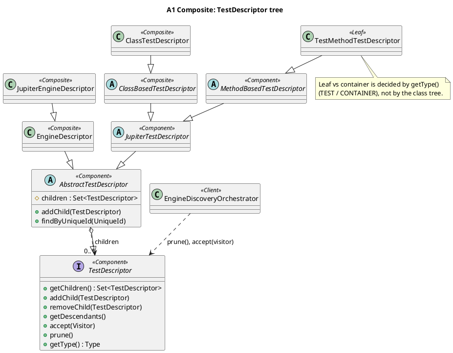

### A2 Composite: CompositeFilter

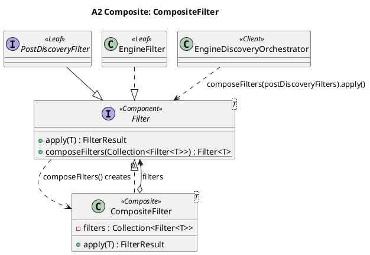

### A3 Strategy: Filter / PostDiscoveryFilter in discovery

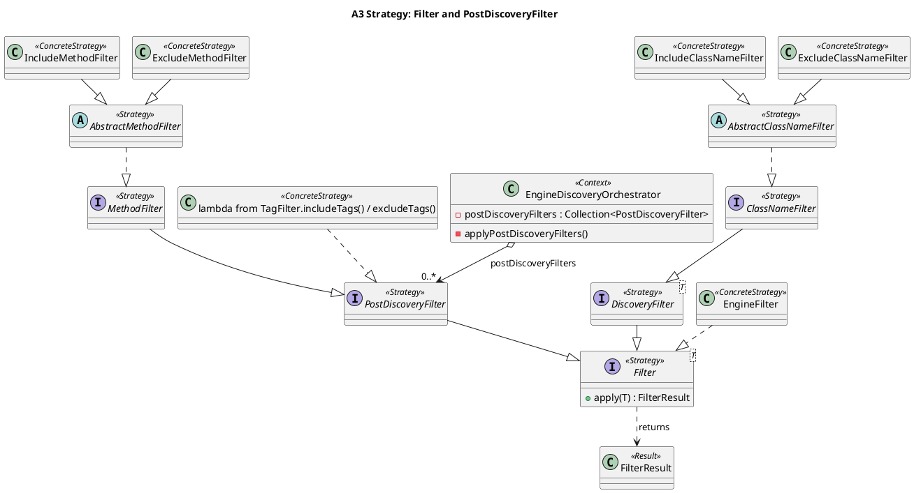

### A4 Template Method: JupiterTestDescriptor

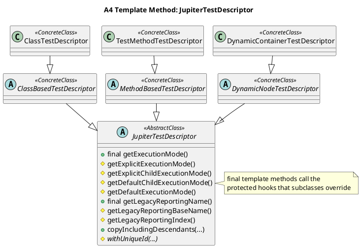

### A5 Template Method: AbstractOrderingVisitor

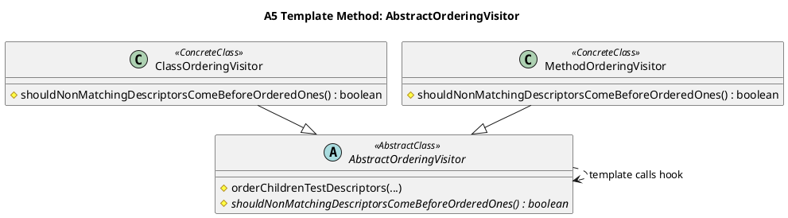

### A6 Observer: LauncherDiscoveryListener

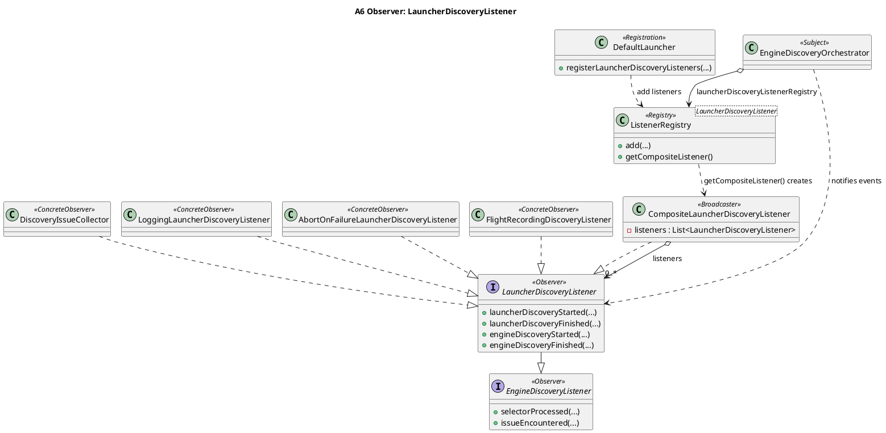

### A7 Adapter: DefaultClassDescriptor / DefaultMethodDescriptor

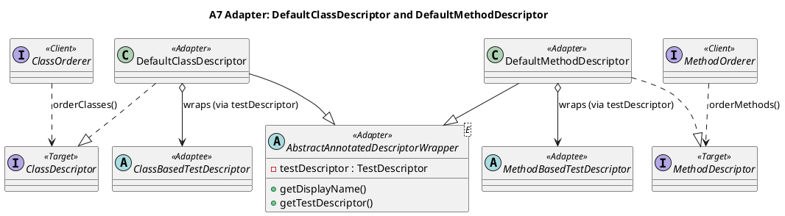

---

## Area B: engines and the execution lifecycle

### B1 Template Method: HierarchicalTestEngine.execute()

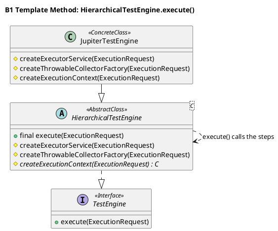

### B2 Factory Method: HierarchicalTestEngine.create…()

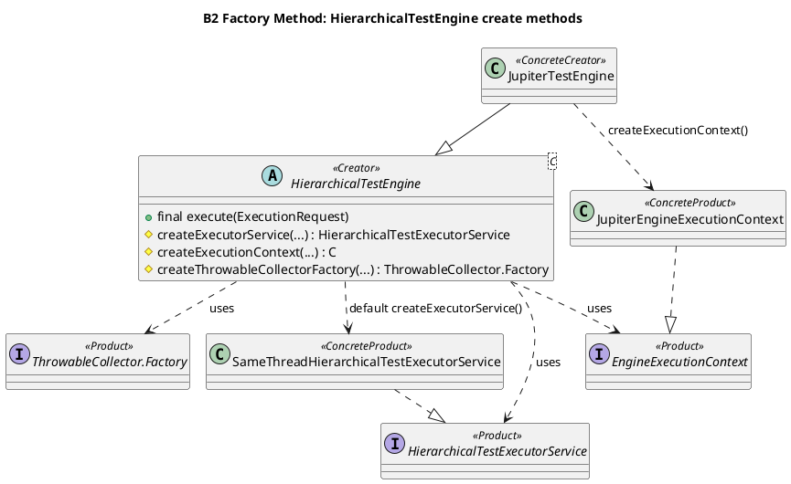

### B3 Strategy: HierarchicalTestExecutorService

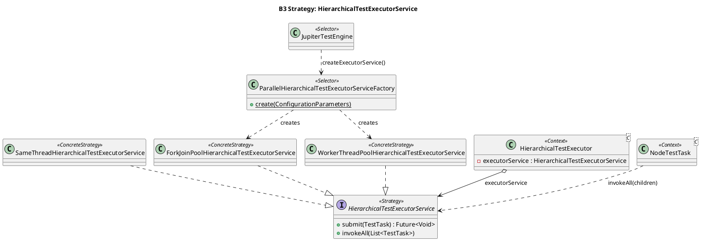

### B4 Strategy: ParallelExecutionConfigurationStrategy

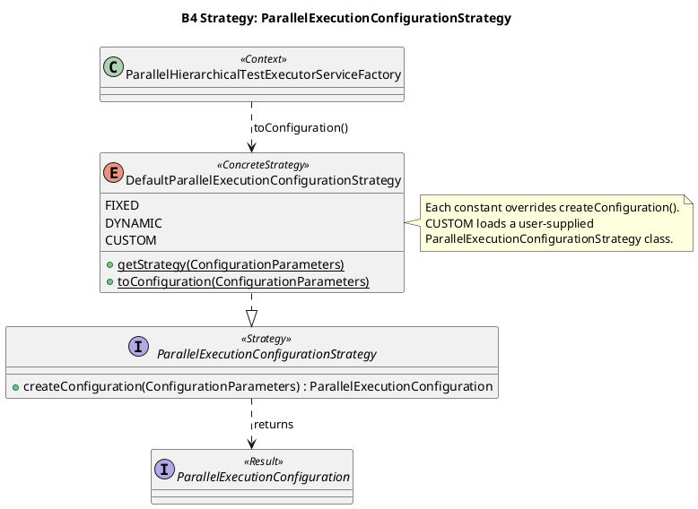

### B5 Decorator: DelegatingLauncher / InterceptingLauncher

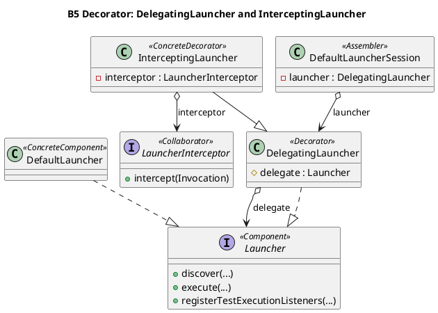

### B6 Decorator: engine-listener wrappers

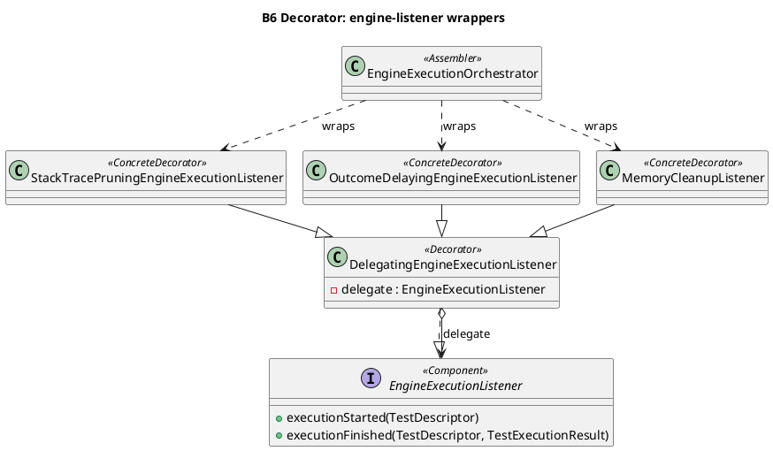

### B7 Adapter: ExecutionListenerAdapter

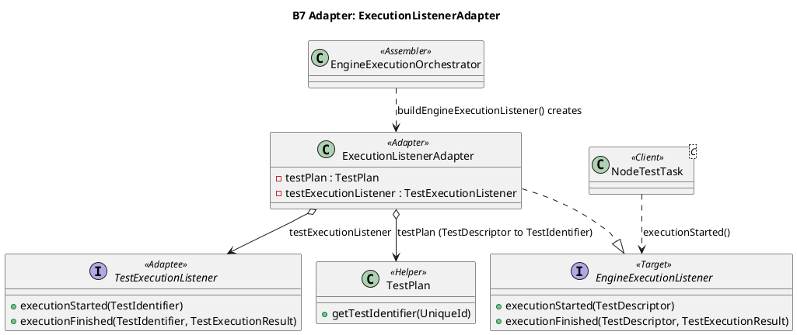

### B8 Observer: NodeTestTask → EngineExecutionListener

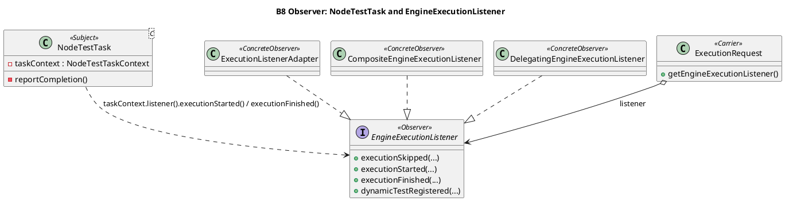

### B9 Composite (reused): NodeTestTask tree

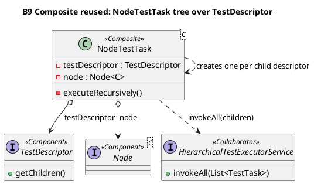

### B10 Command: NodeTestTask as TestTask

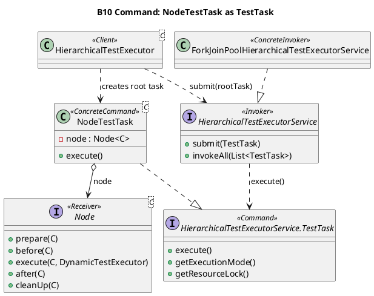

### B11 Null Object: NodeUtils.noOpNode

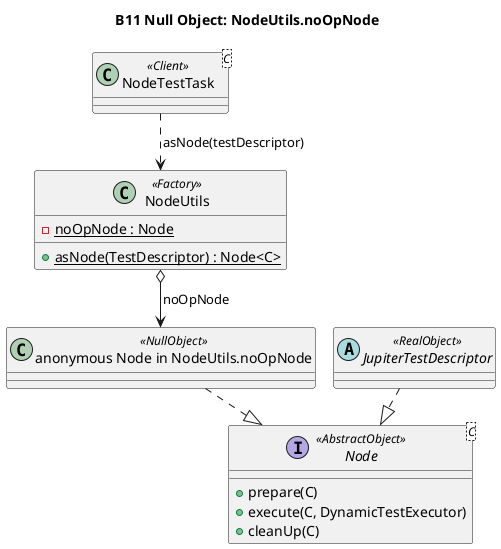

---

## Area C: execution listeners and result reporting

### C1 Observer: TestExecutionListener

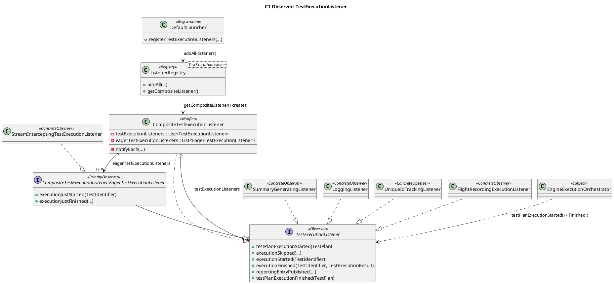

### C2 Observer: LauncherSessionListener

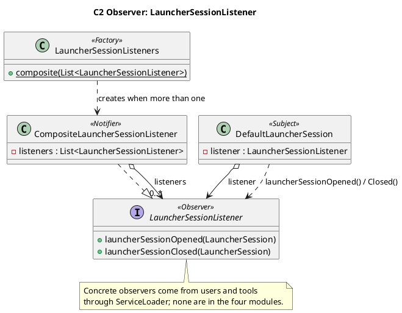

### C3 Strategy: IterationOrder

```plantuml
@startuml C3
!pragma layout smetana
title C3 Strategy: IterationOrder

enum IterationOrder <<Strategy>> {
  ORIGINAL
  REVERSED
  {abstract} forEach(List<T>, Consumer<T>)
}
class CompositeTestExecutionListener <<Context>> {
  -notifyEach(List, IterationOrder, Consumer, Supplier)
}
class CompositeEngineExecutionListener <<Context>> {
  -notifyEach(List, IterationOrder, Consumer, Supplier)
}

CompositeTestExecutionListener ..> IterationOrder : notifyEach(..., REVERSED)
CompositeEngineExecutionListener ..> IterationOrder : notifyEach(..., ORIGINAL)

note right of IterationOrder
  ConcreteStrategies: the constants
  ORIGINAL and REVERSED, each
  overriding forEach()
end note
@enduml
```

### C4 Strategy: LoggingListener log sink

```plantuml
@startuml C4
!pragma layout smetana
title C4 Strategy: LoggingListener log sink

class LoggingListener <<Context>> {
  -logger : BiConsumer<Throwable, Supplier<String>>
  {static} +forJavaUtilLogging(Level) : LoggingListener
  {static} +forBiConsumer(BiConsumer) : LoggingListener
}
interface "BiConsumer<Throwable, Supplier<String>>" as BiConsumer <<Strategy>> {
  +accept(Throwable, Supplier<String>)
}
class "lambda in forJavaUtilLogging(Level)" as JulLambda <<ConcreteStrategy>>
class "caller's lambda passed to forBiConsumer()" as UserLambda <<ConcreteStrategy>>

JulLambda ..|> BiConsumer
UserLambda ..|> BiConsumer
LoggingListener o--> BiConsumer : logger
@enduml
```

### C5 Strategy: ListenerRegistry composite factory

```plantuml
@startuml C5
!pragma layout smetana
title C5 Strategy: ListenerRegistry composite factory

class "ListenerRegistry<T>" as ListenerRegistry <<Context>> {
  -compositeListenerFactory : Function<List<T>, T>
  -listeners : ArrayList<T>
  +getCompositeListener() : T
}
interface "Function<List<T>, T>" as Fn <<Strategy>> {
  +apply(List<T>) : T
}
class "CompositeTestExecutionListener::new" as F1 <<ConcreteStrategy>>
class "CompositeEngineExecutionListener::new" as F2 <<ConcreteStrategy>>
class "LauncherSessionListeners::composite" as F3 <<ConcreteStrategy>>
class "LauncherDiscoveryListeners::composite" as F4 <<ConcreteStrategy>>

F1 ..|> Fn
F2 ..|> Fn
F3 ..|> Fn
F4 ..|> Fn
ListenerRegistry o--> Fn : compositeListenerFactory
@enduml
```

### C6 Adapter: DefaultTestReporter

```plantuml
@startuml C6
!pragma layout smetana
title C6 Adapter: DefaultTestReporter

interface TestReporter <<Target>> {
  +publishEntry(Map<String, String>)
  +publishEntry(String, String)
}
class DefaultTestReporter <<Adapter>> {
  -extensionContext : ExtensionContext
  +publishEntry(Map<String, String>)
}
interface ExtensionContext <<Adaptee>> {
  +publishReportEntry(Map<String, String>)
}
class TestReporterParameterResolver <<Creator>>

DefaultTestReporter ..|> TestReporter
DefaultTestReporter o--> ExtensionContext : extensionContext
DefaultTestReporter ..> ExtensionContext : publishReportEntry(map)
TestReporterParameterResolver ..> DefaultTestReporter : creates for test parameter
@enduml
```

### C7 Decorator: StreamInterceptor

```plantuml
@startuml C7
!pragma layout smetana
title C7 Decorator: StreamInterceptor

class "java.io.PrintStream" as PrintStream <<Component>> {
  +write(int)
  +write(byte[], int, int)
}
class StreamInterceptor <<Decorator>> {
  -originalStream : PrintStream
  {static} ~registerStdout(int)
  ~capture()
  ~consume() : String
  +write(int)
  +write(byte[], int, int)
}
class StreamInterceptingTestExecutionListener <<Installer>> {
  -stdoutInterceptor : Optional<StreamInterceptor>
  -stderrInterceptor : Optional<StreamInterceptor>
}

StreamInterceptor --|> PrintStream
StreamInterceptor o--> PrintStream : originalStream (System.out / System.err)
StreamInterceptingTestExecutionListener o--> StreamInterceptor : stdout / stderr

note right of StreamInterceptor
  write() copies bytes into a per-thread
  buffer, then calls super.write()
end note
@enduml
```

### C8 Null Object: EngineExecutionListener.NOOP / LauncherSessionListener.NOOP

```plantuml
@startuml C8
!pragma layout smetana
title C8 Null Object: EngineExecutionListener.NOOP and LauncherSessionListener.NOOP

interface EngineExecutionListener <<AbstractObject>>
interface LauncherSessionListener <<AbstractObject>>
class "EngineExecutionListener.NOOP (anonymous)" as EelNoop <<NullObject>>
class "LauncherSessionListener.NOOP (anonymous)" as LslNoop <<NullObject>>
class EngineExecutionOrchestrator <<Client>>
class LauncherSessionListeners <<Client>> {
  {static} +composite(List) : LauncherSessionListener
}

EelNoop ..|> EngineExecutionListener
LslNoop ..|> LauncherSessionListener
EngineExecutionOrchestrator ..> EelNoop : passes as parent listener
LauncherSessionListeners ..> LslNoop : returns when list is empty
@enduml
```

---

## Area D: Jupiter extensions and resource management

### D1 Strategy: TempDirFactory

```plantuml
@startuml D1
!pragma layout smetana
title D1 Strategy: TempDirFactory

interface TempDirFactory <<Strategy>> {
  +createTempDirectory(AnnotatedElementContext, ExtensionContext) : Path
  +close()
}
class "TempDirFactory.Standard" as Standard <<ConcreteStrategy>> {
  {static} +INSTANCE : TempDirFactory
}
class TempDirectory <<Context>> {
  -determineTempDirFactory(TempDir) : TempDirFactory
}
class "TempDirectory.CloseablePath" as CloseablePath <<Context>> {
  -factory : TempDirFactory
}

Standard ..|> TempDirFactory
TempDirectory ..> TempDirFactory : picks from @TempDir(factory) or config
TempDirectory ..> CloseablePath : creates
CloseablePath o--> TempDirFactory : factory
@enduml
```

### D2 Strategy: TempDirDeletionStrategy

```plantuml
@startuml D2
!pragma layout smetana
title D2 Strategy: TempDirDeletionStrategy

interface TempDirDeletionStrategy <<Strategy>> {
  +delete(Path, AnnotatedElementContext, ExtensionContext) : DeletionResult
}
class "TempDirDeletionStrategy.Standard" as Standard <<ConcreteStrategy>>
class "TempDirDeletionStrategy.IgnoreFailures" as IgnoreFailures <<ConcreteStrategy>>
class "TempDirectory.Cleanup" as Cleanup <<Context>> {
  deletionStrategy : Supplier<TempDirDeletionStrategy>
  run(Path, ...)
}
class TempDirectory <<Selector>> {
  -determineDeletionStrategy(TempDir)
}

Standard ..|> TempDirDeletionStrategy
IgnoreFailures ..|> TempDirDeletionStrategy
Cleanup o--> TempDirDeletionStrategy : deletionStrategy (Supplier)
TempDirectory ..> Cleanup : creates with chosen strategy
@enduml
```

### D3 Strategy: ParameterResolver

```plantuml
@startuml D3
!pragma layout smetana
title D3 Strategy: ParameterResolver

interface ParameterResolver <<Strategy>> {
  +supportsParameter(ParameterContext, ExtensionContext) : boolean
  +resolveParameter(ParameterContext, ExtensionContext) : Object
}
class TempDirectory <<ConcreteStrategy>>
class TestInfoParameterResolver <<ConcreteStrategy>>
class TestReporterParameterResolver <<ConcreteStrategy>>
class RepetitionExtension <<ConcreteStrategy>>
class ParameterResolutionUtils <<Context>> {
  {static} -resolveParameter(...)
}
interface ExtensionRegistry <<Registry>> {
  +stream(Class) : Stream
}

TempDirectory ..|> ParameterResolver
TestInfoParameterResolver ..|> ParameterResolver
TestReporterParameterResolver ..|> ParameterResolver
RepetitionExtension ..|> ParameterResolver
ParameterResolutionUtils ..> ExtensionRegistry : stream(ParameterResolver.class)
ParameterResolutionUtils ..> ParameterResolver : supportsParameter(), then resolveParameter() on the single match
@enduml
```

### D4 Strategy: ExecutionCondition

```plantuml
@startuml D4
!pragma layout smetana
title D4 Strategy: ExecutionCondition

interface ExecutionCondition <<Strategy>> {
  +evaluateExecutionCondition(ExtensionContext) : ConditionEvaluationResult
}
class DisabledCondition <<ConcreteStrategy>>
abstract class "AbstractOsBasedExecutionCondition<A>" as OsBased <<ConcreteStrategy>>
class EnabledOnOsCondition <<ConcreteStrategy>>
class DisabledOnOsCondition <<ConcreteStrategy>>
class ConditionEvaluator <<Context>> {
  +evaluate(ExtensionRegistry, JupiterConfiguration, ExtensionContext)
}
abstract class JupiterTestDescriptor <<Client>> {
  {static} -conditionEvaluator : ConditionEvaluator
}

DisabledCondition ..|> ExecutionCondition
OsBased ..|> ExecutionCondition
EnabledOnOsCondition --|> OsBased
DisabledOnOsCondition --|> OsBased
ConditionEvaluator ..> ExecutionCondition : first disabled result wins
JupiterTestDescriptor o--> ConditionEvaluator : conditionEvaluator
@enduml
```

### D5 Strategy: NamespacedHierarchicalStore.CloseAction

```plantuml
@startuml D5
!pragma layout smetana
title D5 Strategy: NamespacedHierarchicalStore.CloseAction

class "NamespacedHierarchicalStore<N>" as Store <<Context>> {
  -parentStore : NamespacedHierarchicalStore<N>
  -closeAction : CloseAction<N>
  +close()
}
interface "NamespacedHierarchicalStore.CloseAction<N>" as CloseAction <<Strategy>> {
  +close(N, Object, Object)
  {static} +closeAutoCloseables() : CloseAction<N>
}
class "lambda from AbstractExtensionContext.createCloseAction()" as JupiterClose <<ConcreteStrategy>>
class "lambda from CloseAction.closeAutoCloseables()" as AutoClose <<ConcreteStrategy>>
abstract class "AbstractExtensionContext<T>" as AEC <<Client>> {
  -valuesStore : NamespacedHierarchicalStore
  -createCloseAction()
}

JupiterClose ..|> CloseAction
AutoClose ..|> CloseAction
Store o--> CloseAction : closeAction
AEC ..> Store : new NamespacedHierarchicalStore(parent, createCloseAction())
@enduml
```

### D6 Adapter: NamespaceAwareStore

```plantuml
@startuml D6
!pragma layout smetana
title D6 Adapter: NamespaceAwareStore

interface "ExtensionContext.Store" as JStore <<Target>> {
  +get(Object)
  +put(Object, Object)
  +computeIfAbsent(...)
}
class NamespaceAwareStore <<Adapter>> {
  -valuesStore : NamespacedHierarchicalStore<Namespace>
  -namespace : Namespace
  -accessStore(Supplier)
}
class "NamespacedHierarchicalStore<N>" as PStore <<Adaptee>> {
  +get(N, Object)
  +put(N, Object, Object)
  +computeIfAbsent(N, ...)
}
class LauncherStoreFacade <<AdapterFactory>> {
  +getStoreAdapter(NamespacedHierarchicalStore, ExtensionContext.Namespace)
}
abstract class "AbstractExtensionContext<T>" as AEC <<Client>> {
  +getStore(Namespace) : Store
}

NamespaceAwareStore ..|> JStore
NamespaceAwareStore o--> PStore : valuesStore
LauncherStoreFacade ..> NamespaceAwareStore : creates (converts Namespace)
AEC ..> LauncherStoreFacade : getStoreAdapter(valuesStore, namespace)
@enduml
```

### D7 Adapter: BeforeEachMethodAdapter / AfterEachMethodAdapter

```plantuml
@startuml D7
!pragma layout smetana
title D7 Adapter: BeforeEachMethodAdapter and AfterEachMethodAdapter

interface Extension <<Interface>>
interface BeforeEachMethodAdapter <<Target>> {
  +invokeBeforeEachMethod(ExtensionContext, ExtensionRegistry)
}
interface AfterEachMethodAdapter <<Target>> {
  +invokeAfterEachMethod(ExtensionContext, ExtensionRegistry)
}
class "java.lang.reflect.Method (@BeforeEach / @AfterEach)" as Method <<Adaptee>>
class "lambda from synthesizeBeforeEachMethodAdapter(Method)" as BeforeLambda <<Adapter>>
class "lambda from synthesizeAfterEachMethodAdapter(Method)" as AfterLambda <<Adapter>>
abstract class ClassBasedTestDescriptor <<Creator>> {
  -registerBeforeEachMethodAdapters(...)
  -registerAfterEachMethodAdapters(...)
}
class TestMethodTestDescriptor <<Client>> {
  -invokeBeforeEachMethods(...)
  -invokeAfterEachMethods(...)
}

BeforeEachMethodAdapter --|> Extension
AfterEachMethodAdapter --|> Extension
BeforeLambda ..|> BeforeEachMethodAdapter
AfterLambda ..|> AfterEachMethodAdapter
BeforeLambda o--> Method : captures
AfterLambda o--> Method : captures
ClassBasedTestDescriptor ..> BeforeLambda : registerSyntheticExtension()
ClassBasedTestDescriptor ..> AfterLambda : registerSyntheticExtension()
TestMethodTestDescriptor ..> BeforeEachMethodAdapter : invokeBeforeEachMethod()
TestMethodTestDescriptor ..> AfterEachMethodAdapter : invokeAfterEachMethod()
@enduml
```

### D8 Observer: TestWatcher

```plantuml
@startuml D8
!pragma layout smetana
title D8 Observer: TestWatcher

interface TestWatcher <<Observer>> {
  +testDisabled(ExtensionContext, Optional<String>)
  +testSuccessful(ExtensionContext)
  +testAborted(ExtensionContext, Throwable)
  +testFailed(ExtensionContext, Throwable)
}
class RepetitionExtension <<ConcreteObserver>>
abstract class MethodBasedTestDescriptor <<Subject>> {
  #invokeTestWatchers(context, reverseOrder, callback)
  +nodeSkipped(...)
}
class TestMethodTestDescriptor <<ConcreteSubject>> {
  +nodeFinished(...)
}
class MutableExtensionRegistry <<Registry>> {
  +getExtensions(Class)
}

RepetitionExtension ..|> TestWatcher
TestMethodTestDescriptor --|> MethodBasedTestDescriptor
MethodBasedTestDescriptor ..> MutableExtensionRegistry : getExtensions(TestWatcher.class)
MethodBasedTestDescriptor ..> TestWatcher : notifies (errors only logged)
@enduml
```

### D9 Chain of Responsibility: InvocationInterceptorChain

```plantuml
@startuml D9
!pragma layout smetana
title D9 Chain of Responsibility: InvocationInterceptorChain

interface InvocationInterceptor <<Handler>> {
  +interceptTestMethod(Invocation, ...)
  +interceptBeforeEachMethod(Invocation, ...)
  +interceptAfterEachMethod(Invocation, ...)
}
class TimeoutExtension <<ConcreteHandler>>
interface "InvocationInterceptor.Invocation<T>" as Invocation <<Request>> {
  +proceed() : T
  +skip()
}
class "InvocationInterceptorChain.InterceptedInvocation<T>" as Link <<Successor link>> {
  invocation : Invocation<T>
  call : InterceptorCall<T>
  interceptor : InvocationInterceptor
  +proceed() : T
}
class InvocationInterceptorChain <<ChainBuilder>> {
  +invoke(Invocation, ExtensionRegistry, InterceptorCall)
  -chainInterceptors(...)
}
class InterceptingExecutableInvoker <<Client>> {
  {static} -interceptorChain : InvocationInterceptorChain
}

TimeoutExtension ..|> InvocationInterceptor
Link ..|> Invocation
Link o--> Invocation : invocation (next in chain)
Link o--> InvocationInterceptor : interceptor
InvocationInterceptorChain ..> Link : builds back to front
InterceptingExecutableInvoker o--> InvocationInterceptorChain : interceptorChain
InvocationInterceptor ..> Invocation : proceed() or skip()
@enduml
```

### D10 Decorator: timeout invocations

```plantuml
@startuml D10
!pragma layout smetana
title D10 Decorator: timeout invocations

interface "InvocationInterceptor.Invocation<T>" as Invocation <<Component>> {
  +proceed() : T
  +skip()
}
class "MethodInvocation<T>" as MethodInvocation <<ConcreteComponent>>
class "ConstructorInvocation<T>" as ConstructorInvocation <<ConcreteComponent>>
class "SameThreadTimeoutInvocation<T>" as SameThread <<ConcreteDecorator>> {
  -delegate : Invocation<T>
  -timeout : TimeoutDuration
  +proceed() : T
}
class "SeparateThreadTimeoutInvocation<T>" as SeparateThread <<ConcreteDecorator>> {
  -delegate : Invocation<T>
  -timeout : TimeoutDuration
  +proceed() : T
}
class "InvocationInterceptorChain.ValidatingInvocation<T>" as Validating <<ConcreteDecorator>> {
  -delegate : Invocation<T>
  +proceed() : T
}
class TimeoutInvocationFactory <<Creator>> {
  +create(ThreadMode, TimeoutInvocationParameters) : Invocation<T>
}
class TimeoutExtension <<Client>> {
  -decorate(Invocation, ...) : Invocation<T>
}

MethodInvocation ..|> Invocation
ConstructorInvocation ..|> Invocation
SameThread ..|> Invocation
SeparateThread ..|> Invocation
Validating ..|> Invocation
SameThread o--> Invocation : delegate
SeparateThread o--> Invocation : delegate
Validating o--> Invocation : delegate
TimeoutInvocationFactory ..> SameThread : creates
TimeoutInvocationFactory ..> SeparateThread : creates
TimeoutExtension ..> TimeoutInvocationFactory : decorate()

note bottom of Validating
  No shared abstract decorator class:
  each decorator holds its own delegate.
end note
@enduml
```

### D11 Command: MethodInvocation / ConstructorInvocation

```plantuml
@startuml D11
!pragma layout smetana
title D11 Command: MethodInvocation and ConstructorInvocation

interface "InvocationInterceptor.Invocation<T>" as Invocation <<Command>> {
  +proceed() : T
  +skip()
}
class "MethodInvocation<T>" as MethodInvocation <<ConcreteCommand>> {
  -method : Method
  -target : Optional<Object>
  -arguments : Object[]
  +proceed() : T
}
class "ConstructorInvocation<T>" as ConstructorInvocation <<ConcreteCommand>> {
  +proceed() : T
}
class "java.lang.reflect.Method / Constructor" as Reflective <<Receiver>>
class InterceptingExecutableInvoker <<Client>> {
  +invoke(Method, Object, ...)
  +invoke(Constructor, Optional, ...)
}
class InvocationInterceptorChain <<Invoker>> {
  +invoke(Invocation, ExtensionRegistry, InterceptorCall)
}

MethodInvocation ..|> Invocation
ConstructorInvocation ..|> Invocation
MethodInvocation o--> Reflective : method
ConstructorInvocation o--> Reflective : constructor
InterceptingExecutableInvoker ..> MethodInvocation : creates with resolved arguments
InterceptingExecutableInvoker ..> ConstructorInvocation : creates with resolved arguments
InterceptingExecutableInvoker ..> InvocationInterceptorChain : invoke(invocation, ...)
InvocationInterceptorChain ..> Invocation : proceed()
@enduml
```
