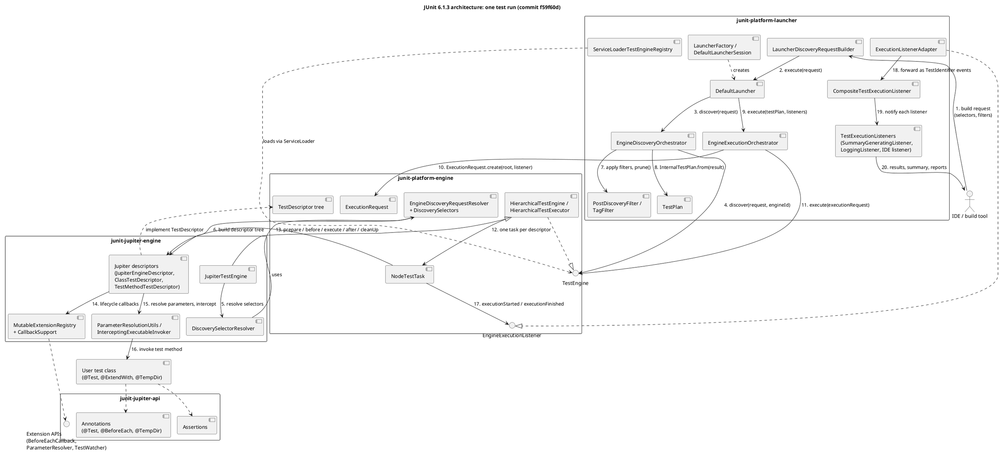

<!-- Raw output of Part 1, prompt 11 (Part1/llm/prompt_11_architecture.txt), same Claude chat. Copied verbatim: chat reply + attached .puml (also saved as Part1/architecture/architecture_llm_original.puml). The rendered PNG the model attached was saved by me from ~/Downloads/architecture-component-diagram.png. -->

# 1. Chat reply

Got it: one component diagram covering the four modules, with numbered arrows for a single test run. I'll check the class names in the source first.

The component diagram is ready in [architecture-component-diagram.puml](/mnt/project-files/junit-case-study/architecture-component-diagram.puml). I also attached a rendered PNG so you can see it before pasting. It uses `!pragma layout smetana`, and it renders in PlantUML 1.2024.7 without errors.

- **The four modules** are drawn as boxes, each holding its main components with their real class names. Two outside parts sit next to them: the IDE or build tool, and the user's test class.
- **The test run has 20 numbered arrows:**
  - Request (1–2): the client builds a request and calls `DefaultLauncher.execute`.
  - Discovery (3–6): `EngineDiscoveryOrchestrator` asks each `TestEngine`, and `JupiterTestEngine` builds the descriptor tree.
  - Filter (7–8): post-discovery filters and pruning, then the `TestPlan`.
  - Execution (9–16): `EngineExecutionOrchestrator` passes an `ExecutionRequest` to the engine. A `NodeTestTask` drives each descriptor through its lifecycle, running extension callbacks and parameter resolution, and finally calls the test method.
  - Events and listeners (17–20): `EngineExecutionListener`, then `ExecutionListenerAdapter`, then `CompositeTestExecutionListener`, then the listeners, and back to the client.
- **Static links** (implements, loads, uses) are dashed and unnumbered, so the numbered path stays easy to follow.

To keep the diagram readable I left out the listener wrappers from area B, the ones between steps 17 and 18 (stack-trace pruning, outcome delaying, memory cleanup). I can add them as one more box if your report needs them.

# 2. Attached file: architecture-component-diagram.puml

